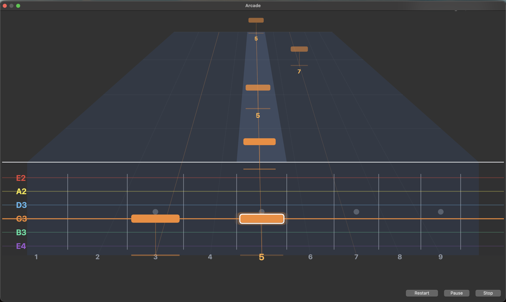
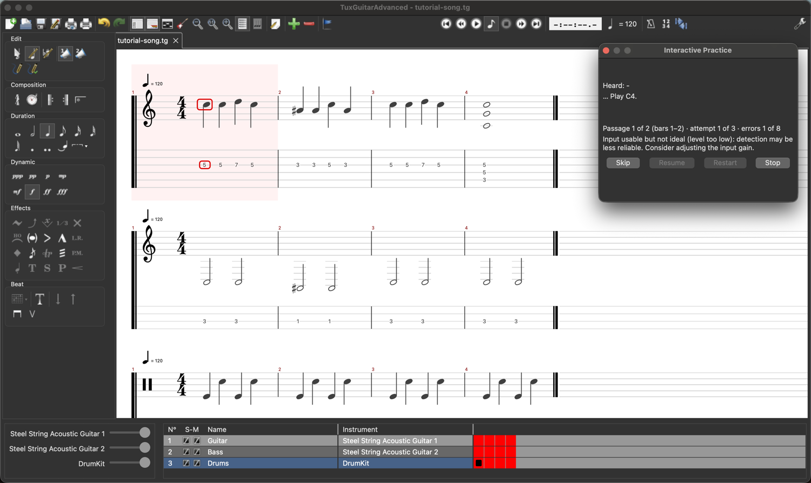
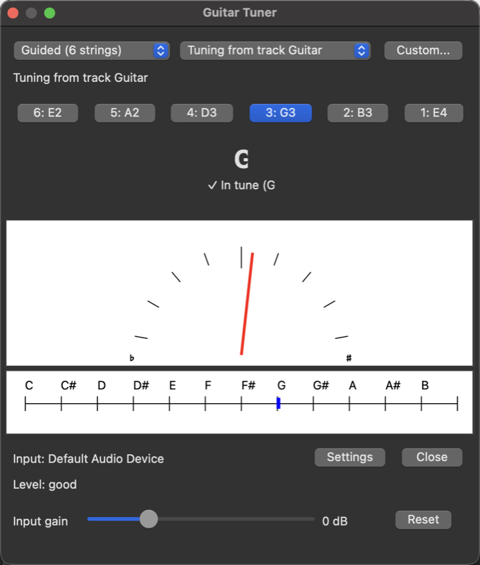

# TuxGuitarAdvanced

*English · [Français](docs/README-FR.md) · [Español](docs/README-ES.md)*

### 🎸 Your guitar is the controller. Your score is the game.

**Press play on a tab. Play the notes as they fly towards your fretboard. Get judged on pitch *and* timing, in real time, with your own guitar.**

TuxGuitarAdvanced is a free, open source tablature editor that **listens to your guitar** (a microphone or an audio interface is all you need). Open any score (Guitar Pro, MIDI, TuxGuitar...), pick a track, and play along with the rest of the band. No subscription, no catalogue, no account: **your songs, your guitar, your machine**.

> 🙏 **Built on TuxGuitar, which is already excellent.** TuxGuitarAdvanced is a **fork of [TuxGuitar](https://www.tuxguitar.app/)**, the great free multitrack tablature editor and player. Everything TuxGuitar does is still here, untouched: editing, playback, Guitar Pro / MIDI / MusicXML / PDF import and export, many languages. **We only add new things on top**: the practice modes (Wait, Follow the tempo, Arcade) and a steadier tuner. All the credit for the editor goes to TuxGuitar's authors and contributors ([helge17](https://github.com/helge17/tuxguitar) and many others); if you only want a superb editor, [go and use TuxGuitar](https://www.tuxguitar.app/) too, it deserves it.

> ⚠️ **Alpha.** It works, we play it, and it is honestly rough in places. That is exactly why we need players like you. [See what is not done yet](#where-it-stands-today) and [how to help](#join-the-band-help-us-level-it-up).

## Choose your game mode

| | Mode | The idea |
|---|---|---|
| 🎯 | **Wait for the right note** | The score **waits for you**. The next note is framed on the tab; play it and a green tick lights up. No pressure, perfect for learning a new piece. |
| 🥁 | **Follow the tempo** | The band starts (count-in, bass, drums, everything but your track) and you play **in time**. Every note is *on time, early, late, wrong or missed*. Raise the tempo step by step from 20 % to 150 %. |
| 🕹️ | **Arcade** (alpha) | Same band, but as a **game**: rounded rectangles come from the horizon in one straight line, a measure ahead, to their fret on the neck, coloured like their string; chords arrive as a panel and everything lands at the foot of the neck at the same instant, after a count-in during which the notes come from the far end. One click on the coloured button of the transport bar starts it at once; the result window also shows when you stop early. Chase streaks, read the verdict badges, beat your score. |

*Chords come as a bar with the diagram and the name of the next chord, so you can get your hand ready. (This screenshot is in French: the interface is available in English, French and Spanish, and more languages can be added.)*

### What you get when the song ends

 &nbsp; 

A score, your share of the maximum, your **best streak** and the count of every verdict, then **play again** from the start or from the measure that beat you.

## It is also a real editor (and a real tuner)

Under the game there is the full **TuxGuitar** editor: write guitar, bass and drums tracks, tabs and staff, chords and effects, play it back, import and export Guitar Pro, MIDI, MusicXML, PDF... You can build your own practice song in ten minutes: the **[worked example](docs/MANUAL.md#part-c-a-complete-example-step-by-step)** takes you from an empty page to a three-track song (guitar, bass, drums) and then plays all three modes.

And before you play, a **steady tuner** (the needle stays still when you are in tune):

## Get started in two minutes

1. **Download** the latest build from [Releases](https://github.com/krl91/tuxguitaradvanced/releases) (macOS Apple Silicon today; see below).
2. Open a score, then **Tools > Interactive Practice** (or the ♪ button next to Play).
3. Pick your track, your input (check the level by plucking a string) and a mode. **Start.** That is it.

Never written a tab? The **[user manual](docs/MANUAL.md)** ([français](docs/MANUAL-FR.md)) has everything, with screenshots, including the step-by-step example.

## Join the band: help us level it up

This is a young project and every kind of help changes it. You do **not** need to be a programmer:

* 🎸 **Play it and tell us.** Your guitar, your microphone, your interface, your machine: the recognition was tuned on 1,200+ real recordings, but **more guitars is the best test there is**. Open an [issue](https://github.com/krl91/tuxguitaradvanced/issues) with what happened (the practice can write a numbers-only trace, no audio, to help us understand).
* 🎚️ **Beat the bosses.** Open problems we would love help with: more reliable timing under load, bass notes below G1, validating hammer-on / slide / vibrato detection on real playing, a Linux and a Windows build we can test.
* 🌍 **Translate it.** The interface is in English, French and Spanish; more languages are one text file away ([how](docs/CONTRIBUTING.md#translate-app-content)).
* 🎨 **Make it prettier.** Arcade is drawn with simple shapes: colours, themes, effects and sounds are wide open.
* 🧪 **Write a test or fix a bug.** The code is Java, built with Maven, with 700+ automatic tests ([INSTALL.md](INSTALL.md)); the architecture is documented in [docs/architecture](docs/architecture/README.md). Every bug gets a reproducing test first.
* 📣 **Share it.** Know a guitarist who would like to play their tabs like a game? Send them here.

### Where it stands today

Available now (version 0.5.0-alpha.5): practice note by note and chord by chord with your real guitar (the pitch is checked), bends, releases and pre-bends followed along their written path, hammer-on, pull-off and slide destinations accepted without a new pick, a steady tuner, input gain and noise reduction. **New, in alpha:** the **tempo-following mode** (the score plays at its tempo with the other tracks as a backing, and each note is judged on time: early, late, missed) and **Arcade**, the same run as a game where the notes come towards you on a neck, a measure ahead. **Not available yet:** a verdict *heard / not heard* for each technique (the detectors are not yet validated on enough real recordings, so the technique line still says "cannot be checked yet"). The user guide lists what is measured and what is not: [English](docs/PRACTICE.md) · [Français](docs/PRACTICE-FR.md) · [Español](docs/PRACTICE-ES.md).

**User manual** (editing and creating a score, and the whole Practice, with screenshots): [English](docs/MANUAL.md) · [Français](docs/MANUAL-FR.md).

**TuxGuitarAdvanced** is an advanced version of [TuxGuitar](https://www.tuxguitar.app/), the open source multitrack tablature editor and player written in Java. It keeps everything TuxGuitar does (editing, playback, Guitar Pro / MIDI / MusicXML import and export...) and adds a **practice mode that listens to your guitar**, a **steadier tuner**, and tools to check your scores.

> Practise any track of any score with your real guitar: TuxGuitarAdvanced listens through your microphone or audio interface, tells you note by note and chord by chord whether you played what is written, and waits for you.

## What is new

| | Feature | In short |
|---|---|---|
|  | **Interactive Practice** | One click on the Practice button next to Play: the track under the score cursor is practised, note by note and chord by chord, with immediate feedback. [User guide](docs/PRACTICE.md) |
| | **Follow the tempo and Arcade (alpha)** | The score plays at its tempo, the other tracks as a backing; each note is judged on time. Arcade shows the run as a game: rectangles come from the horizon towards the neck in a straight line, a measure ahead; a coloured button of the transport bar starts it at once. [Guide](docs/PRACTICE.md#practising-with-the-band-follow-the-tempo-and-arcade-alpha) |
| | **Polyphonic recognition** | Notes and chords are recognised from what each attack adds to the sound, so a note is found even over a string that still rings (fingerstyle, arpeggios, bass under a melody). |
| | **Steady tuner** | The needle shows the median of the confident readings of the last quarter second: no shaking, no freezing on a fading string. |
| | **Input gain and noise reduction** | A gain slider (-6 to +18 dB) in the practice window and in the tuner, an optional noise gate / background-noise subtraction and a suggested gain. |
|  | **Score analysis** | A score that opens is no longer interrupted by a dialog. *Edit > Display invalid measures* (or the toolbar icon) lists every problem of the song, with a one-click fix. |
| | **Diagnostic trace** | An optional text trace (numbers only, no audio) to understand why a note was or was not recognised. |

## Interactive Practice in 30 seconds

1. Open a score and put the cursor on the measure where you want to start.
2. Click the **Practice** button () next to the Play button, or choose it in the *Tools* menu.
3. The first time, choose your audio input and play a string: the level meter tells you if the signal is good. Adjust the **Input gain** slider if needed.
4. Play what is shown. The next note or chord is framed on the score; a green tick means it was heard, a red cross means another note was heard, and nothing advances on silence or noise. **Stop** ends the practice at once.

What is verified: **pitch** (and every note of a chord). String and fret are never claimed from audio, and the written techniques (hammer-on, pull-off, slide, bend, vibrato) are shown with what was heard, or "cannot be checked yet" while no detector meets its quality target. Details, settings and limits: [docs/PRACTICE.md](docs/PRACTICE.md) (English), [docs/PRACTICE-FR.md](docs/PRACTICE-FR.md) (français), [docs/PRACTICE-ES.md](docs/PRACTICE-ES.md) (español).

## Tuned and tested on real recordings

The recognition was not tuned on synthetic sounds only. It was measured and adjusted on **more than 1,200 annotated recordings of real guitars** (single notes, intervals and chords, clean and with 11 audio effects such as distortion, overdrive, chorus, flanger, phaser, delay, reverb), plus recordings of an acoustic guitar played fingerstyle on a real score.

On that benchmark (6,178 automatic tests):

* single notes: **99.8 %** recognised, and **no wrong note** (a semitone or a tone away) accepted in more than 2,300 tests;
* intervals and triads with effects: 87 % recognised, chords of clean guitars: 95 %;
* chords with a note missing refused 96 to 98 % of the time.

Known limits are documented and measured, not hidden: chords whose bass note is G2 can be confused with the chord a whole tone higher, four-note seventh chords are recognised less often, and notes less than 0.15 s apart cannot be told apart. See [docs/PRACTICE.md](docs/PRACTICE.md#measured-quality-and-limits).

The default build runs **479 automatic tests**; the benchmark on recordings is an extra test you can run yourself (see the user guide). No audio of the benchmark is stored in this repository.

## Download and installation

Packages are published in [Releases](https://github.com/krl91/tuxguitaradvanced/releases). **Today the alphas ship a macOS (Apple Silicon) package only**; Linux and Windows packages are built by the release workflow when GitHub Actions is available, and can always be built from source. The macOS package is signed with a self-made certificate and not notarised: the first launch needs *Open Anyway* in *System Settings > Privacy & Security*. The Windows package needs Java 17 or later; the three packages include the Interactive Practice modules.

To build from source, refer to [INSTALL.md](INSTALL.md). The practice modules need a few more things:

* JDK 17 or later (Temurin 21 is the version the project is built and tested with) and Maven; SWT installed into the local Maven repository as described in [INSTALL.md](INSTALL.md);
* the build is run from the folder of your platform: `cd desktop/build-scripts/tuxguitar-macosx-swt-cocoa` (or `tuxguitar-linux-swt`, `tuxguitar-windows-swt-x86_64`), then `mvn -e clean verify -P native-modules` (add `-DskipTests` to skip the tests);
* the audio engine uses TarsosDSP, which is fetched from `https://mvn.0110.be/releases` (it is not on Maven Central), so the first build needs network access;
* on macOS, the launcher is compiled and signed with `clang` and `codesign`: install the Xcode Command Line Tools (`xcode-select --install`). The build does not embed a Java runtime in the `.app`: link or copy one into `Contents/MacOS/jre` to run it from the build folder.

## Documentation

* [Interactive Practice, user guide](docs/PRACTICE.md) - [Guide en français](docs/PRACTICE-FR.md) - [Guía en español](docs/PRACTICE-ES.md)
* [Architecture: CESAM views and sequence diagrams](docs/architecture/README.md)
* [INSTALL.md](INSTALL.md), [docs/CONTRIBUTING.md](docs/CONTRIBUTING.md)

## Credits and license

TuxGuitarAdvanced is a fork of TuxGuitar and is released under the GNU Lesser General Public License, like TuxGuitar.

Copyright (C) 2005-2022 Julián Casadesús, 2023-2025 guiv42, helge17 (TuxGuitar). The additions of this fork are by the TuxGuitarAdvanced contributors.

## Third party products

TuxGuitar includes the following third party products:

* SWT version: SWT (Standard Widget Toolkit): https://www.eclipse.org/swt/
* JFX version: JavaFX (Java client application platform): https://openjfx.io/
* Gervill (Java Software Synthesizer)
* iText (Free Java-PDF library): https://itextpdf.com/
* Magic Sound Font v2.0 - Contributed by Dennis Deutschmann
* TarsosDSP (pitch detection, GPL-3.0), used inside the audio engine of the practice mode
