# Manuel d'utilisation de TuxGuitarAdvanced

*English: [MANUAL.md](MANUAL.md).*

TuxGuitarAdvanced est une version avancée de [TuxGuitar](https://www.tuxguitar.app/), l'éditeur et lecteur de tablatures multipistes. Il garde tout ce que fait TuxGuitar (**édition et création** de partitions, lecture, import et export de nombreux formats) et ajoute le **Practice** (la pratique interactive : l'application écoute votre guitare et vérifie ce que vous jouez), l'**accordeur stable** et des outils d'analyse de partition.

Ce manuel a deux parties :

* **[Partie A : édition et création](#partie-a--édition-et-création)** : écrire, modifier, écouter et exporter une partition ;
* **[Partie B : le Practice](#partie-b--le-practice-pratique-interactive)** : travailler une partition avec votre vraie guitare, dans trois modes (Attendre la bonne note, Suivre le tempo, Arcade), plus l'accordeur et les réglages de reconnaissance.

*Les captures d'écran viennent de la version macOS, interface en français, thème sombre. Sous Linux et Windows, les fenêtres sont les mêmes ; les raccourcis qui utilisent ⌘ sous macOS utilisent Ctrl.*

## Sommaire

* [Installation et premier lancement](#installation-et-premier-lancement)
* **Partie A : édition et création**
  * [A1. La fenêtre principale](#a1-la-fenêtre-principale)
  * [A2. Les menus](#a2-les-menus)
  * [A3. Créer un premier morceau](#a3-créer-un-premier-morceau)
  * [A4. Saisir des notes](#a4-saisir-des-notes)
  * [A5. Les effets de jeu](#a5-les-effets-de-jeu)
  * [A6. Les accords](#a6-les-accords)
  * [A7. La structure du morceau](#a7-la-structure-du-morceau)
  * [A8. Les pistes, les instruments et les paroles](#a8-les-pistes-les-instruments-et-les-paroles)
  * [A9. L'affichage](#a9-laffichage)
  * [A10. La lecture](#a10-la-lecture)
  * [A11. Les fichiers : ouvrir, enregistrer, importer, exporter, imprimer](#a11-les-fichiers)
  * [A12. Les outils et la configuration](#a12-les-outils-et-la-configuration)
  * [A13. Raccourcis clavier](#a13-raccourcis-clavier)
* **Partie B : le Practice**
  * [B1. Principe et prérequis](#b1-principe-et-prérequis)
  * [B2. La fenêtre Pratique interactive](#b2-la-fenêtre-pratique-interactive)
  * [B3. Niveau d'entrée, gain et bruit](#b3-niveau-dentrée-gain-et-bruit)
  * [B4. Mode « Attendre la bonne note »](#b4-mode--attendre-la-bonne-note-)
  * [B5. Mode « Suivre le tempo »](#b5-mode--suivre-le-tempo-)
  * [B6. Mode Arcade (alpha)](#b6-mode-arcade-alpha)
  * [B7. Les réglages de reconnaissance audio](#b7-les-réglages-de-reconnaissance-audio)
  * [B8. L'accordeur](#b8-laccordeur)
  * [B9. Analyse de la partition (mesures invalides)](#b9-analyse-de-la-partition-mesures-invalides)
  * [B10. Qualité mesurée, limites et trace de diagnostic](#b10-qualité-mesurée-limites-et-trace-de-diagnostic)
  * [B11. Questions fréquentes et dépannage](#b11-questions-fréquentes-et-dépannage)

---

## Installation et premier lancement

* **Paquets :** macOS (Apple Silicon), Linux et Windows sont publiés dans les [Releases](https://github.com/krl91/tuxguitaradvanced/releases) du projet. Les paquets de chaque version ne sont pas forcément tous présents : la page de la release dit lesquels le sont. Le paquet Windows demande Java 17 ou plus ; les paquets macOS et Linux embarquent leur Java.
* **macOS :** le paquet est signé avec un certificat auto-créé et n'est pas notarisé. Au premier lancement, ouvrez *Réglages Système > Confidentialité et sécurité* et choisissez *Ouvrir quand même*. La première fois que la pratique écoute le micro, macOS demande l'autorisation d'accès au micro : acceptez.
* **Compiler soi-même :** voir [INSTALL.md](INSTALL.md).
* **Fichiers :** le format natif est `.tg`. L'application ouvre aussi les formats Guitar Pro (`.gp3`, `.gp4`, `.gp5`, `.gpx`, `.gp`), Power Tab (`.ptb`), TablEdit (`.tef`), MIDI, et exporte vers de nombreux formats (voir [A11](#a11-les-fichiers)).
* **Aide intégrée :** la touche **F1** ouvre l'aide de TuxGuitar (en anglais, avec des pages sur la reconnaissance audio en français et en espagnol).

---

# Partie A : édition et création

## A1. La fenêtre principale

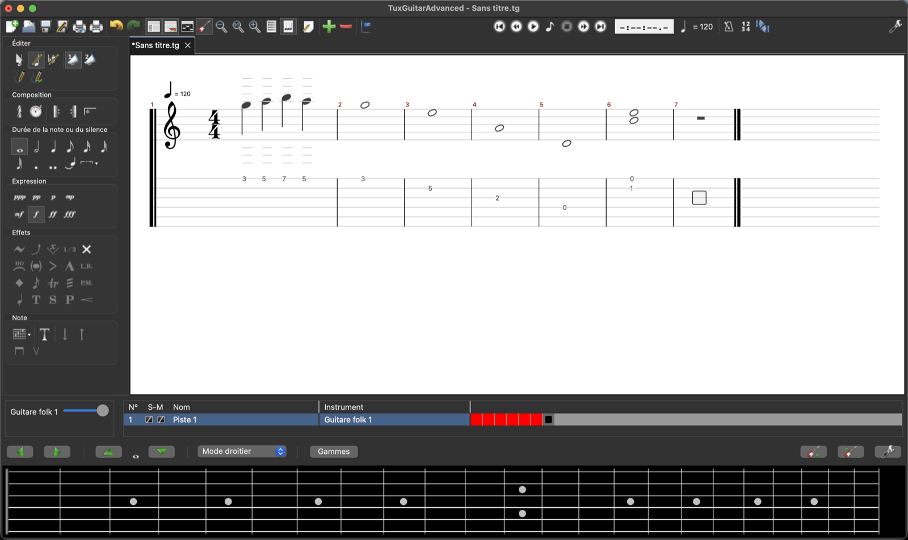

La fenêtre principale se compose, de haut en bas :

1. **La barre de menus** (Fichier, Édition, Affichage, Composition, Piste, Mesure, Note, Marqueur, Lecteur, Outils, Aide).
2. **La barre d'outils principale** : fichiers, annuler/rétablir, affichage, zoom, lecture. Le bouton ♪ à côté de Lecture est le bouton **Practice** (une pression : pratique de la piste sous le curseur, voir [B2](#b2-la-fenêtre-pratique-interactive)).
3. **La barre d'outils latérale** (« Éditer ») : modes d'édition, structure, durées, nuances, effets, notes.
4. **La zone de partition** : la portée (notation) au-dessus et la **tablature** (une ligne par corde) dessous. Le rectangle gris est le **curseur**, c'est à lui que s'appliquent les actions. Les onglets au-dessus de la partition sont les fichiers ouverts.
5. **La liste des pistes**, avec le volume principal, et le « transporteur » (une case par mesure) pour se déplacer dans le morceau.
6. **Les commandes du manche** et le **manche** (la partie noire en bas) : il montre où poser les doigts et permet aussi de saisir en cliquant.

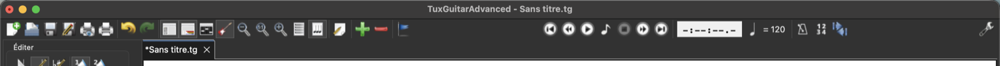

*Barre d'outils principale : nouveau, ouvrir, enregistrer, enregistrer sous, aperçu, imprimer, annuler, rétablir, affichages (barre latérale, liste des pistes, manche, instruments), zoom, mode multipiste, clavier, matrice, ajouter/supprimer une mesure, marqueur ; au centre, les commandes de lecture, le temps, le tempo, le métronome, le décompte et le mode de lecture.*

Les barres d'outils, la liste des pistes et le manche se masquent depuis le menu *Affichage*. Un **clic droit** dans la partition, dans la tablature ou sur une piste de la liste ouvre un **menu contextuel** avec les mêmes actions que les menus.

## A2. Les menus

Toutes les fonctions sont dans les menus. Les raccourcis apparaissent à droite des entrées ; la plupart sont modifiables (voir [A12](#a12-les-outils-et-la-configuration)).

### Fichier

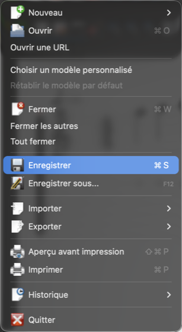

*Nouveau* (morceau vide, ou modèles « Trio blues » et « Duo de guitare classique »), *Ouvrir*, *Ouvrir une URL*, *Choisir un modèle personnalisé* (les nouveaux morceaux partiront de ce fichier) et *Rétablir le modèle par défaut*, *Fermer / Fermer les autres / Tout fermer*, *Enregistrer* (⌘S), *Enregistrer sous…* (F12), *Importer* (MIDI), *Exporter* (sous-menu ci-dessous), *Aperçu avant impression*, *Imprimer*, *Historique* (les 10 derniers fichiers), *Quitter*.

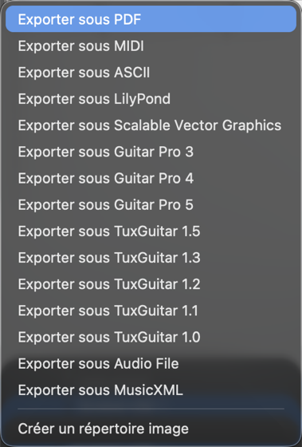

### Édition

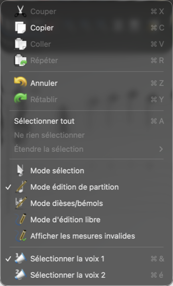

*Couper, Copier, Coller, Répéter* (copie la sélection et la colle juste après), *Annuler / Rétablir*, *Sélectionner tout*, *Ne rien sélectionner*, *Étendre la sélection*, puis les **modes d'édition** (sélection, édition de partition, dièses/bémols, édition libre), *Afficher les mesures invalides*, et le choix de la **voix 1 ou 2**.

### Affichage

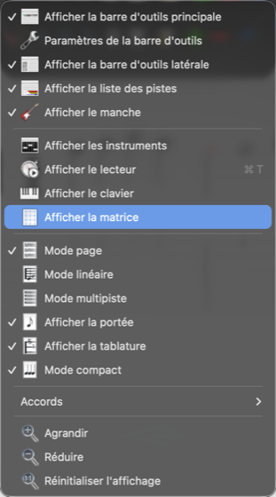

Barres d'outils, liste des pistes, manche ; fenêtres *Instruments*, *Lecteur*, *Clavier*, *Matrice* ; **mode page / linéaire / multipiste** ; afficher la portée et/ou la tablature ; mode compact ; style des accords ; zoom.

### Composition

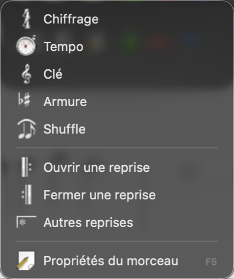

*Chiffrage*, *Tempo*, *Clé*, *Armure*, *Shuffle*, *Ouvrir / Fermer une reprise*, *Autres reprises* (fins alternatives), *Propriétés du morceau* (F5).

### Piste

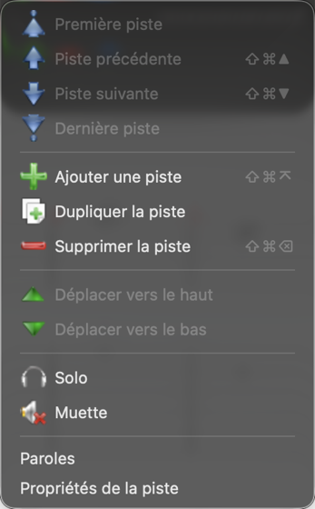

Navigation entre les pistes, *Ajouter une piste*, *Dupliquer la piste*, *Supprimer la piste*, *Déplacer vers le haut / le bas*, **Solo**, **Muette**, *Paroles*, *Propriétés de la piste*.

### Mesure

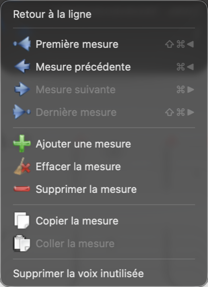

Navigation (première, précédente, suivante, dernière mesure), *Ajouter une mesure*, *Effacer la mesure* (vide la mesure mais la garde), *Supprimer la mesure*, *Copier / Coller la mesure*, *Supprimer la voix inutilisée*, *Retour à la ligne*.

### Note

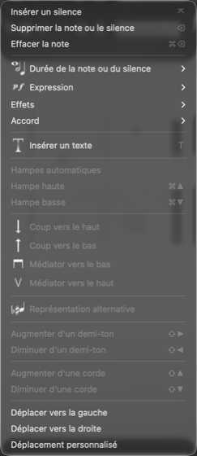

*Insérer un silence*, *Supprimer la note ou le silence*, *Effacer la note*, **Durée**, **Expression** (nuances), **Effets**, **Accord**, *Insérer un texte*, orientation des hampes, **coups** (vers le haut / le bas) et **médiator** (vers le bas / le haut), *Représentation alternative* (enharmonie), demi-ton et corde au-dessus/dessous, *Déplacer vers la gauche / la droite*, *Déplacement personnalisé*.

### Marqueur, Lecteur, Outils, Aide

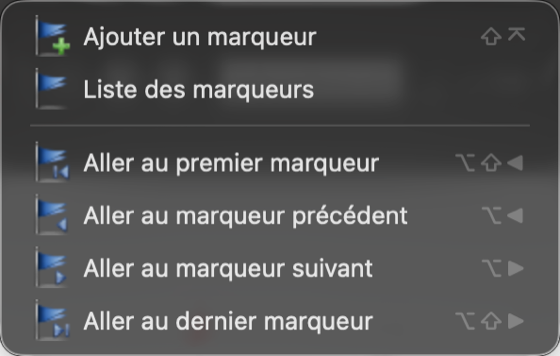 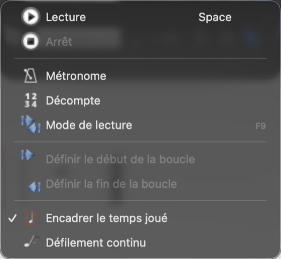 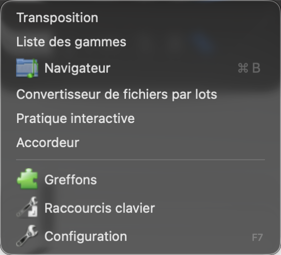 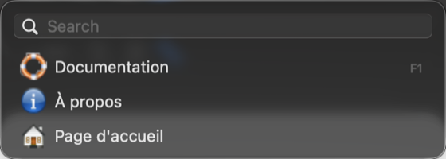

* **Marqueur** : ajouter, lister, naviguer entre les marqueurs.
* **Lecteur** : lecture, arrêt, métronome, décompte, mode de lecture, boucle, encadrer le temps joué, défilement continu.
* **Outils** : *Transposition*, *Liste des gammes*, *Navigateur*, *Convertisseur de fichiers par lots*, **Pratique interactive**, **Accordeur**, *Greffons*, *Raccourcis clavier*, *Configuration* (F7).
* **Aide** : l'aide intégrée et la fenêtre « À propos ».

## A3. Créer un premier morceau

**1. Un document vide.** Au lancement, un document vide est prêt. Pour en créer un autre : *Fichier > Nouveau* (⌘N) ou le premier bouton de la barre d'outils.

**2. Les informations du morceau.** *Composition > Propriétés du morceau* (F5) : nom, interprète, album, auteur-compositeur, date, droits, créateur de la tablature, transcripteur, commentaires. Le **nom** et l'**auteur** s'impriment sur la première page des exports, renseignez-les si vous sortez la partition de TuxGuitar.

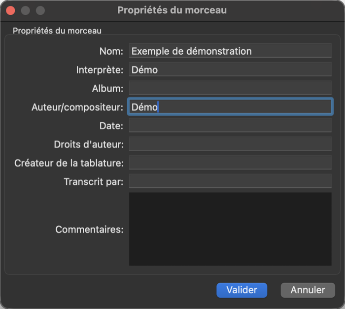

**3. La première piste.** Un nouveau document a déjà une piste. Une piste est un instrument : un morceau avec deux guitares et une basse a trois pistes. **Double-cliquez** sur la piste dans la liste (ou *Piste > Propriétés de la piste*) :

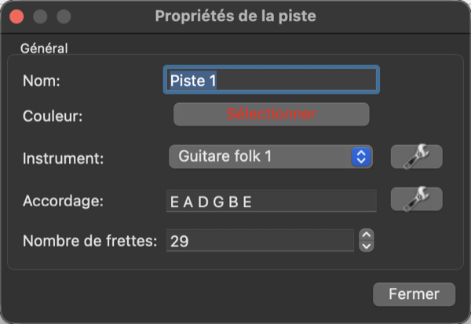

* **Nom** et **couleur** (affichés dans la liste des pistes) ;
* **Instrument** : le son de lecture (bouton clé : réglages détaillés, voir [A8](#a8-les-pistes-les-instruments-et-les-paroles)) ;
* **Accordage** : cliquez sur la clé pour choisir l'instrument, le nombre de cordes (4 pour une basse, 7, 8...) et l'accordage, ou en définir un personnalisé ;
* **Nombre de frettes** (sauf pistes de percussions).

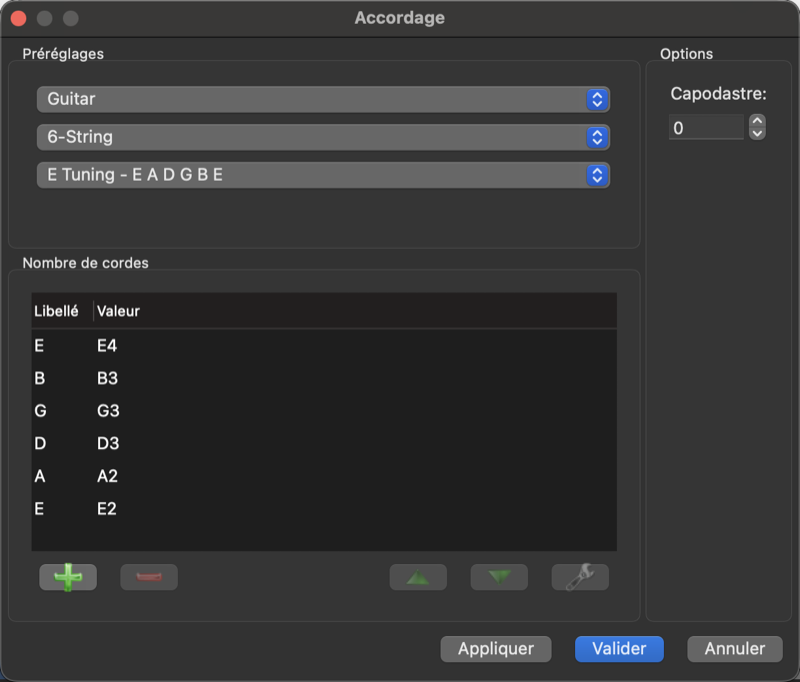

Donnez le **bon accordage** : sans lui, la portée et les numéros de case seraient faux. Quand vous changez l'accordage d'une piste déjà écrite, les notes sont conservées autant que possible et les numéros de case adaptés ; une note devenue injouable peut être perdue. Le **capodastre** décale la hauteur à la lecture sans changer l'affichage.

**4. Avant les notes :** réglez le **chiffrage** (4/4 par défaut), le **tempo** (120 par défaut), la **clé** et l'**armure** ([A7](#a7-la-structure-du-morceau)).

## A4. Saisir des notes

### Se déplacer

Cliquez à l'endroit voulu, ou utilisez les flèches : **← →** passent à la note suivante ou précédente de la piste, **⌘← ⌘→** (Ctrl sous Windows/Linux) à la mesure précédente ou suivante, **↑ ↓** changent de corde dans la tablature. *Configuration > Général > Jouer les notes au déplacement du curseur* fait entendre chaque note.

### Écrire dans la tablature

Placez le curseur sur une corde et **tapez le numéro de case (0 à 29)** : la note est écrite avec la **durée** et la **nuance** sélectionnées dans la barre latérale. Sur une note existante, **⇧→ / ⇧←** augmentent ou diminuent la case sur la même corde, **⇧↑ / ⇧↓** déplacent la note sur la corde du dessus ou du dessous. On peut aussi cliquer sur le **manche** en bas de la fenêtre, ou sur le **clavier** (*Affichage > Afficher le clavier*).

### Écrire sur la portée

Passez en *Mode édition de partition* (*Édition* ou barre latérale) : un clic sur une ligne ou un interligne écrit la note (des lignes supplémentaires s'ajoutent au-dessus et en dessous si besoin). Pour des dièses ou des bémols, activez aussi *Mode dièses/bémols*. Le *Mode sélection* déplace seulement le curseur sans rien modifier, utile pour naviguer sans risque.

### Durées

La somme des durées d'une mesure doit égaler son chiffrage : TuxGuitar empêche de créer une mesure irrégulière. Choisissez la durée dans la barre latérale ou *Note > Durée* (ronde à quadruple croche) ; **+ / −** (pavé numérique) la changent d'un cran. La **note pointée** allonge de 50 % (une blanche pointée = 3/4), la **double pointée** de 75 %. Le menu des **divisions** (barre latérale, flèche à droite) crée des **n-olets** (triolets...). La **liaison** (touche **L**) attache la note à la précédente : indispensable pour une note qui continue sur la mesure suivante, ou pour des durées comme 5/16 (une noire liée à une double croche). Touches : **\*** pointée, **/** triolet.

### Nuances

ppp, pp, p, mp, mf, f, ff, fff (barre latérale « Expression » ou *Note > Expression*) : une nouvelle note prend la nuance choisie ; en cliquant sur une autre nuance avec le curseur sur une note, vous changez cette note.

### Silences, suppression, décalage

* *Note > Insérer un silence* (Inser) insère un silence avant le curseur (dans la mesure, s'il y a un temps vide à la fin) ;
* *Supprimer la note ou le silence* (Suppr) : supprime la note sous le curseur ; sur un temps vide, décale vers la gauche ce qui suit (dans la mesure) ;
* *Effacer la note* (⌘Suppr) : comme ci-dessus, mais ne fait rien sur un temps déjà vide ;
* *Déplacer vers la gauche / la droite* et *Déplacement personnalisé* : décalent tous les temps qui suivent le curseur ;
* *Augmenter / Diminuer d'un demi-ton*, *d'une corde* : agissent sur toutes les notes sélectionnées si elles peuvent toutes être déplacées ;
* *Représentation alternative* (**e**) : une même note peut s'écrire do# ou ré♭ ; le choix par défaut dépend de l'armure.

### Sélection, copier, coller

Cliquez-glissez pour sélectionner des notes (un effet s'applique alors à toute la sélection). *Édition > Copier* sans sélection ouvre une fenêtre pour choisir les mesures à copier (piste courante ou toutes). *Coller* écrase le contenu à partir du curseur ; pour des mesures copiées, on choisit d'écraser ou d'insérer de nouvelles mesures. *Répéter* (⌘R) copie la sélection et la colle juste après.

### Deux voix et mode d'édition libre

Chaque piste peut avoir **deux voix** (*Édition > Sélectionner la voix 1 / 2*, ⌘1 / ⌘2) pour écrire deux lignes rythmiques indépendantes. Le **mode d'édition libre** supprime le contrôle de la somme des durées : à n'utiliser qu'avec de bonnes bases de théorie musicale, surtout à deux voix. *Afficher les mesures invalides* ouvre la fenêtre qui liste et corrige les mesures dont la durée ne correspond pas ([B9](#b9-analyse-de-la-partition-mesures-invalides)).

### Mesures

*Mesure > Ajouter une mesure* : une ou plusieurs mesures avant ou après le curseur, ou à la fin, dans toutes les pistes.

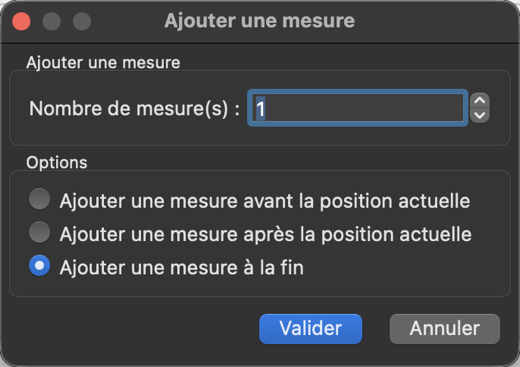

*Effacer la mesure* vide la mesure (dans la piste courante) ; *Supprimer la mesure* la retire de **toutes** les pistes ; *Copier / Coller la mesure* gère la copie d'une ou plusieurs mesures, dans la piste courante ou dans toutes, avec les marqueurs si vous le voulez, et le nombre de collages.

## A5. Les effets de jeu

Presque chaque effet a une icône dans la barre latérale « Effets » et une entrée dans *Note > Effets*. Avec des notes sélectionnées, l'effet s'applique à toute la sélection ; sinon à la note sous le curseur. Les effets s'appliquent dans la **tablature** (laissez-la affichée).

| Effet | Touche | Ce qu'il fait |
|---|---|---|
| **Vibrato** | V | Oscillation de la hauteur ; marqué de petites vagues. Sans paramètre. |
| **Bend** | B | Montée de la hauteur ; ouvre l'**éditeur de bends** (ci-dessous). |
| **Vibrato de levier** (tremolo bar) | | Variation vers le haut ou le bas jusqu'à une octave ; éditeur dédié. |
| **Slide** | S | Glissé entre la note et la suivante sur la même corde. |
| **Note étouffée** (dead note) | X | Note courte et percussive ; la hauteur reste réglable. |
| **Hammer-on / Pull-off** | H | Arc entre la note et la suivante sur la même corde, sans nouveau coup de médiator. |
| **Note fantôme** | O | Entre parenthèses ; seule l'écriture change. |
| **Accentuée / très accentuée** | | Un peu / beaucoup plus fort (marques > et ^). |
| **Let ring** | | « L.R. » : laisser sonner. |
| **Harmoniques** | | Naturelle, artificielle (A.H. 12, 9, 5, 7, 4, 3), pincée, tapée, semi. |
| **Note d'agrément** (grace note) | G | Note très courte avant ou sur le temps, avec transition (bend, slide, hammer). |
| **Trille** | | Série rapide de hammer-ons et pull-offs entre deux notes ; éditeur dédié. |
| **Trémolo de médiator** | | Répétition rapide de la même note (≡). |
| **Palm mute** | P | « P.M. » : étouffé de la paume. |
| **Staccato** | | Durée réduite de moitié (point au-dessus). |
| **Tapping** | | Marque « T » (sans effet sur le son). |
| **Slap / Pop** | | Marques « S » et « P » (sans effet sur le son). |
| **Fade in** | F | Le volume monte progressivement ; marque « < ». |

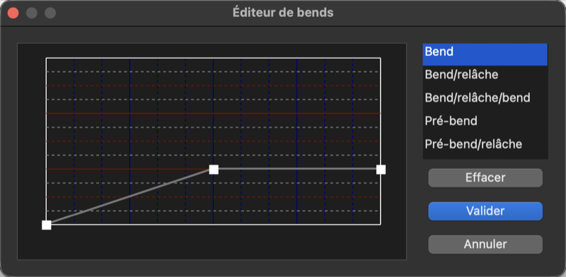

**L'éditeur de bends** : la liste de droite propose les cas fréquents (Bend, Bend/relâche, Bend/relâche/bend, Pré-bend, Pré-bend/relâche), tous d'un ton (2 cases) ; vous ajustez ensuite la courbe en plaçant des points (traits rouges pleins : un ton ; pointillés rouges : un demi-ton ; gris : un quart de ton). *Effacer* retire l'effet. Dans la tablature, le bend est une flèche courbe avec la valeur du décalage.

L'éditeur de vibrato de levier fonctionne de même (de −12 à +12 cases autour de la hauteur d'origine, la ligne noire est la hauteur de départ).

## A6. Les accords

L'**éditeur d'accords** (touche **A**, ou *Note > Accord*) sert à composer, reconnaître, mémoriser et insérer un accord. C'est le seul moyen d'ajouter un **nom** ou un **diagramme** d'accord dans la tablature.

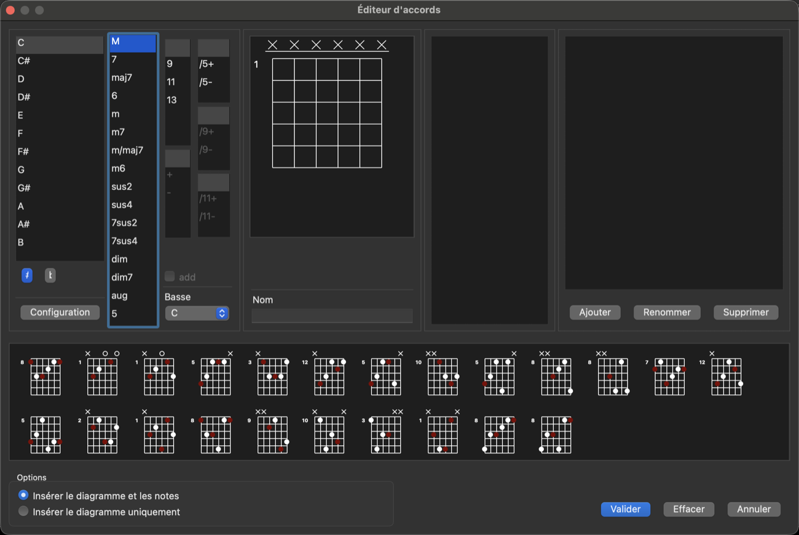

* **À l'ouverture**, les notes du curseur sont reprises, l'accord est reconnu et on l'entend.
* **Colonne de gauche** : la fondamentale (♯ ou ♭), puis le type (M, 7, maj7, 6, m, m7, sus2, sus4, dim, aug, 5...), les extensions (9, 11, 13, avec « add »), les altérations (/5+, /5−, /9+...), et la **basse** (une basse différente de la fondamentale donne un renversement).
* **Au centre : le diagramme** : cliquez pour poser des points, au-dessus de la grille pour passer d'une corde « à vide » à « non jouée » (×). Le curseur à droite choisit la case de départ.
* **Propositions** (bas) : des doigtés générés pour la théorie choisie, pour votre accordage ; cliquer sur un diagramme le charge dans l'éditeur et donne son nom.
* **Reconnu** : les noms possibles de ce que vous avez dessiné, avec une probabilité.
* **Bibliothèque** : *Ajouter*, *Renommer*, *Supprimer* ; les accords enregistrés sont ensuite accessibles par la flèche à côté de l'icône d'accord (ou *Note > Accord*).
* **Configuration** : type (les plus courants, ouverts, fermés, renversements), nombre de propositions, accords « à vide » et plage de cases ; non mémorisé après fermeture.
* **Options** : *Insérer le diagramme et les notes* ou *le diagramme uniquement*.

Dans *Affichage > Accords*, on choisit comment un accord est montré dans la partition : le **diagramme**, le **nom**, ou les deux.

## A7. La structure du morceau

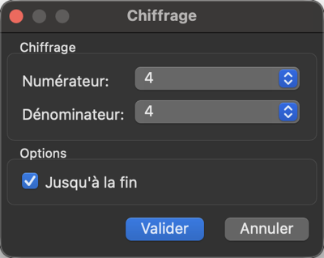 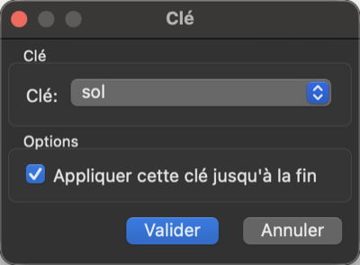 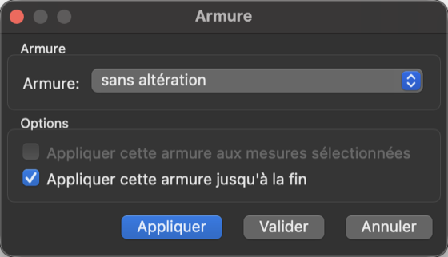

* **Chiffrage** (*Composition > Chiffrage* ou l'icône « 4/4 ») : numérateur et dénominateur ; *Jusqu'à la fin* applique le changement au reste du morceau (sinon, une seule mesure, puis retour au chiffrage précédent). Il s'applique à toutes les pistes et peut changer en cours de morceau.
* **Tempo** (30 à 320 BPM, 120 par défaut) : on peut choisir la figure qui porte la pulsation (noire par défaut) et l'étendue : tout le morceau, jusqu'à la fin, ou jusqu'au prochain marqueur de tempo.

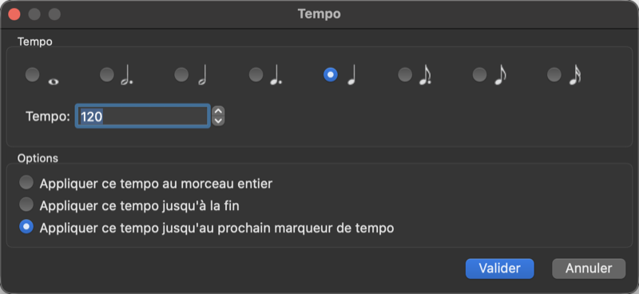

* **Clé** : sol (par défaut), fa, ut alto, ut ténor ; peut changer en cours de morceau.
* **Armure** : la gamme du morceau (naturel = do majeur, un bémol = fa majeur...), pour ne pas écrire chaque dièse ou bémol.
* **Shuffle / triolet de feeling** : le premier temps de chaque paire est allongé (2:1), en croches ou en doubles croches, pour un rendu swing ou blues.
* **Reprises** : *Ouvrir une reprise*, *Fermer une reprise* (on choisit le nombre de répétitions), *Autres reprises* (fins alternatives : on dit à quel passage chacune est jouée).
* **Marqueurs** (menu *Marqueur*) : nom, couleur et position, affichés au-dessus de la mesure dans toutes les pistes et dans le « transporteur » ; une liste permet d'y sauter.

## A8. Les pistes, les instruments et les paroles

### Gérer les pistes

*Piste > Ajouter une piste* (bouton « + »), *Dupliquer*, *Supprimer* (bouton « × »), *Déplacer vers le haut / le bas*. Tout cela s'annule avec ⌘Z. **Solo** n'écoute que la piste choisie ; **Muette** écoute toutes les autres. Dans la liste, cliquer le nom d'une piste l'affiche ; ⌘⇧↑ / ⌘⇧↓ passent à la piste précédente ou suivante.

### Instruments et mélangeur

*Affichage > Afficher les instruments* (ou l'icône) ouvre la fenêtre **Instruments** : pour chaque canal MIDI, le programme (instrument) et la banque, le **volume**, le **panoramique** et les effets (réverbération, chorus, tremolo, phaser). Cochez **Canal de percussions** pour une piste de batterie. **Ajouter** crée un nouveau canal ; la barre de droite règle le gain général.

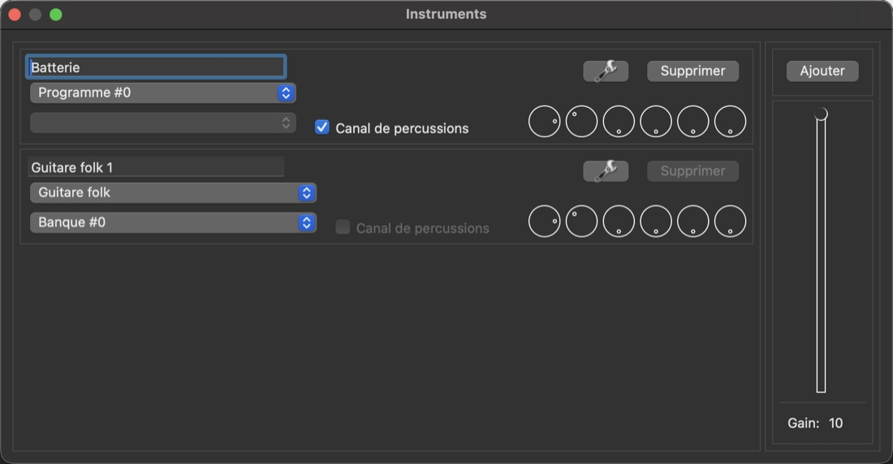

**Canaux :** le MIDI a 16 canaux, le canal 9 étant réservé aux percussions. Chaque piste utilise un canal normal et un canal d'effet (pour jouer en même temps une note étouffée ou une harmonique et une note normale, ou pour appliquer un bend, un slide, un vibrato ou un levier à certaines notes seulement). Tant que vous avez moins de 7 instruments et une percussion, TuxGuitar attribue les canaux seul. Au-delà, faites partager un canal à deux pistes qui ne jouent jamais en même temps.

### Paroles

*Piste > Paroles* ouvre l'éditeur de paroles de la piste. Choisissez la mesure de départ ; chaque mot (séparé par un espace ou une entrée) se place sous la note suivante, les silences sont ignorés ; ajoutez des espaces pour sauter des notes.

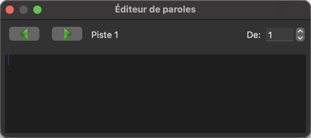

## A9. L'affichage

* **Mode page** (comme sur papier, avec retours à la ligne) ou **mode linéaire** (une seule ligne qui s'étend vers la droite). Le **mode multipiste** montre toutes les pistes ; sinon seule la piste sélectionnée est affichée. En pratique : *linéaire + multipiste* pour l'ensemble, *page sans multipiste* pour une piste ; activer le multipiste passe en linéaire, le désactiver repasse en page.
* **Afficher la portée**, **afficher la tablature** et **mode compact** (certains détails, comme ceux des bends, sont alors masqués).
* **Zoom** : *Agrandir*, *Réduire*, *Réinitialiser l'affichage*, ou ⌘ + molette.
* **Le manche** (en bas) montre les cases à jouer et accepte les clics pour saisir ; il existe pour droitiers et gauchers.
* **Le clavier** (*Afficher le clavier*) : saisie des notes à la souris.

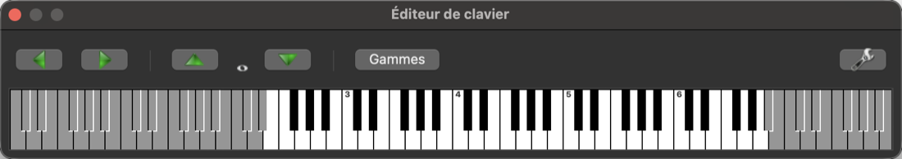

* **La matrice** (*Afficher la matrice*) : surtout utile pour les pistes de **percussions** ; elle découpe la mesure en cases et un clic ajoute ou retire un son. *Nombre de grilles* règle la finesse ; elle ne bloque pas la fenêtre principale (durée, nuance, mesure courante restent modifiables).

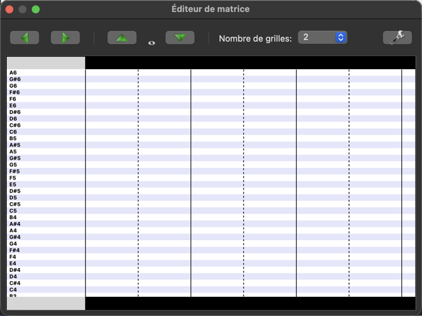

## A10. La lecture

Les commandes de lecture sont dans la barre d'outils, le menu *Lecteur* et la fenêtre **Lecteur** (*Affichage > Afficher le lecteur*, ⌘T). **Espace** lance et met en pause. Pendant la lecture, la note jouée est colorée en rouge, la mesure en cours a un fond rouge (réglable dans *Configuration > Styles*, option *Encadrer le temps joué*).

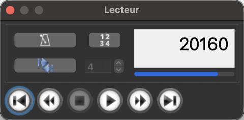

* **Métronome** : un clic à chaque temps. **Décompte** : une mesure d'attente avant le début (4 temps en 4/4, réglable dans la fenêtre Lecteur).
* **Mode de lecture** (F9) :
  * **Mode simple** : un pourcentage de tempo fixe (50 % = moitié moins vite), lecture en boucle, plage de mesures à jouer (début et fin de la boucle) ;
  * **Mode d'apprentissage** : un tempo de départ, un tempo d'arrivée et un incrément ; le tempo augmente de l'incrément à chaque tour (par exemple de 50 % à 100 % par pas de 5 %).

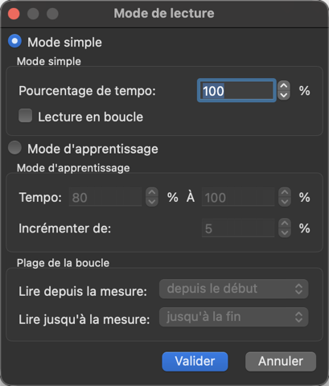

* **Défilement :** par défaut la page défile d'un écran quand la lecture atteint le bord ; *Défilement continu* fait défiler en continu.
* **Le « transporteur »** de la liste des pistes se parcourt à la souris et défile pendant la lecture.

## A11. Les fichiers

* **Ouvrir** (⌘O) : `.tg` (format natif, recommandé), Guitar Pro (`.gtp`, `.gp3`, `.gp4`, `.gp5`, `.gpx`, `.gp`), Power Tab (`.ptb`), TablEdit (`.tef`) ; **Importer** : MIDI. *Ouvrir une URL* ouvre un fichier en ligne (à enregistrer ensuite en local). **Plusieurs fichiers** peuvent être ouverts, chacun dans un onglet.
* **Enregistrer** (⌘S) dans le dernier format natif ; **Enregistrer sous** (F12).
* **Exporter** : PDF, MIDI, ASCII, LilyPond, SVG, Guitar Pro 3/4/5, anciens formats TuxGuitar (1.0 à 1.5), fichier audio, MusicXML, et « Créer un répertoire image ». L'**export audio** utilise le synthétiseur TuxGuitar avec les réglages d'instruments du morceau.
* **Aperçu avant impression**, **Imprimer** (⌘P) : une ou toutes les pistes, plage de mesures, options de mise en page.
* **Modèles :** *Nouveau* propose un morceau vide, *Trio blues* et *Duo de guitare classique* ; *Choisir un modèle personnalisé* fait partir tout nouveau morceau d'un fichier de votre choix.
* **Convertisseur par lots :** voir [A12](#a12-les-outils-et-la-configuration).

## A12. Les outils et la configuration

### Transposition, gammes, navigateur, convertisseur

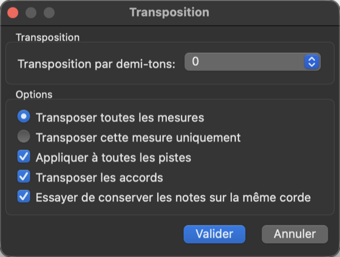 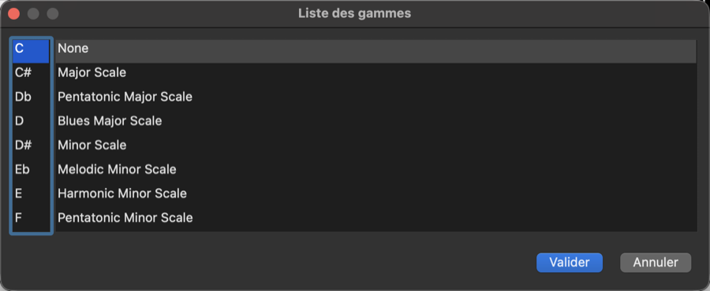

* **Transposition** : décale tout ou partie du morceau.
* **Liste des gammes** : les gammes sont affichées sur le manche pour aider à improviser ou composer (bouton *Gammes* sous la partition).
* **Navigateur** (⌘B) : un navigateur de collections de fichiers (dossiers locaux).

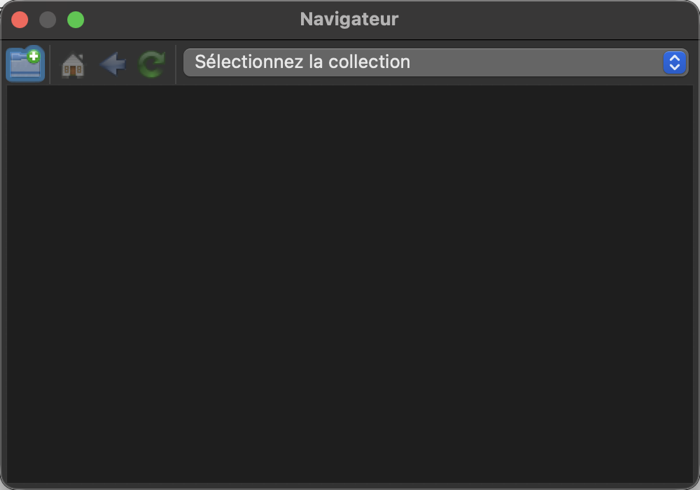

* **Convertisseur de fichiers par lots** : dossier d'entrée (sous-dossiers compris), dossier de sortie, format de sortie ; garde les noms et change l'extension. Une fenêtre montre l'avancement et peut être annulée.

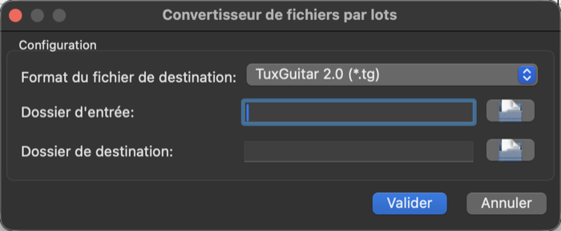

### Greffons

*Outils > Greffons* liste les greffons (formats de fichiers, sorties sonores, autres) : on les active ou on les désactive, **Configurer** règle ceux qui ont des options (par exemple la banque de sons), **Info** donne version, auteur et description. Un greffon est un fichier `.jar` à copier dans `share/plugins/`.

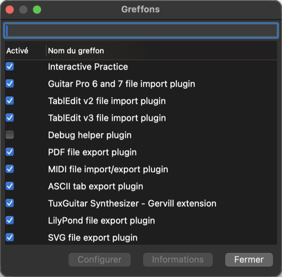

### Raccourcis clavier

*Outils > Raccourcis clavier* : tableau de toutes les actions et de leurs raccourcis ; double-clic pour changer, *Effacer* pour retirer, filtre de recherche en haut, *Défauts* pour tout rétablir.

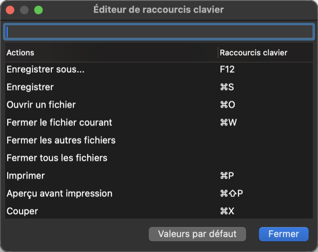

### Configuration (F7)

*Outils > Configuration* regroupe six pages :

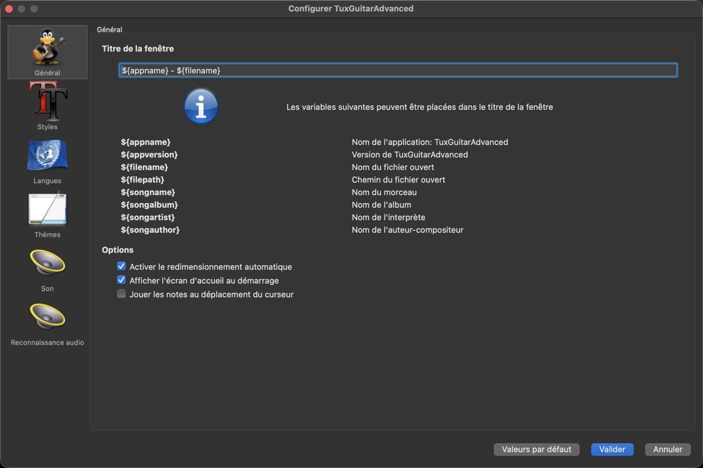

* **Général** : titre de la fenêtre (avec des variables comme `${appname}`, `${filename}`, `${songname}`), redimensionnement automatique de la table, écran d'accueil, jouer les notes au déplacement du curseur.
* **Styles** : polices et couleurs de la partition, de la tablature et des paroles (couleur de la mesure jouée, etc.).
* **Langues** : langue du système ou choix manuel (français, anglais, espagnol, et les autres langues de TuxGuitar).
* **Thèmes** (« skins ») : icônes et boutons, en version claire ou sombre ; un thème se choisit avec un aperçu.
* **Son** : sortie audio, c'est-à-dire le séquenceur MIDI et le port MIDI. Les ports viennent des greffons de sortie : sur macOS, le synthétiseur TuxGuitar, Java Sound (Gervill) et Audio Unit. Le synthétiseur intégré lit les banques de sons SF2 ou DLS (la « Magic Sound Font » est fournie).
* **Reconnaissance audio** : les réglages du Practice et de l'accordeur ([B7](#b7-les-réglages-de-reconnaissance-audio)).

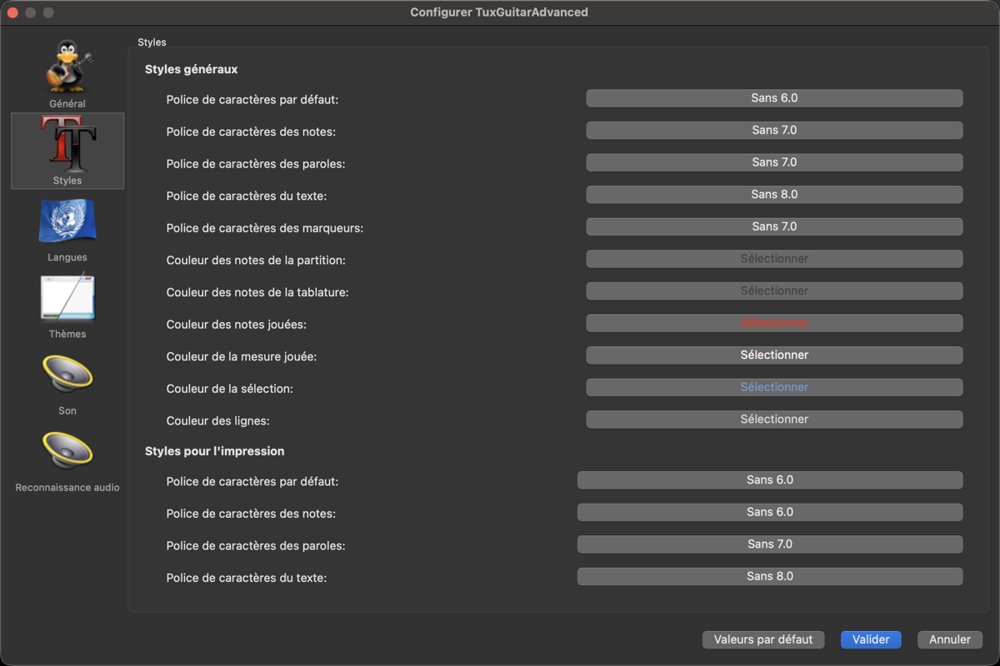 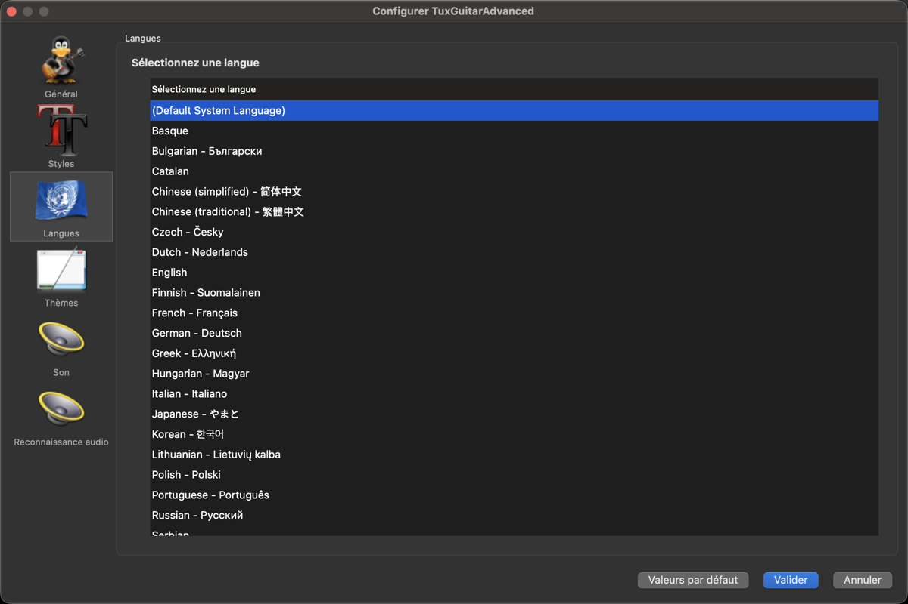

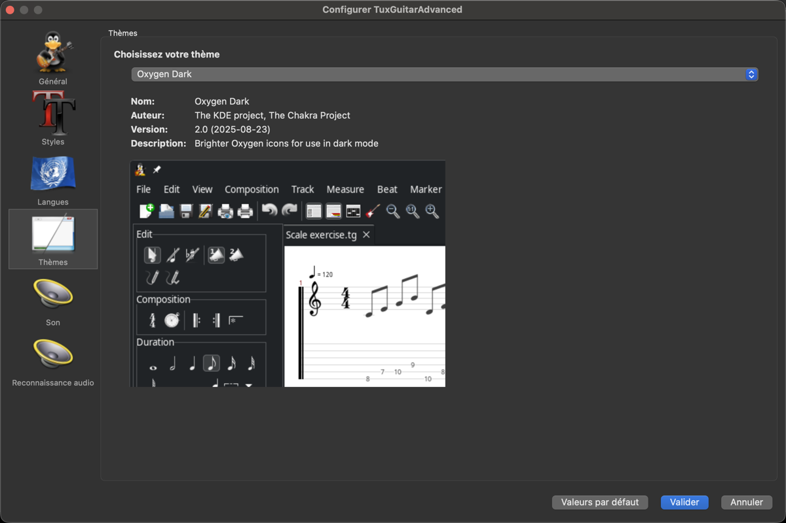 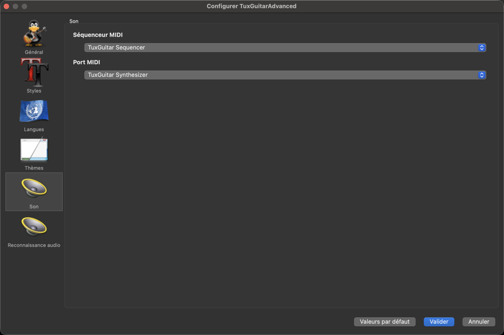

## A13. Raccourcis clavier

*Sous macOS, Ctrl se lit ⌘.* Tous sont modifiables.

| Catégorie | Action | Raccourci |
|---|---|---|
| **Application** | Nouveau / Ouvrir / Enregistrer | Ctrl+N / Ctrl+O / Ctrl+S |
| | Enregistrer sous | F12 |
| | Fermer le fichier | Ctrl+W |
| | Aperçu / Imprimer | Ctrl+Maj+P / Ctrl+P |
| | Quitter | Alt+F4 (⌘Q sur macOS) |
| **Édition** | Couper / Copier / Coller | Ctrl+X / Ctrl+C / Ctrl+V |
| | Répéter | Ctrl+R |
| | Annuler / Rétablir | Ctrl+Z / Ctrl+Y |
| | Sélectionner la piste | Ctrl+A |
| | Voix 1 / voix 2 | Ctrl+1 / Ctrl+2 |
| | Propriétés du morceau | F5 |
| **Pistes** | Piste suivante / précédente | Ctrl+Maj+↓ / Ctrl+Maj+↑ |
| | Ajouter / supprimer une piste | Ctrl+Maj+Inser / Ctrl+Maj+Suppr |
| **Lecture** | Lecture / pause | Espace |
| **Mesures** | Première / précédente / suivante / dernière | Ctrl+Maj+← / Ctrl+← / Ctrl+→ / Ctrl+Maj+→ |
| **Notes** | Insérer une note | chiffres 0 à 29 |
| | Insérer un silence | Inser |
| | Supprimer la note ou la sélection | Suppr |
| | Effacer le temps | Ctrl+Suppr |
| | Note liée / pointée / triolet | L / \* / / |
| | Texte | T |
| | Représentation alternative | e |
| | Note sur la corde du dessus / du dessous | Maj+↑ / Maj+↓ |
| | Hauteur + / − | Maj+→ / Maj+← |
| | Durée + / − | + / − |
| | Hampes vers le haut / le bas | Ctrl+↑ / Ctrl+↓ |
| **Effets** | Bend / fantôme / hammer-on / slide | B / O / H / S |
| | Vibrato / étouffée / palm mute | V / X / P |
| | Fade in / note d'agrément | F / G |
| **Marqueurs** | Ajouter | Maj+Inser |
| | Premier / précédent / suivant / dernier | Alt+Maj+← / Alt+← / Alt+→ / Alt+Maj+→ |
| **Fenêtres** | Éditeur d'accords | A |
| | Configuration | F7 |
| | Lecteur | Ctrl+T |
| | Navigateur | Ctrl+B |
| | Mode de lecture | F9 |
| | Aide | F1 |

---

# Partie B : le Practice (pratique interactive)

## B1. Principe et prérequis

Le Practice **écoute votre guitare** et vérifie, **note par note et accord par accord**, que vous jouez ce que la partition dit. Il ne joue pas à votre place. **Il n'enregistre jamais d'audio** : seuls des nombres dérivés du son (hauteur, niveau, notes entendues) existent en mémoire pendant la pratique.

**Ce qu'il vérifie : la hauteur.** Il ne prétend pas distinguer la corde et la case à l'oreille (ce reste une consigne de la tablature). Pour les techniques écrites (hammer-on, pull-off, slide, bend, vibrato), il suit comment la hauteur évolue ; la ligne « technique » dit « pas encore vérifiable » tant que les détecteurs ne sont pas validés sur assez d'enregistrements réels, ce qui n'est pas une erreur de votre part.

**Il vous faut :**

* macOS (Apple Silicon), Linux ou Windows (les modules sont dans les trois paquets) ;
* une **entrée audio** avec le son de votre guitare : le micro intégré convient pour un jeu propre ; une **interface audio** avec un signal direct est meilleure. Un **casque** est conseillé si la partition joue aussi dans les haut-parleurs, pour que le son de l'ordinateur ne soit pas pris pour votre guitare ;
* une partition avec une piste de guitare (accordage standard ou tout accordage écrit dans la partition).

Trois modes de travail, choisis dans l'onglet *Mode* :

| Mode | Principe |
|---|---|
| **Attendre la bonne note** | La partition **vous attend** : jouez chaque note quand vous êtes prêt. |
| **Suivre le tempo** | La partition **joue à son tempo** après un décompte, les autres pistes en accompagnement ; chaque note est jugée dans le temps. |
| **Arcade** (alpha) | La même chose, présentée comme un **jeu** : les notes viennent vers vous sur un manche. |

## B2. La fenêtre Pratique interactive

**Pour l'ouvrir :** *Outils > Pratique interactive*, ou le bouton **♪** à côté de Lecture : une pression travaille la piste sous le curseur de la partition, à partir du curseur, dès que l'entrée est utilisable. La fenêtre est organisée en **quatre onglets** ; les boutons *Travailler cette piste* (ou *Suivre le tempo de cette piste* / *Démarrer Arcade* selon le mode) et *Fermer* restent visibles quel que soit l'onglet.

### Onglet « Piste »

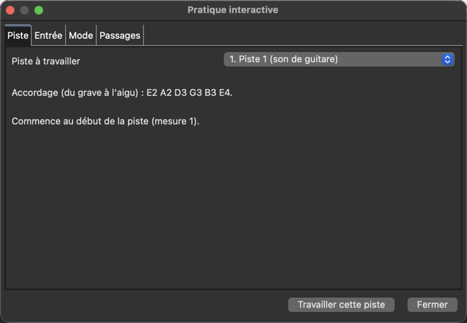

Choisissez la **piste à travailler** (seules les pistes utilisables sont proposées, avec la raison pour les autres). La fenêtre rappelle l'**accordage** de la piste et d'où la pratique commence (le curseur ou le début). En **Arcade**, toute piste avec hauteur est proposée, quel que soit son nombre de cordes (basse comprise).

### Onglet « Entrée »

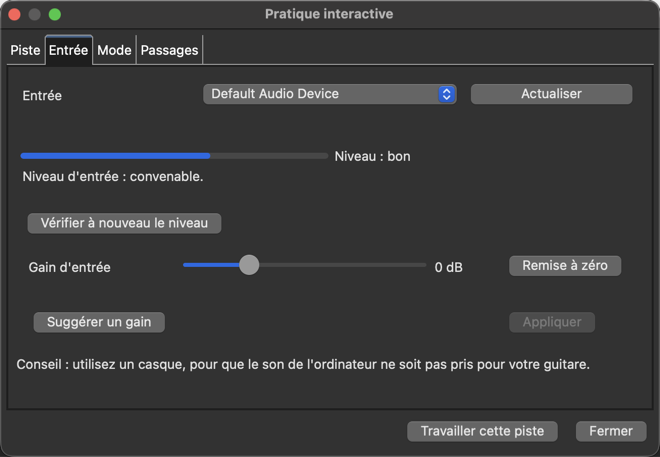

* **Entrée** : la liste des entrées audio, une par appareil mono et une par canal utilisable des appareils multicanaux. L'application ne change jamais d'entrée seule.
* **Actualiser** : relit la liste, pour une interface branchée **pendant** que l'application tourne (la liste n'est pas surveillée).
* **Niveau** : un indicateur et un message (bon, trop faible, trop fort, saturé) ; *Vérifier à nouveau le niveau* relance la mesure (jouez une corde).
* **Gain d'entrée**, *Remise à zéro*, *Suggérer un gain*, *Appliquer* : voir [B3](#b3-niveau-dentrée-gain-et-bruit).
* Un conseil rappelle de préférer un casque.

### Onglet « Mode »

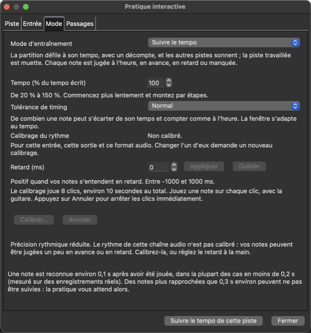

Le **mode d'entraînement** (liste déroulante) et, pour les modes chronométrés, le **tempo** (20 à 150 % du tempo écrit), la **tolérance de timing** (stricte, souple, normale), le **calibrage du rythme** et un **retard** manuel ; en Arcade, la **taille des disques qui arrivent** (40 à 150 %). En bas, la fenêtre rappelle le délai de reconnaissance mesuré (environ 0,1 s, et que des notes plus rapprochées que 0,3 s peuvent ne pas être suivies : la pratique vous attend alors).

### Onglet « Passages »

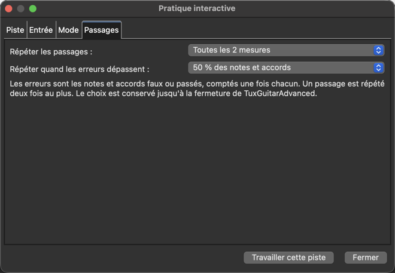

Pour le mode « Attendre » : **répéter les passages** (désactivé, ou toutes les 1, 2, 4 mesures) et **répéter quand les erreurs dépassent** un seuil (en pourcentage des notes et accords). Les erreurs sont les notes et accords faux ou passés ; un passage est répété deux fois au plus. Le choix est conservé jusqu'à la fermeture de l'application (il se règle aussi dans *Configuration > Reconnaissance audio > Passages*).

## B3. Niveau d'entrée, gain et bruit

* Sous l'indicateur de niveau, le curseur **Gain d'entrée** amplifie ou atténue le signal dans l'application (de −6 à +18 dB) ; **Remise à zéro** revient à 0 dB. Le gain n'est jamais mémorisé : il revient à 0 dB quand l'entrée change et à chaque démarrage. Si l'amplification ne fait qu'amplifier le bruit de fond, ou fait saturer le signal, un avertissement le dit et conseille d'augmenter le gain sur l'interface audio.
* Pendant que vous jouez, si vos notes sont trop faibles pour une reconnaissance rapide fiable (en dessous d'environ −30 dBFS mesurés), la fenêtre le dit : augmentez le gain ou rapprochez-vous ; un jeu lent peut encore être reconnu.
* **Réduire le bruit de fond** (réglage, désactivé par défaut) : réduction du bruit par seuil et soustraction du bruit de fond. **Suggérer un gain** (activé par défaut) : propose un gain après la vérification du niveau. Voir [B7](#b7-les-réglages-de-reconnaissance-audio).

## B4. Mode « Attendre la bonne note »

C'est le mode d'origine. **Choix du mode :** onglet *Mode*, « Attendre la bonne note ». Puis *Travailler cette piste*.

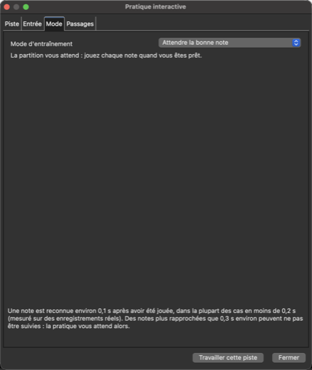

La partition **attend** : la note ou l'accord attendu est **encadré** sur la partition, le passage en cours est surligné, et la **palette** de pratique reste affichée.

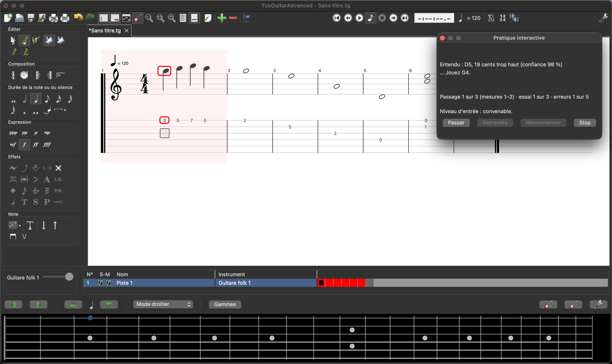

La palette (fenêtre « Pratique interactive » pendant la pratique) dit :

* ce qui a été **entendu** (« D5, 19 cents trop haut, confiance 98 % ») et ce qu'il faut **jouer** ensuite (« Jouez G4 ») ;
* l'avancement du **passage** (« Passage 1 sur 3 (mesures 1–2) · essai 1 sur 3 · erreurs 1 sur 5 ») ;
* le **niveau d'entrée** ;
* des boutons **Passer** (ignorer la note courante), **Reprendre**, **Recommencer** et **Stop**.

Une coche verte signifie « entendu », une croix rouge « une autre note a été entendue » ; **rien n'avance sur un silence ou un bruit**. **Stop** arrête la pratique immédiatement. Quand les erreurs d'un passage dépassent le seuil réglé dans l'onglet *Passages*, ce passage est répété.

## B5. Mode « Suivre le tempo »

**Choix du mode :** onglet *Mode*, « Suivre le tempo ». Puis *Suivre le tempo de cette piste*. La partition défile **à son tempo après un décompte** ; la **piste travaillée est muette**, les autres pistes jouent en accompagnement. Chaque note ou accord est **jugé dans le temps** :

| Verdict | Sens |
|---|---|
| À l'heure | Juste note, dans la tolérance. |
| En avance / En retard | Juste note, mais décalée (en millisecondes). |
| Fausse | Une autre note a été jouée. |
| Manquée | Rien d'attendu n'a été entendu. |
| En trop | Une note supplémentaire non écrite. |
| Non jugée | Événement qui ne peut pas être jugé (passé automatiquement, technique non vérifiable...). |

**Réglages :**

* **Tempo (% du tempo écrit)** : de 20 % à 150 %. Commencez plus lentement et montez par étapes.
* **Tolérance de timing** : de combien une note peut s'écarter de son temps et compter comme à l'heure ; la fenêtre s'adapte au tempo. Trois niveaux : stricte, normale, souple (la valeur initiale est celle de *Configuration > Reconnaissance audio > Pratique, notes*).
* **Calibrage du rythme** : le son met du temps à traverser votre entrée, votre sortie et le format audio ; sans calibrage, vos notes peuvent être jugées un peu en avance ou en retard et la fenêtre dit **« Précision rythmique réduite »**. Le bouton **Calibrer…** joue **8 clics** (environ 10 secondes) : jouez une note sur chaque clic, avec la guitare ; **Annuler** arrête les clics immédiatement. Le calibrage vaut pour **cette entrée, cette sortie et ce format audio** : changer l'un demande un nouveau calibrage. À défaut, saisissez un **retard (ms)** à la main (positif quand vos notes s'entendent en retard, entre −1000 et 1000 ms) avec *Appliquer*, ou *Oublier*.
* Si le délai de l'entrée est élevé ou instable (typiquement sans fil), la fenêtre l'avertit : une entrée filaire est plus stable.

Pendant la partie, la palette montre le verdict de la dernière note, le compteur (à l'heure, en avance, en retard, fausses, manquées, en trop, non jugées) et la note **suivante**. Au bout, un **bilan** détaille les nombres ; il n'est gardé que tant que la fenêtre est ouverte.

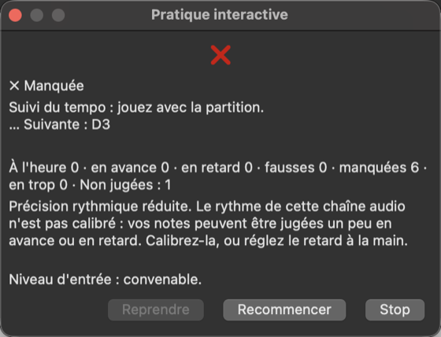 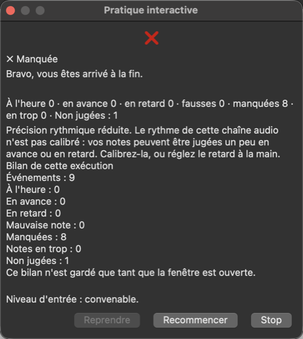

**Pause, reprise :** si vous jouez la partition depuis la fenêtre principale, le suivi s'arrête (la lecture normale continue) ; **Reprendre** repart après une pause, les notes passées entre-temps ne sont pas jugées. Le mode est impossible si la lecture est déjà en cours : arrêtez-la d'abord.

## B6. Mode Arcade (alpha)

**Choix du mode :** onglet *Mode*, « Arcade ». Dans l'onglet *Piste*, choisissez la piste que vous jouez (toute piste avec hauteur, **basse comprise**), puis **Démarrer Arcade**. La fenêtre de pratique se masque pendant que la fenêtre du jeu tourne.

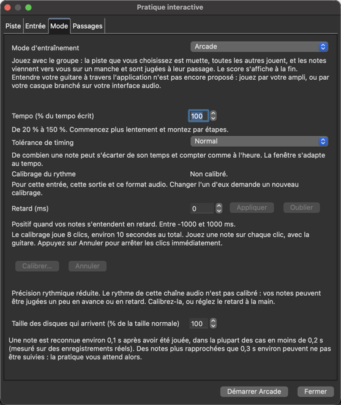

C'est le mode « Suivre le tempo » (mêmes tempo, tolérance et calibrage) présenté sous forme de jeu. La piste que vous choisissez est muette, toutes les autres jouent.

**Comment lire l'écran :**

* **Chaque note se voit venir pendant cinq secondes**, depuis l'horizon, quel que soit le nombre de notes. Une note écrite à la case *n* suit toujours **la même voie** jusqu'au **milieu de sa case** sur le manche ; seule sa **couleur** (celle de sa corde) dépend de la corde. Le disque qui atteint le manche est celui que vous jouez maintenant. Le chiffre dans le disque est le numéro de case.
* **Le manche** (en bas) montre les cordes (avec leurs notes à vide, de la plus aiguë en haut) et les cases numérotées. La cible de la note à jouer est un disque plein sur la case et la corde exactes.
* **Les accords** sont une barre sur un axe central ; le prochain accord montre son **diagramme** et son **nom**, les autres sont des barres sans diagramme.
* **En haut** : votre **série** (à gauche), le **tempo** en pourcentage et la **suite** (à droite : « Suivante : corde 3, case 2 » ou « Suivant : accord »).
* **Les verdicts** (à l'heure, en avance, en retard, faux, incomplet, manqué) apparaissent en **badge** sous le manche une fois la note jugée (le texte accompagne toujours la couleur).
* **Pause / Reprendre** et **Arrêter** sont en bas à droite. Jouer la partition depuis la fenêtre principale arrête la partie.

**La taille des disques** qui arrivent se règle (40 % à 150 %, 100 % par défaut) dans l'onglet *Mode*, pour les disques qui ne sont pas encore sur le manche. Elle est conservée jusqu'à la fermeture de l'application.

**À la fin**, la fenêtre **Résultat** donne le score, la part du maximum, la meilleure série et le décompte de chaque verdict. Vous pouvez **rejouer depuis le début** ou **depuis une mesure** choisie (*Depuis la mesure*, puis *Jouer*). Les techniques (hammer-on, slide, bend...) sont signalées à part et ne changent pas le score.

**Alpha, ce qui n'est pas vérifié :** voir [B10](#b10-qualité-mesurée-limites-et-trace-de-diagnostic). Les notes **sous sol 1 (49 Hz)** (les plus graves d'une basse standard) sont affichées mais pas jugées. L'**écoute de votre propre guitare à travers l'application n'est pas proposée** : jouez par votre ampli ou par un casque branché sur l'interface audio.

## B7. Les réglages de reconnaissance audio

*Outils > Configuration > Reconnaissance audio*. Chaque réglage a une **valeur recommandée** et un bouton **Rétablir** par catégorie ; *Rétablir tous les réglages de reconnaissance audio* remet tout. Les modifications sont enregistrées avec **Valider** ; **Annuler** garde les valeurs précédentes. Les réglages de l'accordeur s'appliquent aussitôt, ceux de la pratique au **prochain Démarrer** ; les réglages de niveau et d'attaque relancent brièvement l'écoute. Survolez le nom d'un réglage pour voir son effet. Les captures montrent les valeurs de la machine de test, pas forcément les valeurs recommandées (indiquées ci-dessous).

**Catégorie « Entrée audio »** : l'**entrée** (partagée par l'accordeur et la pratique ; elle change immédiatement et n'est pas mémorisée après la fermeture de l'application, bouton **Actualiser** compris), le **niveau minimal utilisable** (−40 dBFS recommandé), l'**alerte de niveau élevé** (−6 dBFS), **Réduire le bruit de fond** (désactivé) et **Suggérer un gain d'entrée** (activé).

**« Accordeur »** : l'**écart considéré comme juste** (5 cents) et **Garder la dernière note** (activé : l'aiguille grise garde la dernière lecture quand la corde se tait).

**« Pratique, notes »** : l'**écart de hauteur accepté** (35 cents recommandés) ; la **certitude minimale** (80 %) du détecteur avant de juger une note ; la **durée de confirmation d'une note** (107 ms) ; la **sensibilité à l'attaque** (4,5 dB) ; le traitement des **liés, tirés-poussés, glissés** (une nouvelle attaque est exigée pour chaque note, le seul choix de cette version) ; **Vérifier les techniques de jeu** (activé) ; la **tolérance de timing** pour le jeu au tempo (normale).

**« Pratique, accords »** : l'**exigence sur les accords** (33 %), la **fenêtre de grattage** (600 ms : le temps maximal d'un coup de médiator sur plusieurs cordes), les **cordes exigées** (toutes les cordes vérifiables) et les **cordes en trop** (pas encore vérifiées).

**« Passages »** : répéter les passages (toutes les 2 mesures), répéter si les erreurs dépassent un pourcentage (50 %), **nombre maximal de répétitions** (2).

**« Moteur de reconnaissance »** : le moteur de détection de hauteur (automatique, FastYin ; le seul choix de cette version).

**« Avancé »** : la tolérance « trop haut » par case (0,7 cent : les notes pressées sonnent un peu plus haut vers l'aigu du manche ; ce réglage ajoute ces cents du côté aigu seulement, 0 le désactive), le niveau d'échantillon saturé (99 %), la part d'échantillons saturés (10 %), la certitude minimale de l'accordeur (80 %), le seuil de détection d'attaque (−50 dBFS), les harmoniques par corde pour les accords (2) et la durée de confirmation d'un accord (43 ms).

## B8. L'accordeur

*Outils > Accordeur* ouvre l'accordeur ; il partage sa détection de hauteur avec la pratique.

* **Deux modes** : *Guidé (6 cordes)* vous conduit corde par corde ; *Chromatique* montre la note la plus proche de ce que vous jouez.
* **Accordage** : un préréglage, *Personnalisé…* (une note par corde) ou l'**accordage d'une piste** du morceau ouvert.
* **L'aiguille** montre la **médiane des lectures sûres du dernier quart de seconde** : un parasite ne la déplace pas, une courte interruption ne la fige pas. Le texte dit quoi faire (« Trop bas : 12 cents sous mi2. Accordez plus haut », « Juste », « Trop haut... »).
* **Aiguille grise figée** (« Dernière mesure ») : la corde est silencieuse ou trop faible, rejouez-la.
* **Entrée** : l'entrée choisie et son niveau (bon / trop faible / trop fort / saturé), **Vérifier à nouveau le niveau** et le curseur de **gain** (−6 à +18 dB) avec sa **Remise à zéro** ; **Réglages** ouvre les réglages de l'accordeur.
* **Pas pendant la pratique** : l'accordeur refuse de s'ouvrir tant que la fenêtre de pratique est ouverte (ils partagent le micro) ; fermez-la d'abord, accordez, puis relancez.

## B9. Analyse de la partition (mesures invalides)

Ouvrir un fichier Guitar Pro ou MIDI ne vous interrompt plus par une boîte de dialogue sur les mesures dont la durée ne correspond pas au chiffrage. Pour voir **tous les problèmes d'un morceau** : *Édition > Afficher les mesures invalides* (ou l'icône de la barre d'outils). La fenêtre liste les mesures et notes liées invalides de chaque piste (piste, mesure, voix, trop long / trop court...), avec des filtres, l'état de la mesure courante et un bouton **Corriger**. Elle ne bloque rien : laissez-la ouverte pendant que vous éditez.

## B10. Qualité mesurée, limites et trace de diagnostic

Sur un banc d'essai de 1 208 enregistrements annotés de vraies guitares (propres et avec 11 effets), 6 178 tests :

* **notes isolées reconnues** : 99,8 % (effets) à 100 % (propre) ;
* **une note à un demi-ton ou un ton de la note jouée acceptée** : aucune sur plus de 2 700 tests ;
* **intervalles et accords de trois notes avec effets reconnus** : 87 % ; **accords de guitares propres** : 95 % ;
* **accords auxquels il manque une note refusés** : 96 à 98 % ;
* **délai** entre le jeu d'une note et sa reconnaissance : environ 0,1 s (médiane 105 ms, 90 % sous 170 ms).

Sur un **jeu de données indépendant** (GuitarSet, accompagnement rythmique à la guitare acoustique), le résultat est **bien plus bas** : 60 % des accords complets reconnus (six micros de manche additionnés), 46 % au micro ; 13 % des accords auxquels il manque une note acceptés par erreur.

**Limites, mesurées et non cachées :**

* **Notes rapprochées :** environ 0,3 s entre notes jouées au médiator sont suivies ; plus vite, seule la première d'une série est reconnue et la pratique vous attend, sans jamais compter de fausse note. La fenêtre le dit.
* Les accords dont la note grave est sol2 sont parfois acceptés un ton plus haut ; les accords de septième à quatre notes et certains accords à vide (la majeur, mi majeur) sont reconnus moins souvent.
* Une octave, ou une note qui est un harmonique d'une note grave de l'accord, ne se vérifie pas séparément.
* **Alpha (Arcade et suivi du tempo) :** validés par des tests automatiques et par le propriétaire sur un Mac, **pas** par d'autres joueurs, guitares, micros ou machines. Sur un test de charge de 10 minutes, la chaîne audio **manque encore environ une échéance d'analyse par minute** (un trou d'ordonnancement du système) ; il n'a pas été montré qu'elle change un jugement, mais l'objectif n'est pas atteint.
* Les réglages ont été mis au point sur ces enregistrements ; une autre guitare ou un autre micro peut demander un autre gain ou une autre sensibilité.

**Trace de diagnostic (pour comprendre un échec).** Quand une note jouée juste n'est pas reconnue (ou une fausse l'est), l'application peut écrire **ce qu'elle a entendu, sous forme de nombres seulement, sans audio** :

1. quittez l'application, puis lancez-la avec la propriété `tuxguitar.practice.trace` nommant un fichier, par exemple sur macOS depuis un terminal : `open -n --env JAVA_TOOL_OPTIONS="-Dtuxguitar.practice.trace=/tmp/practice-trace.csv" /chemin/vers/TuxGuitarAdvanced.app` ;
2. jouez le passage dans la pratique ;
3. ouvrez le CSV : une ligne par pas d'analyse (temps, événement, notes attendues, hauteur détectée et certitude, niveau, force de l'attaque, amplitude de chaque note attendue et de ses voisines, lignes `ACCEPTED`). Envoyez-le avec la description de ce qui aurait dû se passer.

## B11. Questions fréquentes et dépannage

**Rien n'est entendu / le niveau est « trop faible ».** Vérifiez l'**entrée** choisie (onglet *Entrée*), jouez une corde en regardant l'indicateur, augmentez le gain de l'interface (de préférence) ou le gain de l'application, rapprochez le micro. Avec une interface branchée après le lancement, appuyez sur **Actualiser**.

**macOS ne laisse pas la pratique écouter le micro.** *Réglages Système > Confidentialité et sécurité > Micro* : autorisez TuxGuitarAdvanced.

**L'accordeur ne s'ouvre pas.** La fenêtre de pratique est ouverte (ou masquée pendant une partie) : fermez-la, puis ouvrez l'accordeur.

**Les notes sont jugées « en retard » ou « en avance » systématiquement.** Calibrez le rythme (onglet *Mode*, **Calibrer…**), ou entrez un retard manuel. Une entrée filaire et un casque filaire sont plus stables que le sans fil.

**La fenêtre de pratique a disparu après une partie Arcade.** Rouvrez-la par *Outils > Pratique interactive* (elle revient depuis la version qui suit 0.5.0-alpha.1 ; dans cette version, redémarrez l'application si besoin).

**La partition d'un fichier Guitar Pro se lit mal ou la pratique refuse la piste.** La pratique ne retient que les pistes avec hauteur ; les pistes de percussions sont exclues, et la raison est indiquée dans l'onglet *Piste*. *Afficher les mesures invalides* aide à trouver des mesures dont la durée est fausse.

**Je veux plus ou moins d'exigence.** Ajustez, dans *Configuration > Reconnaissance audio*, l'écart de hauteur accepté, la certitude minimale, la durée de confirmation et, pour les accords, l'exigence sur les accords ; *Rétablir* revient aux valeurs mesurées.

**Où trouver plus de détails ?** [PRACTICE-FR.md](PRACTICE-FR.md) (guide du Practice, mesures de qualité), [README-FR.md](README-FR.md) et les notes de release.
