# Mode Practice interactif, guide utilisateur

Le mode Practice écoute votre guitare et vérifie, note par note et accord par accord, que vous jouez ce que dit la partition. Il ne joue pas la partition à votre place et il n'enregistre jamais le son : seuls des chiffres calculés à partir du son (hauteur, niveau, notes entendues) existent en mémoire pendant son fonctionnement.

*English: [PRACTICE.md](PRACTICE.md). Español: [PRACTICE-ES.md](PRACTICE-ES.md).*

## Ce qu'il faut

* macOS (Apple Silicon), Linux ou Windows : les modules de pratique sont dans les trois paquets. L'accès au micro et le comportement des entrées audio dépendent de la prise en charge de Java Sound par le système.
* Un son de guitare sur une entrée : le micro intégré convient pour un jeu clair ; une interface audio avec le signal direct de la guitare est préférable. Un casque est conseillé si la partition joue aussi dans les haut-parleurs.
* Une partition avec une piste de guitare (accordage standard ou tout accordage écrit dans la partition).

## Démarrer

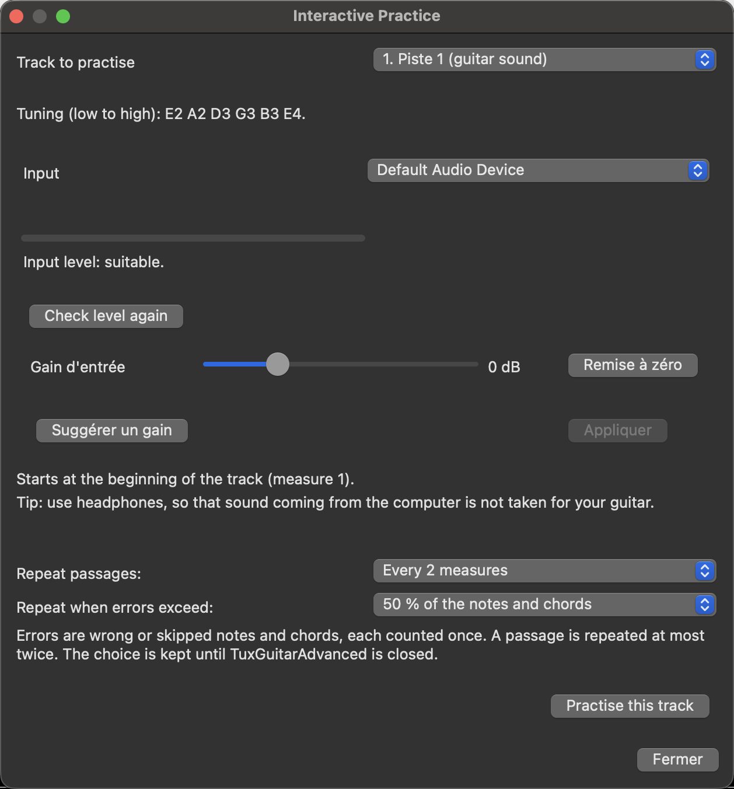


| Comment | Ce qui se passe |
|---|---|
| **Bouton Practice**  à côté du bouton Play | Pratique la piste sous le curseur de la partition, à partir du curseur, dès que l'entrée est utilisable. Un seul clic. |
| Menu *Outils > Interactive Practice* | Ouvre la fenêtre de pratique pour choisir d'abord la piste, le départ et l'entrée. |

La première fois (ou après un changement d'entrée), la fenêtre **vérifie le niveau d'entrée** : jouez une corde et regardez la jauge. Si elle indique *trop bas* ou *saturation*, rapprochez-vous ou réglez le gain (voir plus bas).

**La fenêtre de démarrage (avant chaque départ).** À chaque démarrage d'un mode — bouton Démarrer, bouton Pratique de la barre de transport, bouton Arcade coloré — une petite fenêtre demande d'abord *Votre guitare est-elle accordée ?* *Non, ouvrir l'accordeur* ouvre l'accordeur et le mode ne commence pas ; quand vous fermez l'accordeur, la question revient. *Oui, accordée* demande un accord de test : grattez un accord et laissez-le sonner. La fenêtre juge le niveau des 0,3 seconde qui suivent : si plus de 0,5 % des échantillons atteignent le maximum, elle dit que le signal sature (baissez le volume de l'adaptateur ou de la guitare) ; un signal trop fort ou trop faible est aussi nommé, avec la marche à suivre ; un bon niveau lance le mode aussitôt. Un mauvais niveau bloque le départ : *Vérifier à nouveau* juge un nouvel accord, et *Continuer quand même* continue **pour ce départ seulement** (proposé aussi après 10 secondes sans accord). Relancer une partie ou *rejouer* ne redemande pas. La fenêtre ne change jamais le gain de l'interface ni du système. Le seuil de 0,5 % a été calibré sur les enregistrements du propriétaire avec un adaptateur Rocksmith et sur les 180 enregistrements microphone de GuitarSet (aucun n'est signalé) ; les conseils pour Windows et Linux reprennent le texte de macOS et n'y ont pas été essayés.

## Pendant la pratique

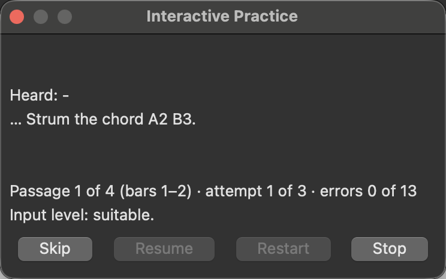


Une petite palette reste à l'écran et la note ou l'accord attendu est encadré sur la partition :

* **coche verte** : entendu, la pratique avance ;
* **croix rouge** : une autre note a été entendue (affichée seulement pour une note qui vient d'être frappée, pas pour la note précédente qui résonne encore) ;
* rien ne se passe sur du silence ou du bruit, et une note qui résonne n'est jamais prise pour la suivante ;
* un accord est accepté quand ses notes sont entendues ensemble ; les notes manquantes sont nommées si l'accord est incomplet ;
* une **note avec bend** est acceptée quand le bend atteint la cible écrite : la note de départ (un pré-bend, sa hauteur déjà montée) lance le bend et la pratique vous dit de faire monter la note ; pendant que vous faites le bend, le relâché ou le pré-bend comme écrit, aucune hauteur intermédiaire n'est une fausse note, la hauteur atteinte par le bend n'est pas prise pour la note suivante (qui demande son propre coup de médiator), et un relâché écrit doit aussi être fait (la pratique vous dit de relâcher jusqu'à sa fin) ; **Passer** permet de sauter un bend ou un relâché que vous ne voulez pas jouer. Savoir si le bend était exactement juste est un résultat de technique, qui dit pour l'instant *pas encore vérifiable* ;
* **Passer** saute la note, **Reprendre** continue après une pause (lecture, entrée inutilisable), **Recommencer** reprend le passage, **Stop** termine la pratique immédiatement et ramène la fenêtre de préparation.

La pratique peut aussi se faire **par passages** : quelques mesures à la fois, répétées jusqu'à atteindre la part de notes justes que vous avez fixée.

Ce qui est vérifié, c'est la **hauteur**. La corde et la case utilisées ne peuvent pas être connues par le son. Pour chaque technique écrite (hammer-on, pull-off, slide, bend, vibrato), une ligne sous le résultat de hauteur dit ce qui a été entendu : *entendu*, *non entendu*, *incertain* ou *pas encore vérifiable*. Aucune technique n'est encore vérifiée (détection mesurée : vibrato 59 %, bend 82 %, slide 48 % des notes annotées, objectif 85 %) : pour l'instant la ligne indique donc *pas encore vérifiable*. Elle ne bloque jamais l'exercice : une note de hammer-on ou de pull-off est acceptée d'après sa hauteur.

## S'entraîner avec le groupe : Suivre le tempo et Arcade (alpha)

Dans l'onglet **Mode** de la fenêtre de pratique, vous choisissez comment la partition est travaillée :

| Mode | Ce qui se passe |
|---|---|
| **Attendre la bonne note** | La partition vous attend (le mode décrit plus haut). |
| **Suivre le tempo** | La partition joue à son tempo, après un décompte. La piste travaillée est muette, les autres pistes jouent l'accompagnement. Chaque note ou accord est jugé dans le temps : à l'heure, en avance, en retard, faux, manqué. |
| **Arcade** | La même partie, présentée comme un jeu : les notes viennent vers vous sur un manche et sont jugées à leur passage. Le résultat s'affiche à la fin. |

Les deux modes chronométrés partagent le **tempo** (20 % à 150 % du tempo écrit), la **tolérance de timing** (stricte, normale, souple) et le **calibrage du rythme** de votre chaîne audio (calibrage par clics, ou délai saisi à la main : sans lui, les notes peuvent être jugées un peu en avance ou en retard, et la fenêtre indique *Précision rythmique réduite*).

### Arcade

Deux façons de le lancer : le **bouton Arcade coloré** de la barre de transport (juste après le bouton ♪ Pratique) lance Arcade **tout de suite** sur la piste sous le curseur, avec l'entrée actuelle, sans la fenêtre de préparation ; ou choisissez **Arcade** dans l'onglet Mode, la piste que vous jouez dans l'onglet Piste (toute piste avec hauteur, basse comprise), puis *Démarrer Arcade*. La fenêtre de pratique se masque pendant que la fenêtre du jeu tourne.

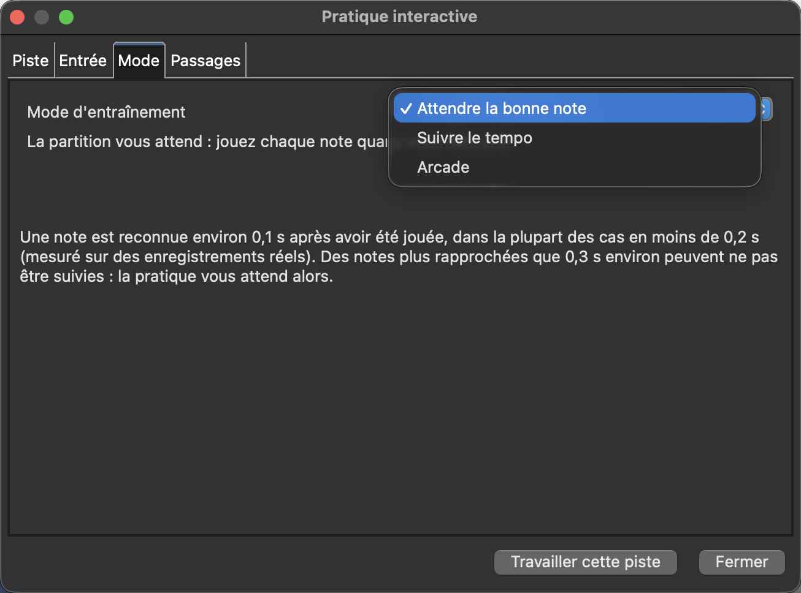

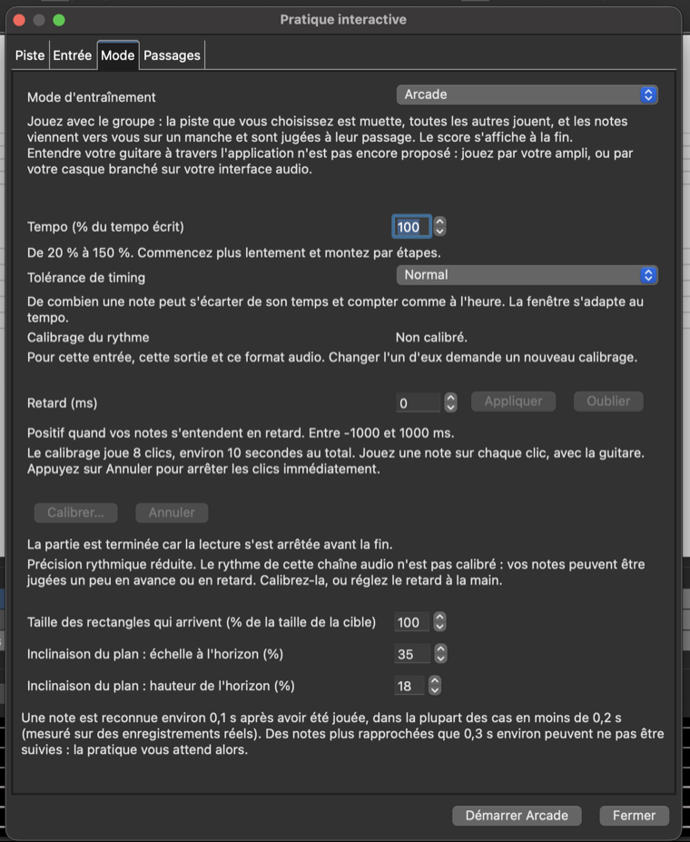

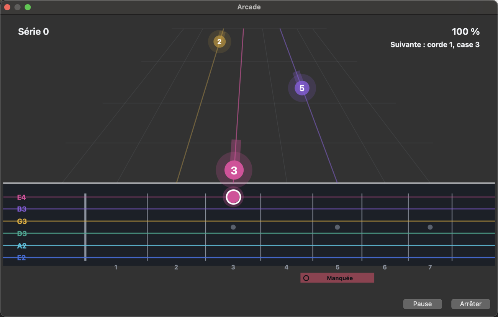

* **Vous voyez une mesure à l'avance** (une seconde au moins), quel que soit le tempo. Une note est un **rectangle arrondi** de la couleur de sa corde ; elle arrive **en ligne droite** depuis l'horizon jusqu'au milieu de sa case au pied du manche, à travers le manche transparent, et a la largeur de la case de sa frette. Au moment de jouer, elle est exactement sur sa cible sur le manche.
* **Les accords** sont un panneau translucide de la première à la dernière case de l'accord, avec un rectangle par note et le nom au-dessus du coin gauche.
* **Les verdicts** (à l'heure, en avance, en retard, faux, incomplet, manqué) apparaissent en badge une fois la note jugée. Le haut de la fenêtre montre votre série, le tempo et la suite.
* **Recommencer, pause, reprise et arrêt** sont dans la fenêtre. *Recommencer* repart du début du morceau (ou du passage) sans quitter le jeu. Pendant le décompte, les notes arrivent du fond pendant que vous entendez les clics ; après une pause, *Reprendre* refait un décompte à partir de l'endroit où vous étiez. Jouer la partition depuis la fenêtre principale arrête la partie.
* **Réglages de l'image** (onglet Mode) : la **taille des rectangles qui arrivent** (0 % à 150 % de la taille de la cible) et l'**inclinaison du plan** (échelle à l'horizon 20 % à 100 %, 35 % par défaut ; hauteur de l'horizon 0 % à 40 %, 18 % par défaut).
* **Flammes de scène** (onglet Mode) : des flammes derrière l'image qui **grandissent quand vous jouez mieux** (leur hauteur suit votre part du score maximum ; des braises tant que quatre événements ne sont pas jugés). **Désactivées**, **Discrètes** (par défaut) ou **Pleines** ; lu au début d'une partie. Décoration seulement : elles ne changent jamais le jugement ni le score, ne couvrent jamais un texte, et restent immobiles quand macOS est réglé sur *Réduire les animations* (macOS seulement dans cette version). Détails dans le [manuel](MANUAL-FR.md#b6-mode-arcade-alpha).
* **Les techniques écrites sur une note seule sont dessinées** sur la note pendant qu'elle arrive puis sur le manche, en jaune : bends (flèche, valeur, rectangle fantôme à la case atteinte), hammer-on et pull-off (arc, H ou P, fantôme sur la note suivante de la corde), slide (rail en pointillés, S), vibrato (onde), palm mute et tapping (pastilles P.M. et T), trémolo (trois traits) ; un harmonique est une barre qui dit *Harmonique ◇*. **Ce qui est vérifié : le timing et la hauteur** (la courbe écrite d'un bend, la note d'arrivée d'un hammer-on, pull-off ou slide). **Aucune technique n'est annoncée détectée ou non détectée** : les détecteurs ne sont pas encore validés (bend 82 %, vibrato 59 %, slide 48 % des notes annotées, 85 % requis ; aucun pour hammer-on et pull-off ; aucun pour palm mute, tapping et trémolo). Détails et images dans le [manuel](MANUAL-FR.md#b6-mode-arcade-alpha).
* À la fin (et aussi quand vous arrêtez le jeu avant la fin), le **résultat** donne le score, la part du maximum, la meilleure série et le décompte de chaque jugement ; vous pouvez **rejouer depuis le début ou depuis une mesure**.
* **Entrées :** le bouton *Actualiser* de l'onglet Entrée relit la liste des entrées audio ; *Mémoriser par défaut* enregistre l'entrée choisie dans la configuration (sélectionnée quand elle est là, et de nouveau quand elle revient après une absence).

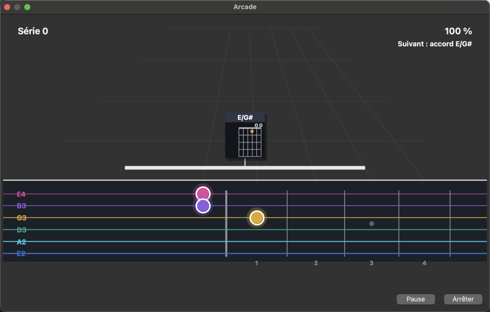

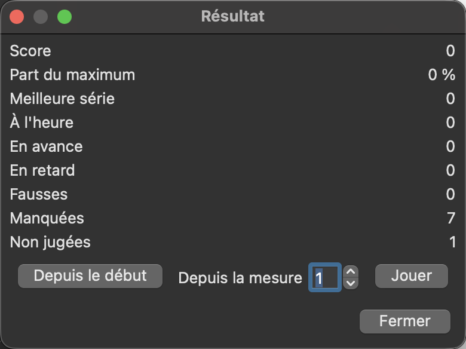

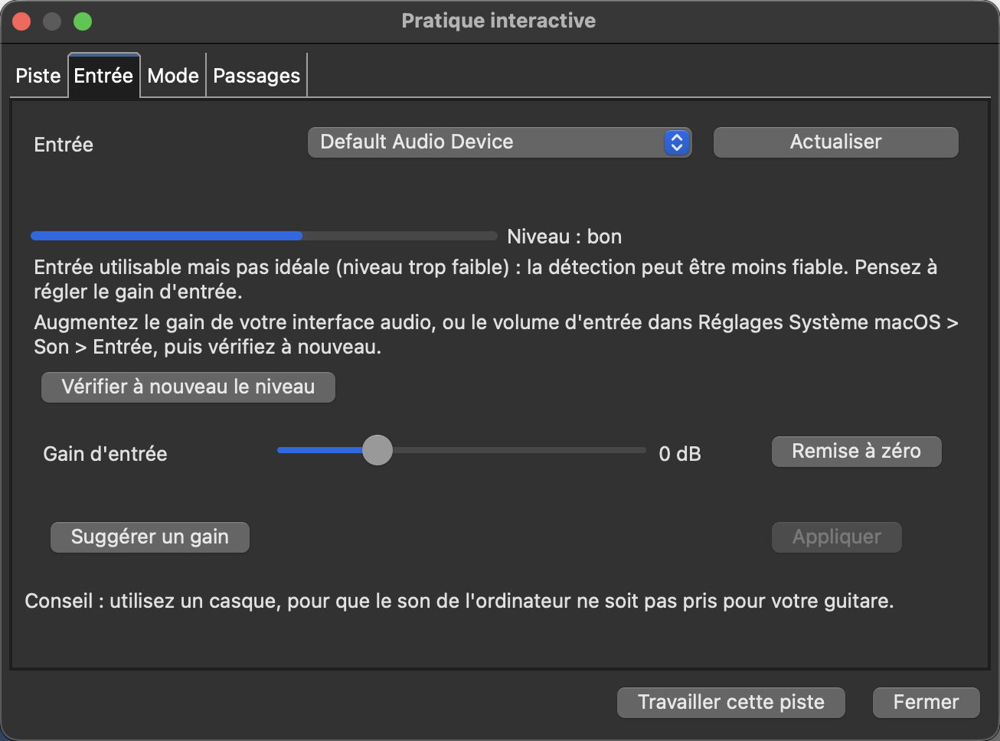

*Captures de l'application.*

### Alpha : ce qui n'est pas encore vérifié

* C'est une **alpha** : le timing de la vue Arcade et du suivi de tempo est validé par des tests automatiques, et l'aspect de la vue par le propriétaire sur un Mac ; il n'a **pas** été validé avec d'autres joueurs, guitares, micros ou machines.
* Sur un test de charge de 10 minutes, la chaîne audio **manque encore environ une échéance d'analyse par minute** (un trou d'ordonnancement du système) ; il n'a pas été montré qu'elle change un jugement, mais l'objectif de moins n'est pas atteint.
* **Basse :** les notes sous le sol 1 (49 Hz) sont affichées mais pas jugées.
* **Entendre sa propre guitare à travers l'application** n'est pas proposé : jouez par votre ampli, ou par un casque branché sur votre interface audio.
* Les notes plus rapprochées que 0,3 s environ peuvent ne pas être suivies ; les techniques (hammer-on, slide, bend...) sont signalées à part et ne changent pas le score.

## Gain d'entrée, réduction du bruit et gain suggéré

Sous la jauge de niveau de la fenêtre de pratique, et dans l'accordeur, un curseur **Gain d'entrée** renforce ou baisse le signal dans l'application (de -6 à +18 dB) ; **Remise à zéro** revient à 0 dB. Le gain n'est jamais mémorisé : il revient à 0 dB quand l'entrée change et à chaque démarrage. Si l'amplification n'amplifie surtout que le bruit de fond, ou fait saturer le signal, un avertissement le dit et conseille d'augmenter plutôt le gain de l'interface audio.

Pendant que vous jouez, si vos notes sont trop faibles pour une reconnaissance rapide fiable (en dessous d'environ -30 dBFS, mesuré), la fenêtre de pratique le dit et vous indique d'augmenter le gain ou de jouer plus près ; un jeu lent peut rester reconnu.

Réglages (*Réglages de reconnaissance* dans la fenêtre de pratique) : un **noise gate / soustraction du bruit de fond** optionnel et un **gain suggéré** après le contrôle de niveau ; les deux peuvent être désactivés.

**La fenêtre de démarrage (avant chaque départ).** À chaque démarrage d'un mode — bouton Démarrer, bouton Pratique de la barre de transport, bouton Arcade coloré — une petite fenêtre demande d'abord *Votre guitare est-elle accordée ?* *Non, ouvrir l'accordeur* ouvre l'accordeur et le mode ne commence pas ; quand vous fermez l'accordeur, la question revient. *Oui, accordée* demande un accord de test : grattez un accord et laissez-le sonner. La fenêtre juge le niveau des 0,3 seconde qui suivent : si plus de 0,5 % des échantillons atteignent le maximum, elle dit que le signal sature (baissez le volume de l'adaptateur ou de la guitare) ; un signal trop fort ou trop faible est aussi nommé, avec la marche à suivre ; un bon niveau lance le mode aussitôt. Un mauvais niveau bloque le départ : *Vérifier à nouveau* juge un nouvel accord, et *Continuer quand même* continue **pour ce départ seulement** (proposé aussi après 10 secondes sans accord). Relancer une partie ou *rejouer* ne redemande pas. La fenêtre ne change jamais le gain de l'interface ni du système. Le seuil de 0,5 % a été calibré sur les enregistrements du propriétaire avec un adaptateur Rocksmith et sur les 180 enregistrements microphone de GuitarSet (aucun n'est signalé) ; les conseils pour Windows et Linux reprennent le texte de macOS et n'y ont pas été essayés.

## Réglages de reconnaissance

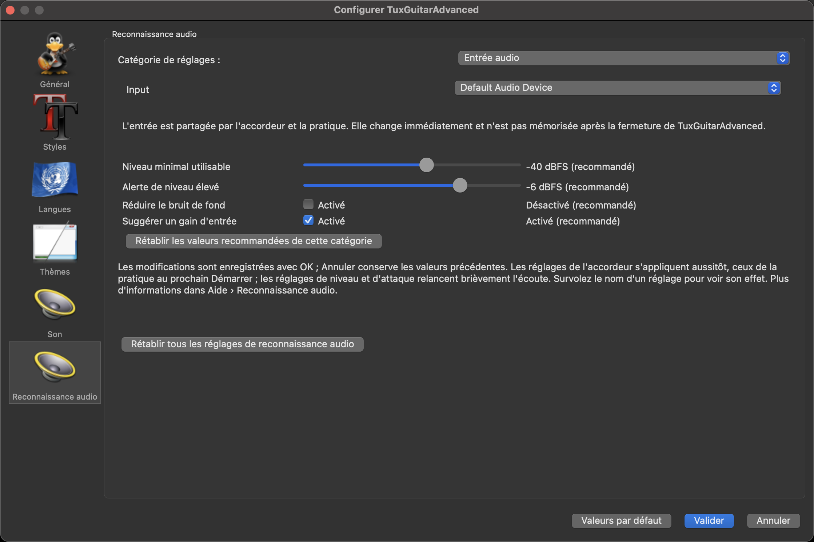

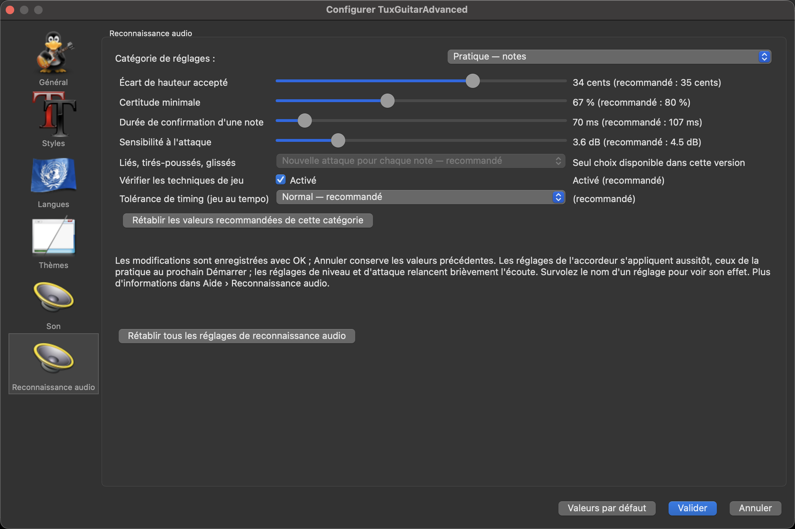


Chaque réglage a une valeur recommandée et un bouton *Restaurer*. Ceux que vous pouvez vouloir changer :

| Réglage | Effet |
|---|---|
| Écart de hauteur accepté | De combien (en cents) une note peut s'écarter de la note écrite et rester correcte. |
| Tolérance « trop haut » par case (Avancé) | Les notes sur le manche sonnent un peu trop haut, davantage vers les aigus : ce réglage ajoute ce nombre de cents par case, du côté trop haut seulement. 0 le désactive. |
| Certitude minimale | À quel point le détecteur doit être sûr avant de juger une note seule. |
| Durée de confirmation d'une note | Combien de temps une note doit sonner avant d'être acceptée. |
| Sensibilité à l'attaque | Quelle hausse soudaine du son compte comme une nouvelle attaque. |
| Réglages des accords | Avec quelle rigueur les notes d'un accord sont vérifiées et combien de temps peut durer un grattage. |

## L'accordeur

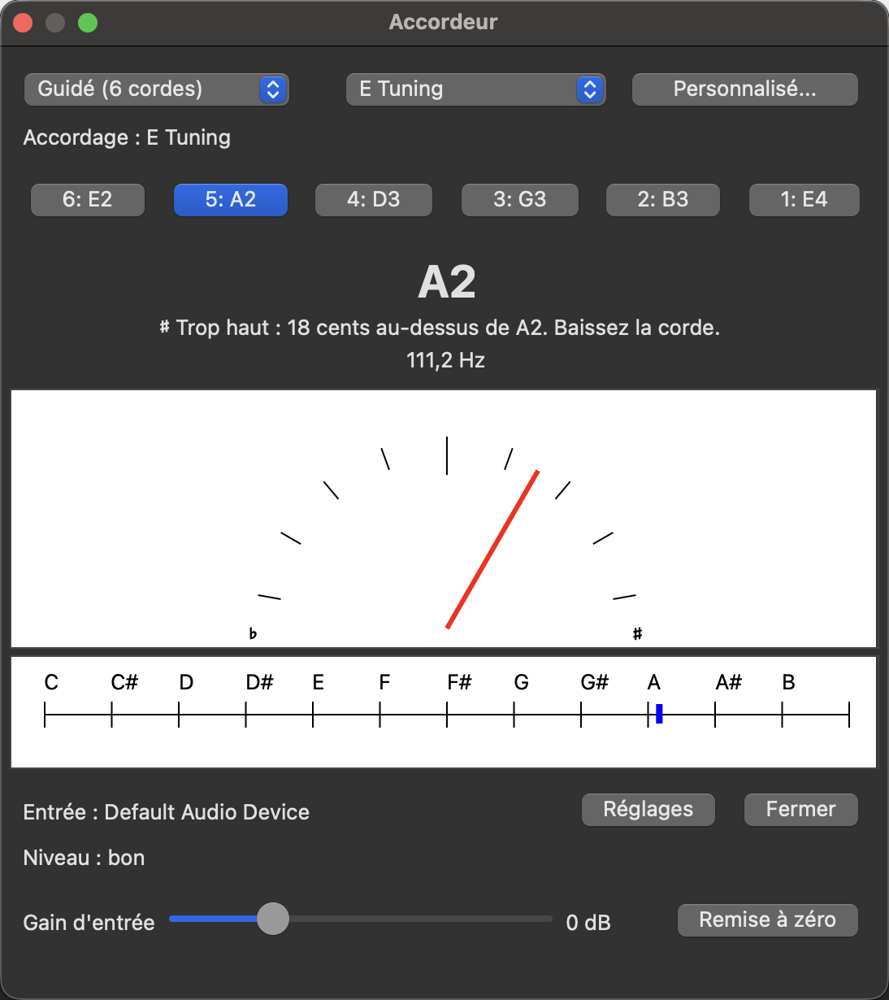


*Outils > Accordeur de guitare* ouvre l'accordeur. Il partage sa détection de hauteur avec le mode pratique.

* **Deux modes** : *Guidé (6 cordes)* vous fait passer par les cordes d'un accordage, *Chromatique* affiche la note la plus proche de ce que vous jouez.
* **Accordage** : un préréglage, *Personnalisé...* (une note par corde) ou l'accordage d'une piste de la partition ouverte (« Accordage de la piste N »).
* **L'aiguille** affiche la **médiane des mesures fiables du dernier quart de seconde** : un parasite ne la bouge pas, un trou court ne la fige pas, une nouvelle note remplace l'ancienne en quelques mesures. Le texte dessous dit quoi faire : « Trop bas : 12 cents en dessous de Mi2. Montez la corde. », « Juste », « Trop haut... ».
* **Une aiguille grise figée** (« Dernière mesure (figée) ») signifie que la corde est silencieuse ou trop faible maintenant : rejouez-la.
* **Entrée** : l'entrée choisie et son niveau (« bon / trop faible / trop fort / saturation »), un bouton **Vérifier à nouveau le niveau**, et le curseur **Gain d'entrée** (-6 à +18 dB) avec son bouton **Remise à zéro**, comme dans la fenêtre de pratique.
* **Pas pendant la pratique** : l'accordeur refuse de s'ouvrir tant que la fenêtre de pratique est ouverte (ils partagent le micro) ; fermez d'abord la fenêtre de pratique.

## Analyse de la partition (mesures invalides)

L'ouverture d'un fichier Guitar Pro ou MIDI ne vous interrompt plus avec une fenêtre sur les mesures dont la durée ne correspond pas à la signature rythmique. Pour voir **tous les problèmes d'un morceau** :

1. *Édition > Afficher les mesures invalides* (ou l'icône de la barre d'outils ) ;
2. la fenêtre liste les mesures et notes liées invalides de chaque piste (piste, mesure, voix, trop longue / trop courte...), avec des filtres, l'état de la mesure courante et un bouton **Réparer** ;
3. elle ne bloque rien : laissez-la ouverte pendant que vous éditez, et rouvrez-la quand vous voulez.

## Trace de diagnostic (comprendre un échec)

Quand une note jouée correctement n'est pas reconnue (ou qu'une fausse l'est), vous pouvez demander à l'application d'écrire ce qu'elle a entendu, **en chiffres uniquement, sans audio** :

1. quittez l'application, puis lancez-la avec la propriété `tuxguitar.practice.trace` qui désigne un fichier, par exemple depuis un terminal sur macOS :
   `open -n --env JAVA_TOOL_OPTIONS="-Dtuxguitar.practice.trace=/tmp/practice-trace.csv" /chemin/vers/TuxGuitarAdvanced.app`
2. jouez le passage dans le mode Practice ;
3. ouvrez le CSV : une ligne par pas d'analyse (temps, événement, notes attendues, hauteur détectée et certitude, niveau, force de l'attaque, amplitude de chaque note attendue et de ses voisines, lignes `ACCEPTED`). Envoyez-le avec la description de ce qui aurait dû se passer.

Le fichier n'est écrit que tant que la propriété est définie.

## Vérifier la qualité vous-même

Un banc d'essai rejoue des enregistrements annotés dans la vraie chaîne de pratique et indique, par type de test, combien réussissent, échouent ou ne sont pas exécutés (et pourquoi). Il lit des enregistrements que vous gardez hors du dépôt (les licences de tels jeux de données interdisent de les redistribuer) :

```sh
cd desktop/build-scripts/tuxguitar-macosx-swt-cocoa
mvn test -pl ../../TuxGuitar-practice -am -Dgroups=dataset -DexcludedGroups= \
  -Dtest=DatasetBenchmarkTest -Dsurefire.failIfNoSpecifiedTests=false \
  -Dtuxguitar.datasets=/chemin/vers/vos/jeux -Dtuxguitar.datasets.sample=70
```

Le rapport est écrit dans `desktop/TuxGuitar-practice/target/dataset-benchmark/report.txt` (synthèse) et `outcomes.csv` (chaque test). Les tests qui ne peuvent pas être exécutés sont comptés avec leur raison (par exemple : une octave ne se distingue pas d'un partiel de la note jouée ; la note est hors de la tessiture d'une guitare à six cordes).

Deux tests de rejeu tournent dans le build normal quand leurs enregistrements sont présents dans `tests/1`, et sont ignorés sinon.

## Qualité mesurée et limites

Sur un banc d'essai de 1 208 enregistrements annotés de vraies guitares (claires et avec 11 effets), 6 178 tests :

* **notes seules reconnues** : 99,8 % (effets) à 100 % (claires) ;
* **note à un demi-ton ou un ton de celle jouée acceptée** : aucune sur plus de 2 700 tests ;
* **intervalles et accords de trois notes avec effets reconnus** : 87 % ; **accords de guitares claires** : 95 % ;
* **accords auxquels il manque une note refusés** : 96 à 98 % ;
* **notes jouées l'une après l'autre, la précédente résonnant encore** : 97 à 100 % reconnues ;
* **délai** entre le jeu d'une note et sa reconnaissance : environ 0,1 s (médiane 105 ms, 90 % en moins de 170 ms) sur un vrai enregistrement ; la fenêtre de préparation de la pratique l'indique.

Sur un **jeu de données indépendant** (GuitarSet, 180 enregistrements d'accompagnement rythmique à la guitare acoustique, 702 accords plaqués dont l'annotation était fiable, les cordes précédentes sonnant encore), le résultat est nettement plus bas :

* **accords complets reconnus** : 60 % (six canaux de micros de chevalet sommés), 46 % au micro ;
* **accords auxquels il manque une note acceptés à tort** : 13 % (29 % quand la note manquante est la basse, 5 % une note intérieure, 3 % la note aiguë) ;
* aucun réglage ne corrige les deux à la fois : un réglage plus strict refuse plus d'accords incomplets et aussi plus d'accords complets (détails et tableau dans les notes de recherche de la spécification, R10).

Limites, mesurées et non cachées :

* **notes rapprochées** : environ 0,3 s entre deux notes jouées au médiator sont suivies (91 % des suites de trois notes à 0,35 s, 67 % à 0,25 s) ; plus vite, seule la première note d'une suite est reconnue et la pratique vous attend, sans jamais compter une note fausse (0 sur 92 tests). La fenêtre de pratique le dit quand cela arrive ;

* les accords dont la note la plus grave est Sol2 sont parfois acceptés un ton plus haut (les deux accords ne sont séparés que d'un pas de fréquence à cette hauteur) ;
* les accords de septième à quatre notes et certains accords ouverts (La majeur, Mi majeur) sont moins souvent reconnus ;
* une octave, ou une note qui est un harmonique d'une note plus grave de l'accord, ne peut pas être vérifiée séparément de celle-ci ;
* les réglages ont été ajustés sur les enregistrements ci-dessus : une autre guitare ou un autre micro peut demander un autre gain ou une autre sensibilité.
