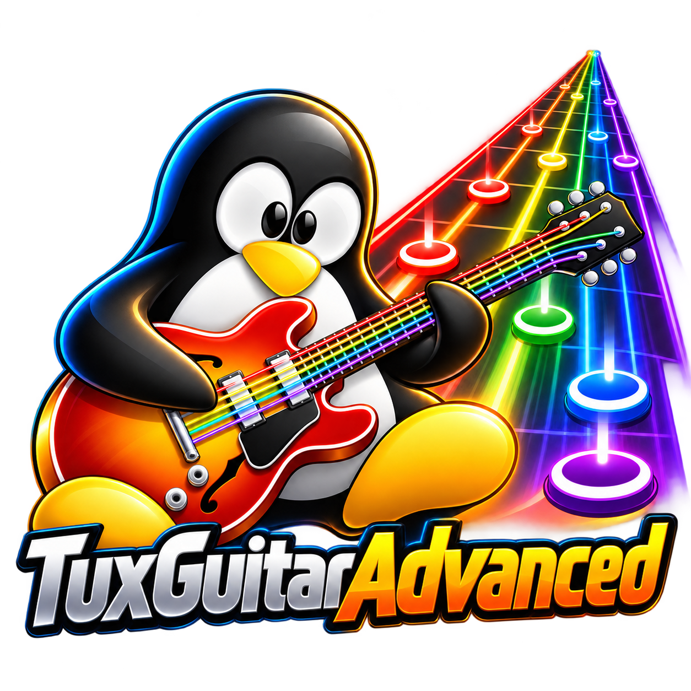

# TuxGuitarAdvanced

El logotipo es un rediseño asistido por IA, elegido por el propietario del producto. Los avisos y la licencia de TuxGuitar original no cambian, y no se reclama la propiedad de marcas de terceros.

*[English](../README.md) · [Français](README-FR.md) · Español*

### 🎸 Tu guitarra es el mando. Tu partitura es el juego.

**Abre una tablatura. Toca las notas que vuelan hacia tu mástil. Te juzgan por la altura *y* el ritmo, en tiempo real, con tu guitarra de verdad.**

TuxGuitarAdvanced es un editor de tablaturas libre y de código abierto que **escucha tu guitarra** (basta un micrófono o una interfaz de audio). Abre cualquier partitura (Guitar Pro, MIDI, TuxGuitar...), elige una pista y toca con el resto de la banda. Sin suscripción, sin catálogo, sin cuenta: **tus canciones, tu guitarra, tu máquina**.

> 🙏 **Construido sobre TuxGuitar, que ya es excelente.** TuxGuitarAdvanced es un **fork de [TuxGuitar](https://www.tuxguitar.app/)**, el gran editor y reproductor de tablaturas multipista libre. Todo lo que hace TuxGuitar sigue ahí, intacto: edición, reproducción, importación y exportación Guitar Pro / MIDI / MusicXML / PDF, muchos idiomas. **Solo añadimos cosas nuevas encima**: los modos de práctica (Esperar, Seguir el tempo, Arcade) y un afinador más estable. El mérito del editor es de los autores y colaboradores de TuxGuitar ([helge17](https://github.com/helge17/tuxguitar) y muchos más); si solo quieres un editor magnífico, [usa TuxGuitar](https://www.tuxguitar.app/), se lo merece. (Algunas capturas están en inglés o francés: la interfaz existe en español, francés e inglés.)

> ⚠️ **Alfa.** Funciona, jugamos con ella, y todavía está algo áspera en algunos puntos. Por eso necesitamos jugadores como tú. [Lo que falta](#dónde-está-el-proyecto) y [cómo ayudar](#únete-a-la-banda-ayúdanos-a-subir-de-nivel).

## Elige tu modo de juego

| | Modo | La idea |
|---|---|---|
| 🎯 | **Esperar la nota correcta** | La partitura **te espera**. La siguiente nota aparece enmarcada; tócala y se enciende una marca verde. Sin presión, ideal para aprender una pieza nueva. |
| 🥁 | **Seguir el tempo** | La banda arranca (cuenta atrás, bajo, batería, todo menos tu pista) y tocas **a tiempo**. Cada nota es *a tiempo, pronto, tarde, errónea o fallada*. Sube el tempo poco a poco del 20 % al 150 %. |
| 🕹️ | **Arcade** (alfa) | La misma banda, pero como **juego**: rectángulos redondeados vuelan desde el horizonte en línea recta, un compás antes, hasta su traste en el mástil, del color de su cuerda; los acordes llegan como un panel y todo aterriza al pie del mástil a la vez, tras una cuenta atrás durante la cual las notas vienen del fondo. Un clic en el botón de color de la barra de transporte lo lanza de inmediato; la ventana de resultado también aparece si paras antes del final. Persigue rachas, lee las insignias de veredicto, supera tu puntuación. |

## También es un editor de verdad (y un afinador de verdad)

Bajo el juego está el editor **TuxGuitar** completo: escribe pistas de guitarra, bajo y batería, tablatura y pentagrama, acordes y efectos, escúchalos, importa y exporta Guitar Pro, MIDI, MusicXML, PDF... El **[ejemplo completo](MANUAL.md#part-c-a-complete-example-step-by-step)** (en inglés y francés) te lleva de una página vacía a una canción de tres pistas y a los tres modos.

## Empezar en dos minutos

1. **Descarga** la última versión en [Releases](https://github.com/krl91/tuxguitaradvanced/releases) (macOS Apple Silicon hoy).
2. Abre una partitura y **Herramientas > Práctica interactiva** (o el botón ♪ junto a Reproducir).
3. Elige tu pista, tu entrada (comprueba el nivel punteando una cuerda) y un modo. **Empieza.**

## Únete a la banda: ayúdanos a subir de nivel

El proyecto es joven y toda ayuda cuenta. No hace falta ser programador:

* 🎸 **Toca y cuéntanos.** Tu guitarra, tu micrófono, tu interfaz, tu máquina: **más guitarras es la mejor prueba**. Abre una [issue](https://github.com/krl91/tuxguitaradvanced/issues).
* 🎚️ **Vence a los jefes.** Temporización más fiable bajo carga, notas de bajo por debajo de sol1, validar hammer-on / slide / vibrato con toque real, paquetes de Linux y Windows.
* 🌍 **Traduce.** Interfaz en inglés, francés y español; más idiomas están a un fichero de texto.
* 🎨 **Embellece.** Arcade usa formas simples: colores, temas, efectos y sonidos están abiertos.
* 🧪 **Escribe una prueba o corrige un error.** Java, Maven, más de 700 pruebas automáticas ([INSTALL.md](../INSTALL.md)). Cada error recibe primero una prueba que lo reproduce.
* 📣 **Comparte.** ¿Conoces a un guitarrista al que le gustaría tocar sus tablaturas como un juego?

## Dónde está el proyecto

Disponible hoy (versión 0.5.0-alpha.6): la práctica nota a nota y acorde a acorde con tu guitarra real (se comprueba la altura), los bends, las liberaciones y los pre-bends seguidos a lo largo de su recorrido escrito, la llegada de un hammer-on, un pull-off o un slide aceptada sin una nueva púa, un afinador estable, la ganancia de entrada y la reducción de ruido. **Nuevo, en alfa:** el **modo de seguimiento del tempo** (la partitura suena a su tempo con las demás pistas de acompañamiento, y cada nota se juzga en el tiempo: pronto, tarde, fallada) y **Arcade**, la misma partida como juego en el que las notas vienen hacia ti sobre un mástil, un compás antes. **Aún no disponible:** un veredicto *oído / no oído* para cada técnica (los detectores aún no están validados con suficientes grabaciones reales, así que la línea de técnica sigue diciendo «aún no se puede comprobar»). La guía de uso enumera lo que está medido y lo que no: [English](PRACTICE.md) · [Français](PRACTICE-FR.md) · [Español](PRACTICE-ES.md).

**Manual de usuario** (edición y creación de partituras, y todo el Practice, con capturas de pantalla; en inglés y francés): [English](MANUAL.md) · [Français](MANUAL-FR.md).

El proyecto es una versión avanzada de [TuxGuitar](https://www.tuxguitar.app/), el editor libre de tablaturas multipista. Consulta el [README principal](../README.md) (en inglés) para las funciones, las mediciones con grabaciones reales y la instalación.
