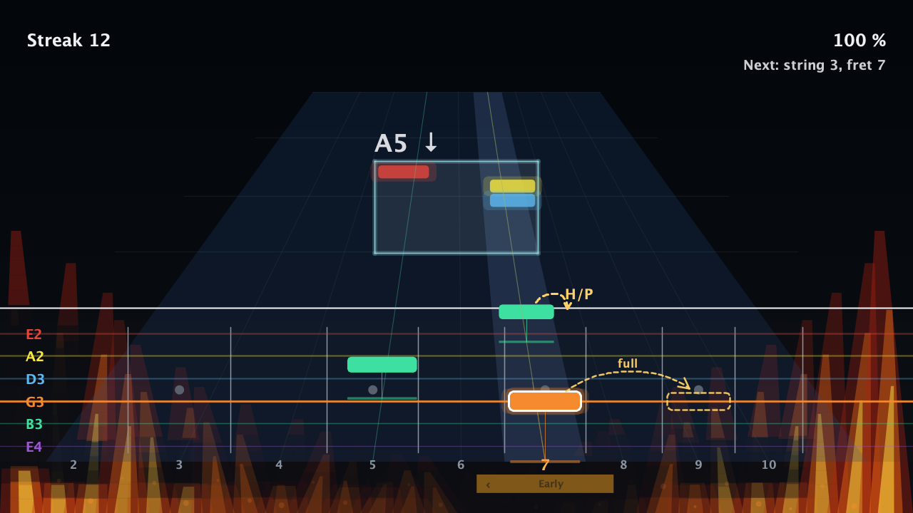
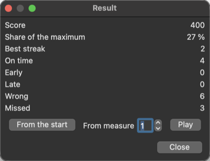

# TuxGuitarAdvanced

Le logo est une refonte assistée par IA, choisie par le propriétaire du produit. Les mentions et la licence de TuxGuitar d'origine sont inchangées, et aucune propriété sur des marques tierces n'est revendiquée.

*[English](../README.md) · Français · [Español](README-ES.md)*

### 🎸 Votre guitare est la manette. Votre partition est le jeu.

**Lancez une tablature. Jouez les notes qui filent vers votre manche. Soyez jugé sur la hauteur *et* le rythme, en temps réel, avec votre vraie guitare.**

<em>Image dessinée par le moteur de rendu d'Arcade de l'application à partir d'une scène de référence (pas une capture d'une fenêtre) : une série de 12 notes à l'heure, les flammes de chaque côté, un hammer-on/pull-off et un bend.</em>

TuxGuitarAdvanced est un éditeur de tablatures libre et open source qui **écoute votre guitare** (un micro ou une interface audio suffit). Ouvrez n'importe quelle partition (Guitar Pro, MIDI, TuxGuitar...), choisissez une piste et jouez avec le reste du groupe. Sans abonnement, sans catalogue, sans compte : **vos morceaux, votre guitare, votre machine**.

> 🙏 **Construit sur TuxGuitar, qui est déjà excellent.** TuxGuitarAdvanced est un **fork de [TuxGuitar](https://www.tuxguitar.app/)**, le très bon éditeur et lecteur de tablatures multipistes libre. Tout ce que fait TuxGuitar est toujours là, intact : édition, lecture, import et export Guitar Pro / MIDI / MusicXML / PDF, de nombreuses langues. **Nous n'ajoutons que du neuf par-dessus** : les modes de pratique (Attendre, Suivre le tempo, Arcade) et un accordeur plus stable. Tout le mérite de l'éditeur revient aux auteurs et contributeurs de TuxGuitar ([helge17](https://github.com/helge17/tuxguitar) et beaucoup d'autres) ; si vous ne voulez qu'un superbe éditeur, [utilisez TuxGuitar](https://www.tuxguitar.app/), il le mérite.

> ⚠️ **À lire avant de vous y fier.** TuxGuitarAdvanced est jeune. Les tests automatiques sont nombreux et les mesures sur enregistrements sont bonnes, **mais la validation en conditions réelles est petite** : elle a surtout été jouée sur le Mac et la guitare de l'auteur, **les paquets Windows et Linux n'ont jamais été lancés par personne**, et très peu de micros et d'interfaces audio ont été essayés. Les modes de pratique sont encore marqués alpha plus bas. Ça marche chez nous et c'est honnêtement encore brut par endroits : c'est précisément pour ça qu'on a besoin de joueurs comme vous, sur **votre** machine et **votre** interface. [Ce qui est validé, et ce qui ne l'est pas](#où-en-est-le-projet) · [comment aider](#rejoignez-le-groupe--aidez-nous-à-monter-de-niveau).

## Choisissez votre mode de jeu

| | Mode | L'idée |
|---|---|---|
| 🎯 | **Attendre la bonne note** | La partition **vous attend**. La prochaine note est encadrée ; jouez-la et une coche verte s'allume. Aucune pression, idéal pour apprendre un nouveau morceau. |
| 🥁 | **Suivre le tempo** | Le groupe démarre (décompte, basse, batterie, tout sauf votre piste) et vous jouez **en rythme**. Chaque note est *à l'heure, en avance, en retard, fausse ou manquée*. Montez le tempo par étapes de 20 % à 150 %. |
| 🕹️ | **Arcade** (alpha) | Le même groupe, mais en **jeu** : des rectangles arrondis filent de l'horizon en ligne droite, une mesure à l'avance, vers leur case sur le manche, de la couleur de leur corde ; les accords arrivent en panneau et tout atterrit au pied du manche au même instant, après un décompte pendant lequel les notes viennent du fond. Un clic sur le bouton coloré de la barre de transport le lance tout de suite ; la fenêtre de résultat s'affiche aussi si vous arrêtez avant la fin. Visez les séries, lisez les badges de verdict, battez votre score. |

*Les accords arrivent en barre avec le diagramme et le nom du prochain accord, pour préparer votre main. (Certaines captures sont en anglais : l'interface existe en français, anglais et espagnol, et d'autres langues peuvent s'ajouter.)*

### Ce que vous gagnez à la fin du morceau

 &nbsp; 

Un score, votre part du maximum, votre **meilleure série** et le décompte de chaque verdict, puis **rejouez** depuis le début ou depuis la mesure qui vous a battu.

## C'est aussi un vrai éditeur (et un vrai accordeur)

Sous le jeu, il y a l'éditeur **TuxGuitar** complet : écrivez des pistes de guitare, basse et batterie, tablature et portée, accords et effets, écoutez-les, importez et exportez Guitar Pro, MIDI, MusicXML, PDF... Vous pouvez construire votre morceau d'entraînement en dix minutes : l'**[exemple complet](MANUAL-FR.md#partie-c--un-exemple-complet-pas-à-pas)** vous mène d'une page vide à un morceau de trois pistes (guitare, basse, batterie), puis aux trois modes.

Et avant de jouer, un **accordeur stable** (l'aiguille ne bouge plus quand vous êtes juste) :

## Démarrer en deux minutes

1. **Téléchargez** la dernière version dans les [Releases](https://github.com/krl91/tuxguitaradvanced/releases) (macOS Apple Silicon aujourd'hui).
2. Ouvrez une partition, puis **Outils > Pratique interactive** (ou le bouton ♪ à côté de Lecture).
3. Choisissez votre piste, votre entrée (vérifiez le niveau en pinçant une corde) et un mode. **C'est parti.**

Jamais écrit de tablature ? Le **[manuel](MANUAL-FR.md)** ([English](MANUAL.md)) dit tout, avec des captures, dont l'exemple pas à pas.

## Rejoignez le groupe : aidez-nous à monter de niveau

Le projet est jeune et chaque aide compte. Pas besoin d'être développeur :

* 🎸 **Jouez et dites-nous.** Votre guitare, votre micro, votre interface, votre machine : la reconnaissance a été réglée sur plus de 1 200 vrais enregistrements, mais **plus de guitares, c'est le meilleur test**. Ouvrez une [issue](https://github.com/krl91/tuxguitaradvanced/issues) avec ce qui s'est passé (la pratique peut écrire une trace de nombres, sans audio, pour nous aider).
* 🎚️ **Battez les boss.** Problèmes ouverts pour lesquels l'aide est bienvenue : timing plus fiable sous charge, notes de basse sous sol1, validation des détecteurs de hammer-on / slide / vibrato sur du vrai jeu, un paquet Linux et un Windows que nous pouvons tester.
* 🌍 **Traduisez.** Interface en anglais, français et espagnol ; d'autres langues sont à un fichier texte près.
* 🎨 **Embellissez.** Arcade est dessiné avec des formes simples : couleurs, thèmes, effets et sons sont grands ouverts.
* 🧪 **Écrivez un test ou corrigez un bug.** Le code est en Java, construit avec Maven, avec plus de 700 tests automatiques ([INSTALL.md](../INSTALL.md)) ; l'architecture est documentée dans [architecture](architecture/README.md). Chaque bug reçoit d'abord un test qui le reproduit.
* 📣 **Partagez.** Un guitariste qui aimerait jouer ses tablatures comme à un jeu ? Envoyez-le ici.

## Où en est le projet

Disponible aujourd'hui (version 0.6.0) : la pratique note par note et accord par accord avec votre vraie guitare (la hauteur est vérifiée), les bends, relâchés et pré-bends suivis le long de leur chemin écrit, l'arrivée d'un hammer-on, d'un pull-off ou d'un slide acceptée sans nouveau coup de médiator, un accordeur stable, le gain d'entrée et la réduction de bruit. **Nouveau, en alpha :** le **mode de suivi du tempo** (la partition joue à son tempo avec les autres pistes en accompagnement, et chaque note est jugée dans le temps : en avance, en retard, manquée) et **Arcade**, la même partie sous forme de jeu où les notes viennent vers vous sur un manche, une mesure à l'avance. **Pas encore disponible :** un verdict *entendu / pas entendu* pour chaque technique (les détecteurs ne sont pas encore validés sur assez d'enregistrements réels, donc la ligne de technique dit toujours « pas encore vérifiable »). Le guide d'utilisation liste ce qui est mesuré et ce qui ne l'est pas : [English](PRACTICE.md) · [Français](PRACTICE-FR.md) · [Español](PRACTICE-ES.md).

**Ce qui est validé, et ce qui ne l'est pas.** Les tests automatiques sont nombreux (plus de 1 500) et la reconnaissance a été mesurée sur de nombreux enregistrements : cela dit comment elle se comporte **sur des sons enregistrés**, pas sur votre installation. En direct, la validation est **petite** : jouée surtout sur le Mac et la guitare de l'auteur (les mesures de la calibration et d'Arcade ont été faites avec le micro intégré de ce Mac) ; **les paquets Windows et Linux n'ont jamais été lancés** (ils sont construits, et la version qu'ils portent est vérifiée) ; très peu d'interfaces audio et de micros essayés ; aucun gain de la calibration n'a encore été mesuré. Le détail en anglais : [README](../README.md#what-is-validated-and-what-is-not). Essayez sur votre machine et dites-nous ce qui s'est passé, en bien ou en mal.

**Manuel d'utilisation** (édition et création de partitions, et tout le Practice, avec des captures d'écran) : [English](MANUAL.md) · [Français](MANUAL-FR.md).

Le projet est une version avancée de [TuxGuitar](https://www.tuxguitar.app/), l'éditeur libre de tablatures multipistes. Voir le [README principal](../README.md) (en anglais) pour les fonctions, les mesures sur enregistrements réels et l'installation.
