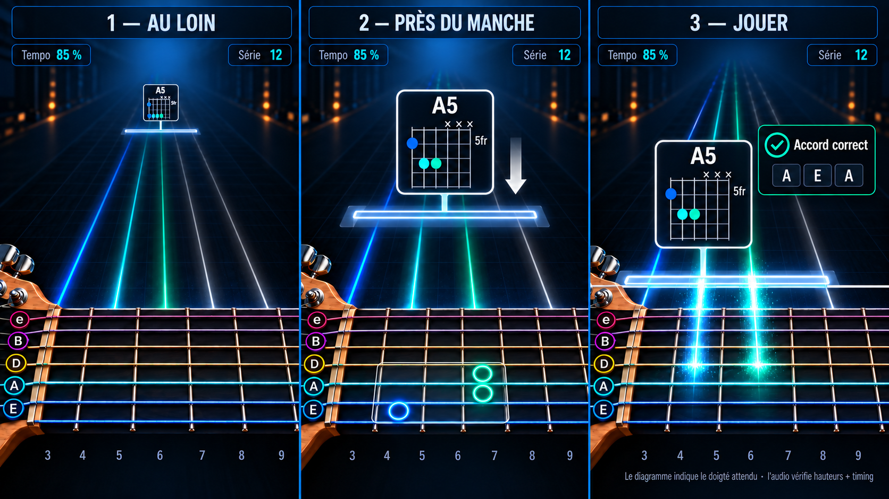

# Feature Specification: Arcade Mode (play along at tempo, with backing band and live guitar sound)

**Feature Branch**: `feature/interactive-practice` (spec dir `003-arcade-mode`)

**Created**: 2026-10-01

**Status**: Draft (clarified 2026-10-08: selected player track, MIDI backing, clear live monitoring with a measured 22 ms maximum; effects deferred)

**Input**: User description: "Mode « Arcade » (variante du mode Practice, inspiré de Rocksmith), distinct de la spec 002 mais qui s'appuie sur son mode de jeu au tempo de la partition (US2b). Le joueur choisit la piste de guitare ou de basse qu'il joue; cette piste est retirée de l'accompagnement et toutes les autres pistes sont jouées en MIDI. Il joue chaque note au bon moment pendant que le morceau avance sans attendre, avec retour immédiat et score de type jeu. Sa guitare est renvoyée en son clair vers la sortie choisie avec une latence réelle qui ne dépasse pas 22 ms. Réverbération et distorsion sont différées à une version suivante et devront respecter la même limite. Aucun audio n'est enregistré."

## Relation to other specifications

- **Builds on** `002-practice-industrialization`, user story 2b (tempo-following practice) and its recognition work. Arcade reuses its judging of notes against the tempo; it does not redefine it. Arcade cannot ship before that mode exists.
- **Adds what earlier specifications excluded**: the MVP (`001`) listed amp simulation, effects and any live audio return as out of scope. They are new requirements here, stated below with their risks.

## Clarifications

### Session 2026-10-01

- Q1: Display → a dedicated incoming-note view is required; soft but visible colours. The initial 2D direction was superseded on 2026-10-07 by the isometric direction below.
- Q2: Scores → shown only at the end of each run, never kept. Recorded as FR-026.

### Session 2026-10-07

- Q3: Visual direction → the approved direction is a 3D isometric view with a recognisable physical neck across the foreground and notes arriving from the distance, perpendicular to the strings. Recorded as FR-025 and user story 6.
- Q4: Instrument geometry → fret spacing, string count, string thickness and position markers must be derived from the selected instrument and physically credible; the generated concept is not a geometry source. Recorded as FR-027.
- Q5: Chords → all notes at the same expected instant form one visibly grouped object while retaining each expected string/fret position. Recorded as FR-028.
- Q6: Camera → the neck pans smoothly left or right using musical look-ahead. Every target fret, including every member of a chord, must already be visible before its note first appears. Recorded as FR-029.
- Q7: String colours → every string has a stable colour, and each approaching note, its lane and its target disk repeat the colour of the string it targets. Colour remains a redundant cue, never the only way to identify a string or verdict. Recorded as FR-025 and FR-028.
- Q8: Chord presentation → an approaching chord is a neutral timing bar with an attached, camera-facing cartouche containing a traditional vertical-string chord diagram. The bar says *when*; the cartouche says *what*. Recorded as FR-028.

### Session 2026-10-08

- Q9: Player/backing split → before starting, the learner explicitly chooses the one track they will play. That track is excluded from MIDI playback for the run; every other playable track remains in the MIDI backing. The song and its saved mute/solo state are not modified. Recorded as FR-002 and FR-010 to FR-014.
- Q10: First live sound and later effects → the first Arcade version provides only a dry, clear return of the selected guitar/bass input. A later version may add reverb, distortion and instrument-dependent recommended presets, but reverb and distortion remain independent optional effects: each can be enabled, disabled and adjusted separately, both can be combined, and a full bypass always restores the dry clear sound. Recorded as FR-030 to FR-037.
- Q11: Latency → 22 ms is a hard maximum for the end-to-end monitoring path from captured input to audible output on a supported configuration, not a warning threshold. If the application cannot establish that the selected path meets it, live monitoring stays off and explains why. Recorded as FR-040 to FR-047 and SC-003.
- Q12: Measurement → planning must define a repeatable measurement that combines timestamp/buffer accounting with a physical loopback validation. A cable loopback is preferred; an acoustic test using the computer microphone/speakers or an independent microphone may be used as an indicative real-world check, with distance and room error documented. Recorded as FR-045 to FR-047.
- Q13: Effects technology → before implementing the later effects version, the team must inventory actively usable free/open-source real-time audio libraries, verify licence and platform compatibility, and benchmark viable candidates inside the actual monitoring path. The selected solution is the one with the best verified live behaviour within the remaining 22 ms budget, not simply the largest feature list. If no library qualifies, no library is adopted and a smaller purpose-built effect or a deferred feature must be considered explicitly. Recorded as FR-038, FR-039 and SC-013.
- Q14: Visual admission → the picture of the approach holds one **admitted visual set** and nothing else: the active event and the events that follow it in onset order, at least four in all and every event due within five seconds when that makes more (never more than eight), notes and chords alike. Every other event is absent from the picture (no preview, dot, bar, lane, label or target). Recorded as FR-062 and supersedes every earlier rule about detailed events, compact previews and a number of visible notes or chords.
- Q15: Fret lanes → every fret cell owns one predefined approach lane that ends at the middle of the cell's upper edge, shared by every string; a single note travels on it; nothing of the approach enters the neck. Recorded as FR-066 and supersedes every earlier rule about per-note trajectories, landing connectors and direct lines to the string target.
- Q16: Neck targets and completed events → only the active event owns targets on the neck (FR-060, FR-065); an event that has its judgement leaves the picture at once but for its verdict badge, which stays for the feedback hold (FR-062). Supersedes the earlier "the cartouche remains visible briefly after impact".

## Approved visual direction

The image fixes the intended composition and visual hierarchy, not literal geometry or final artwork:

- **Top-right HUD**: speed, current streak and the next expected musical event. The numerical score is intentionally absent during play and appears only in the end-of-run result.
- **Upper and middle depth field**: the events of the admitted visual set (the active event and the events that follow it, FR-062) start small in the distance and approach the player along the depth axis, perpendicular to the strings. Distance represents time-to-play. From its first visible frame, each note and its lane use the stable colour of its destination string. No other event is drawn.
- **Lower foreground**: the selected track's real neck model, with its strings and frets. A guitar normally shows six strings and a standard bass normally four, but the actual track definition is authoritative. Every string has a distinct, restrained tint repeated by its label, incoming notes and the target disks.
- **Impact line**: the thin luminous line immediately before the neck is the top edge of the neck, where the lanes end, and the fixed musical instant at which an event is expected. A single note reaches it, at the middle of the top edge of its cell, exactly at its onset (FR-066).
- **Predefined fret lanes**: every visible fret cell owns one stable approach lane. Its endpoint is the midpoint of the cell's upper edge, computed from the two fret wires actually painted. Every single note written on that fret uses that lane regardless of string; the marker colour identifies the destination string. Approach lines stop at the upper edge and never cross the neck. The lanes of all visible cells are also drawn faintly as depth cues that belong to no event; only the lane of an admitted note is drawn in its string colour.
- **Target**: the active event alone resolves, on the neck, to its exact expected string/fret intersection from the tablature (FR-060, FR-065). That position is an instruction; audio feedback still claims to verify only pitch and timing.
- **Feedback**: when an event has its judgement it leaves the picture but for its verdict badge (symbol and word, never colour alone), which stays near the impact point for the feedback hold.

### Approved chord presentation

- **At a distance**: a neutral timing bar and its attached chord cartouche approach as one unit once the chord is in the admitted visual set. The learner can distinguish a chord from a single note immediately.
- **Near the neck**: the cartouche grows to a readable size but remains facing the camera. It uses the traditional chord-diagram orientation: strings vertical, frets horizontal, open/muted indications above, position number at the side and one dot per written position. While the chord is the active event, one target disk per written position appears on the real neck (FR-060).
- **At impact**: the leading edge of the timing bar reaches the fixed hit line at the written onset. The cartouche stays until the chord has its judgement; then only the chord-level verdict badge remains, for the feedback hold. The renderer never claims that audio verified the displayed physical fingering.
- **Separation of meaning**: the neutral bar encodes only time; the cartouche encodes chord name and expected tablature positions; per-string colours remain supplementary location cues; the verdict badge encodes recognition.

The source-to-visual mapping, animation states, fallback rules and required tests are normative in [visual-design.md](visual-design.md). It exists so an implementation agent can reproduce the approved visuals from TuxGuitar's real score and practice models without guessing APIs or musical semantics.

The concept image contains generative approximations. Implementations MUST NOT trace its fret widths, dot count or dot positions. Model-space fret position for fret `n` MUST follow twelve-tone equal temperament for the instrument scale length `L`: `x(n) = L * (1 - 2^(-n/12))`; therefore fret 12 lies at half the scale length. The renderer then projects those model positions into the isometric camera. Position inlays are conventional rather than universal: the default visual model may use single markers at 3, 5, 7, 9, 15, 17, 19 and 21 and double markers at 12 and 24, but an explicit instrument model or theme may override them. The neck width, radius, string spacing and string gauges must remain visually plausible.

Implementation should compare its proportions with a real instrument rather than the generated pixels. Useful manufacturer references include a [22-fret, 25.5-inch-scale Fender neck with documented fingerboard and inlays](https://de.fender.com/en/products/richie-kotzen-telecaster) and Fender's explanation that the [12th fret is half the scale length](https://www.fender.com/articles/maintenance/intonation-101).

## User Scenarios & Testing *(mandatory)*

### User Story 1 - Play along with the band (Priority: P1)

A learner opens a song, explicitly chooses the guitar or bass track they will perform, and plays along: the score advances at the tempo, every other playable track (drums, bass, rhythm guitar...) is rendered by the MIDI player, the learner's chosen track is excluded from playback, and each note they play is judged as it passes. There is no waiting for the learner.

**Why this priority**: it is the point of the mode: the feeling of playing in a band, which wait-for-the-note practice cannot give.

**Independent Test**: with a song of several tracks, start Arcade on one track: the other tracks play, the chosen one is silent, a count-in leads in, the score advances without stopping, and notes played in time are judged while wrong or missed ones do not stop the song.

**Acceptance Scenarios**:

1. **Given** a song with several tracks, **When** the learner selects a guitar or bass track and starts Arcade, **Then** a count-in is heard, then all other playable tracks form the MIDI backing at the song's tempo while the selected track is excluded from MIDI playback.
2. **Given** Arcade running, **When** the learner misses or plays a wrong note, **Then** the song continues and the following notes are judged normally.
3. **Given** a song with tempo changes and repeats, **When** Arcade runs, **Then** the judging follows the same order and tempo as the playback.
4. **Given** Arcade, **When** the learner sets a speed below 100%, **Then** backing and judging both slow down together.
5. **Given** the learner presses Play, Stop or opens the tuner while Arcade runs, **Then** Arcade reacts predictably and says what happened.
6. **Given** the chosen track is silent in Arcade, **When** the learner leaves Arcade, **Then** the song's own mute and solo settings are exactly as they were before.

---

### User Story 2 - Game-style score and immediate feedback (Priority: P1)

As notes pass, the learner sees at once whether each was right (on time, early, late, wrong, missed) and their streak of consecutive good notes; at the end a result screen shows the score and summarises accuracy, timing and the best streak.

**Why this priority**: the game feel is what makes repeated playing rewarding, and the feedback is what makes it useful.

**Independent Test**: play a known passage with deliberate early, late, wrong and missed notes and confirm that every judgement, the score, the streak and the final summary match.

**Acceptance Scenarios**:

1. **Given** a note played at the right pitch and moment, **When** it is judged, **Then** it scores the most and extends the streak.
2. **Given** an early, late or wrong note, **When** it is judged, **Then** it scores less or nothing, and the learner is told which (early / late / wrong / missed).
3. **Given** a streak, **When** a note is missed or wrong, **Then** the streak restarts at zero.
4. **Given** the end of the song, **When** Arcade completes, **Then** a result shows the score, the share of notes on time, early, late, wrong and missed, and the best streak.
5. **Given** a judgement is uncertain (low confidence input), **When** it is shown, **Then** it is presented as uncertain, never as a definite error.
6. **Given** what audio can establish, **When** feedback is shown, **Then** only pitch and timing are claimed as verified (string and fret never are).

---

### User Story 3 - Hear my own guitar with a clear, low-latency return (Priority: P1)

The learner hears their guitar or bass in real time through their chosen headphones, speakers or audio interface. The first version returns the input dry and clear, without reverb, echo, distortion, amp simulation or other tone processing. They can switch monitoring off and adjust its volume and balance against the MIDI backing.

**Why this priority**: playing along without hearing oneself is uncomfortable, while a delayed return makes accurate timing harder. A transparent, bounded-latency path is the safe foundation for later effects.

**Independent Test**: with a guitar connected, enable monitoring, verify that the returned signal is dry and clear, measure its end-to-end delay, adjust its volume and balance, and confirm that switching it off silences only the monitored instrument.

**Acceptance Scenarios**:

1. **Given** a connected guitar or bass and a validated output path, **When** the learner enables monitoring, **Then** they hear the selected input through that output as a dry, clear signal.
2. **Given** the initial Arcade version, **When** the learner opens monitoring controls, **Then** it does not offer reverb, echo, distortion or instrument-dependent effects as if they were already supported.
3. **Given** monitoring is enabled, **When** the learner changes its volume or balance with the MIDI backing, **Then** the change is heard promptly without interrupting playback or judging.
4. **Given** monitoring is off, **When** the learner plays, **Then** recognition and Arcade judging still operate normally and no input audio is sent to the output.
5. **Given** any monitoring setting, **When** notes are judged, **Then** analysis uses the original captured samples, independently of monitoring gain or future effects.
6. **Given** the selected input/output path cannot be demonstrated at or below 22 ms, **When** the learner tries to enable monitoring, **Then** it remains off and the application explains how to choose a lower-latency path.

---

### User Story 4 - Choose the output and know the delay (Priority: P2)

The learner chooses where the sound goes (headphones, speakers, an interface), sees the measured delay of the live return on their setup, and is warned of the risk of feedback when a microphone and speakers are used together.

**Why this priority**: a live return that lags or howls makes the mode unplayable; the learner must be told, honestly.

**Independent Test**: choose different outputs and inputs; confirm the delay shown comes from a measurement, that a microphone with speakers triggers the feedback warning, and that headphones or a direct input do not.

**Acceptance Scenarios**:

1. **Given** several output devices, **When** the learner picks one, **Then** the live return and the backing use it (or the learner is told why they cannot).
2. **Given** the live return, **When** it is on, **Then** the measured total delay on this setup is shown, not an assumed figure.
3. **Given** the measured or conservatively bounded delay exceeds 22 ms, **When** monitoring is requested, **Then** the learner is told and offered lower-latency input/output choices, and software monitoring remains disabled.
4. **Given** a built-in microphone with the computer speakers as output, **When** the live return is enabled, **Then** a feedback warning recommends headphones, and the return starts at a low volume.
5. **Given** the chosen output disappears (unplugged), **When** it happens during Arcade, **Then** Arcade degrades with a clear message and does not crash or hang.

---

### User Story 5 - Start Arcade easily and retry a section (Priority: P3)

The learner starts Arcade from the practice entry points (transport-bar button and Tools menu), picks the track, speed, monitoring state and audio balance, can pause, and can replay a difficult section.

**Why this priority**: convenience on top of a working mode.

**Independent Test**: start Arcade from both entry points, pause and resume, and replay a chosen section at a lower speed.

**Acceptance Scenarios**:

1. **Given** the Practice entry points of spec 002, **When** the learner opens them, **Then** Arcade is offered as a mode, with the choice remembered only for the session.
2. **Given** Arcade running, **When** the learner pauses, **Then** backing and judging both pause and resume together.
3. **Given** a finished run, **When** the learner chooses to replay a section, **Then** it restarts from that section with the same settings.

---

### User Story 6 - See notes approach a real neck in an isometric view (Priority: P1)

A 3D isometric view shows the physical neck of the selected track across the foreground. The next few notes and chords (the admitted visual set, FR-062) come from far away toward the top edge of the neck, perpendicular to the strings, so the learner sees what to play next, where the tablature places it, and when. The neck pans smoothly with look-ahead whenever upcoming events require other frets. It replaces reading the moving cursor in the score during Arcade.

**Why this priority**: seeing the next notes is what makes playing in time possible without stopping to read the score.

**Independent Test**: start Arcade on a song containing single notes, chords and large fret jumps: the admitted notes approach the neck on their fret lanes at the tempo, every target fret is visible before its event appears, the neck pans smoothly without jumping, chords remain grouped, and an event that is judged leaves the picture but for its verdict badge.

**Acceptance Scenarios**:

1. **Given** Arcade running, **When** notes approach from the distance, **Then** each single note remains centred on the predefined lane of its written fret and reaches the midpoint of that fret cell's upper edge exactly at the moment to play.
2. **Given** a note to play, **When** it is displayed, **Then** it resolves to its expected string/fret intersection on the visible neck (as the tablature's instruction, never claimed as verified).
3. **Given** a chord, **When** it approaches, **Then** a neutral timing bar carries an attached traditional chord-diagram cartouche as one event; the bar reaches the hit line at the written onset, the diagram shows the score's expected positions, and complete, incomplete, uncertain and strum-again verdicts remain distinguishable at chord level.
4. **Given** a judged note, **When** the verdict is known, **Then** its marker leaves the picture at once and its verdict badge (on time, early, late, wrong, missed) appears near the impact point, with a symbol and a word as well as a colour, so colour is never the only signal.
5. **Given** the application's light or dark look, **When** Arcade is shown, **Then** the colours stay soft but visible in both, with enough contrast to be read comfortably.
6. **Given** a window resize or a dense passage, **When** the view is drawn, **Then** it stays legible and does not slow the judging or the playback.
7. **Given** the streak and speed, **When** Arcade runs, **Then** they are shown on the same view without hiding incoming notes; the numerical score is reserved for the result screen.
8. **Given** a standard guitar, bass or another supported track definition, **When** its neck is drawn, **Then** the string count comes from the track, frets get progressively narrower according to its scale length, string gauges remain plausible, and position markers follow the selected instrument visual model.
9. **Given** that an upcoming note or chord targets a fret outside the current view, **When** it enters the look-ahead horizon, **Then** the neck begins a smooth horizontal pan early enough that every required fret is visible with a safety margin before the event is spawned into the visible approach field.
10. **Given** successive events that alternate between distant fret regions, **When** the camera follows them, **Then** it does not teleport, oscillate between targets or hide the current event; it pans continuously and may zoom out within readable bounds when that is necessary to keep the current and look-ahead targets visible.
11. **Given** a note or one member of a chord, **When** it is visible from the distance through impact, **Then** its marker, lane and target disk use exactly the stable colour of its destination string; its position, string label and geometry still identify the destination with all colours removed.
12. **Given** several future events in the look-ahead, **When** the learner looks at the physical neck, **Then** the neck carries targets for the active event only: one disk for a note, all and only the disks of its simultaneous positions for a chord. No position belonging to a later event is projected onto the neck until it becomes the active event, and the replacement is atomic.
13. **Given** an approaching chord, **When** its timing bar/cartouche enters the visible approach field, **Then** it clearly shows the exact name written in the score, or—when no usable name is written—a deterministic conventional name derived from the chord's written pitches and bass note. A pitched chord event never displays only the generic word “Chord”/“Accord”.
14. **Given** a very fast or dense passage, **When** many future events fall inside the look-ahead horizon, **Then** only the admitted visual set is drawn: the active event and the events that follow it in onset order, at least four in all and every event due within five seconds when that makes more (never more than eight), notes and chords alike (the set is narrowed from its far end when essential labels would touch, never below the active event). Every other event is absent from the picture, with no preview, dot, halo, bar, lane or label, and nothing in the picture resembles a cloud, snake or constellation of dots. Absent events remain present and unchanged in judging, timing and MIDI playback, and enter the picture, in order, when an earlier event is completed.
15. **Given** several chords in the admitted visual set, **When** Arcade draws them, **Then** only the nearest of them that can be read has a full diagram/cartouche, centred on its timing bar and completely inside the viewport; the other admitted chords are timing bar without diagrams centred on the same axis and ordered by depth. Chords outside the set are absent. Diagrams never appear scattered at unrelated horizontal fret positions, and promotion follows onset order.
16. **Given** the owner's recursive GP3/GP4 collection, **When** Arcade rendering is validated, **Then** the validation uses a deterministic, diverse panel of real score tracks—not only synthetic stress scores—including sparse notes, mixed notes/chords, chord-heavy passages, fast passages, repeated chords, large fret jumps, bass/alternate string counts and multi-track/repeat/tempo-change songs.
17. **Given** the active event, **When** its target is projected onto the physical neck, **Then** every required string/fret position is shown as a large, fully opaque, filled disk in that string's colour, with a contrasting outline. The target never relies on a faint translucent ring; no other event draws a disk on the neck.
18. **Given** an admitted single note for fret `n`, **When** it travels from the horizon to the neck, **Then** it selects the one predefined lane for fret `n`, remains centred on that lane at every frame and reaches the midpoint of the upper edge of cell `n` at onset. Notes on different strings but the same fret use the same lane and differ by their stable string colour. The approach primitive stops at the top edge of the neck; no per-note line or connector crosses the neck to the string target.

---

### Edge Cases

- A very dense passage or a very high tempo where notes are too close to be drawn apart on the view.
- A track with more than six strings, fewer strings, or an unusual tuning, requiring a different neck model without changing the approach or judgement semantics.
- A rapid jump between distant fret regions, or a chord spanning a wide fret range, requiring anticipatory pan and possibly bounded zoom without ever spawning an event whose target is off-screen.
- A song with only one track (nothing to hear but the metronome and the learner's own notes).
- The chosen track is also the only one with notes in a section; backing silent there.
- Input too quiet or noisy for reliable judging: judgements become "uncertain" and the learner is told.
- Very fast passages beyond what recognition can follow: notes are flagged as not reliably judged, not wrongly scored.
- Tempo changes, repeats and alternate endings during a run.
- The input or output device changes or disappears during a run.
- Output sample rate differing from the input's; a long-running session drifting out of step between backing and judging.
- The learner plays a technique (bend, slide...) that the recognition of spec 002 judges differently from a plain note.
- Feedback (howl) from a microphone picking up the speakers during the live return.
- Two applications using the audio device; the audio device busy or refused.
- The learner listens without headphones, so the backing is picked up by the microphone and judged as guitar.

## Requirements *(mandatory)*

### Functional Requirements

**The mode**

- **FR-001**: The application MUST offer an Arcade mode next to the existing practice modes, reachable from the same entry points, named "Arcade" in English and French (name to be confirmed by the owner).
- **FR-002**: Arcade MUST start only when the input is suitable and the learner has explicitly chosen the one guitar or bass track they will perform, like the tempo-following mode it builds on.
- **FR-003**: Arcade MUST give a count-in, then advance at the song's tempo scaled by the chosen speed, without ever waiting for the learner.
- **FR-004**: The playback MUST follow the same order, repeats and tempo changes as the judging.

**Backing**

- **FR-010**: The learner's chosen track MUST be excluded from MIDI playback for the run, and every other playable track MUST be rendered by the normal MIDI player in the song's order, tempo, repeats and mix.
- **FR-011**: The temporary playback exclusion applied for Arcade MUST NOT change the song or its saved mute/solo settings, and MUST be undone when Arcade ends.
- **FR-012**: The learner MUST be able to adjust the balance between the backing and their live guitar.
- **FR-013**: The backing MUST NOT be judged as the learner's playing (the learner is advised to use headphones, and the application MUST say so when the input could pick up the speakers).
- **FR-014**: If the song contains only the chosen track, Arcade MUST continue with count-in/metronome and live monitoring as configured; it MUST NOT re-enable the chosen track merely to avoid silent backing.

**Score and feedback**

- **FR-020**: Each expected event MUST be judged as on time, early, late, wrong or missed, using the timing tolerance of the tempo-following mode, and feedback MUST appear immediately.
- **FR-021**: The application MUST keep the score in memory during the run, keep and show a streak of consecutive good notes during play, and reserve the numerical score for the end-of-run result as required by FR-026.
- **FR-022**: The scoring rules (points per judgement, how the streak affects the score) MUST be documented and identical from one run to the next for the same play.
- **FR-023**: At the end of a run the application MUST show a result: score, counts per judgement, and best streak.
- **FR-024**: Uncertain judgements MUST be presented as uncertain, and pitch and timing are the only properties claimed as verified.
- **FR-025**: Arcade MUST show the approved 3D isometric incoming-note view (superseding the initial 2D decision on 2026-10-07): a recognisable instrument neck across the foreground; events arriving from the distance perpendicular to its strings; a fixed hit line; and expected string/fret targets taken from the tablature. Each string MUST have one stable, distinct colour repeated exactly by every note, lane and target disk assigned to it from first appearance until its judgement. String labels, position and geometry MUST remain sufficient without colour. Chords MUST be grouped, and streak and speed MUST remain visible without hiding events. Colours MUST be soft but clearly visible in light and dark looks, and colour MUST never be the only string or verdict signal.
- **FR-026**: Scores MUST be shown only in the result at the end of each run (decided 2026-10-01); nothing about scores is kept after the application closes, and no history or personal best is stored.
- **FR-027**: The neck model MUST derive its string count from the chosen track and its fret positions from the instrument scale length using twelve-tone equal-tempered spacing. Default marker placement MUST follow a documented real-instrument convention, including a double marker at the octave where that convention applies; generated concept-art geometry MUST NOT be used as reference data.
- **FR-028**: Notes expected at the same musical instant MUST be rendered as one chord event: a neutral timing bar perpendicular to the approach direction, with a traditional chord-diagram cartouche attached to and moving with it. The bar MUST encode only the written onset; the cartouche MUST remain camera-facing and encode the score's chord name when present plus expected string/fret positions, with strings vertical and frets horizontal. It MUST remain legible for as long as the chord is in the admitted visual set (FR-062), show written stroke direction when present, and allow waiting, correct, incomplete, uncertain and strum-again feedback at chord level, the verdict then remaining as a badge once the chord is completed. Per-string colours MAY repeat inside the diagram and the target disks, but audio MUST NOT be presented as verification of physical fingering. A chord has no flying markers of its own: only its bar, its cartouche and, while it is the active event, its target disks.
- **FR-029**: The visible fret range MUST be driven by a deterministic musical look-ahead window. The neck MUST pan left or right with continuous, smooth animation and MAY use bounded zoom to include a wide span. Every target fret for every visible note or chord MUST already be visible with a margin before that event first appears; camera motion MUST never change musical timing or block playback/judging.

**Live guitar/bass return**

- **FR-030**: The initial version MUST offer an optional dry, clear live return of the selected guitar or bass input to the selected output, with no reverb, echo, distortion, amp simulation or other tone effect.
- **FR-031**: The live return MUST be switchable off, have its own volume and backing balance, and leave recognition and Arcade judging unchanged when off.
- **FR-032**: Reverb, distortion and instrument-dependent tone presets MUST be deferred to a later specification/version. Any future effect MUST be deterministic, act only on the monitoring branch and preserve the same end-to-end 22 ms maximum.
- **FR-033**: Judging and every analysis MUST always use the original unprocessed captured samples; monitoring gain and future effects MUST apply only to what is heard.
- **FR-034**: The live return MUST NOT record, store or transmit audio.
- **FR-035**: The live return MUST NOT degrade playback or user-interface responsiveness.
- **FR-036**: Monitoring and MIDI backing MUST share a stable output timeline. Starting, pausing, resuming, seeking or stopping Arcade MUST not leave a stale monitoring route, duplicate the input or desynchronise the backing.
- **FR-037**: When effects are introduced in the later version, reverb and distortion MUST each have an independent on/off control and independently adjustable parameters with documented safe ranges, recommended defaults and a one-action reset. The learner MUST be able to use either effect alone, combine both, bypass either one, or bypass the complete effect chain to recover the dry clear sound. Changing, bypassing or resetting an effect MUST be click-free, MUST NOT interrupt MIDI backing or judging, and MUST NOT cause the monitoring path to exceed 22 ms.
- **FR-038**: Before choosing an effects implementation, research MUST identify viable free/open-source libraries and compare at least licence compatibility, maintenance status, macOS/Windows/Linux support, Java/native integration cost, real-time safety, deterministic output, supported sample rates/channels, buffer constraints, added latency, CPU load, steady-state allocations and the availability/quality of adjustable reverb and distortion. Claims MUST cite the inspected source, official documentation and measured library version.
- **FR-039**: Every viable candidate MUST be benchmarked through the same representative monitoring harness at the same sample rates and buffer sizes in five states: dry bypass, distortion only, reverb only, both effects and live parameter changes. The report MUST include processing-time median/95th percentile/maximum, deadline misses, dropouts, CPU, allocations/garbage-collection activity and complete physical-loopback latency. Selection MUST reserve enough input/output latency headroom so the complete path remains at or below 22 ms under the worst supported effects state. A candidate that cannot meet the deadline, has an incompatible licence or performs blocking/unbounded work on the audio thread MUST be rejected regardless of sound quality.

**Latency, output, safety**

- **FR-040**: For the selected input/output configuration, the application MUST measure or conservatively bound the end-to-end software-monitoring delay from captured input to audible output and display the result and method; it MUST NOT present nominal buffer size or an unverified estimate as a measured physical latency.
- **FR-041**: Live software monitoring MUST NOT be enabled unless the validated end-to-end delay is at most 22 ms. A result above 22 ms, an unstable result whose upper bound exceeds 22 ms, or an inability to establish the bound MUST keep monitoring off and explain how to improve the path.
- **FR-042**: The learner MUST be able to choose the output device for the live return and the backing.
- **FR-043**: The application MUST warn of feedback when a microphone input is combined with a speaker output, and start the live return at a low volume in that case.
- **FR-044**: A lost, refused or busy audio device MUST degrade gracefully with a clear message, never crash or hang.
- **FR-045**: Planning MUST define a reproducible latency protocol with at least (a) deterministic accounting from capture timestamps, processing time and queued output buffers and (b) an external end-to-end loopback measurement based on correlated impulses or transients.
- **FR-046**: A wired electrical loopback from output to an independent input SHOULD be the reference measurement when suitable hardware is available. An acoustic test using the built-in microphone/speakers or an independent microphone MAY validate a real setup, but its report MUST state microphone/speaker distance, subtract or bound acoustic propagation time, repeat enough trials to report median, 95th percentile and maximum, and identify room-reflection uncertainty.
- **FR-047**: The 22 ms gate MUST use the worst credible value for the validated configuration, including buffer scheduling and observed jitter; passing on an average while repeated trials exceed 22 ms is forbidden. Automated timing tests MAY validate software budgets, but only a physical loopback can validate the complete input-to-audible-output claim.

**Quality**

- **FR-050**: All new texts MUST exist in English and French.
- **FR-051**: New logic MUST have automatic tests using synthetic and real sound examples, and the user interface MUST have GUI tests, as required for spec 002.
- **FR-052**: Existing behaviour of the editor, the player and the other practice modes MUST NOT change.
- **FR-053**: When resources are constrained, Arcade MUST preserve this strict priority order: uninterrupted input/output audio and unchanged judging; stable gameplay timing and animation; legibility of the events of the admitted visual set (FR-062); decorative visual quality. A richer image MUST never be preferred to a reliable musical run.
- **FR-054**: Arcade MUST be able to reduce visual cost during a run without changing musical time, camera anticipation or judgement. The reduction order MUST be deterministic: remove decorative glow, trails, shadows and similar effects first; then reduce antialiasing and internal render resolution or geometric detail. It MUST never remove or delay the hit line, the events of the admitted visual set, the string/fret target of the active event, chord timing/cartouche, essential HUD, accessibility cues or verdicts, and it MUST NOT change which events belong to the admitted visual set.
- **FR-055**: A late render MUST be discarded in favour of the newest clock-derived scene; frames MUST NOT accumulate in a queue. Visual degradation or a skipped frame MUST NOT move an event's written impact time or make the next event appear late.
- **FR-056**: Scene construction, painting, asset preparation and quality adaptation MUST remain isolated from capture, recognition, judging, MIDI playback and live monitoring. Rendering MUST NOT hold an audio lock, block an audio thread or introduce steady-state allocation on a real-time audio path.
- **FR-057**: The implementation MUST use the simplest rendering path that meets the measured targets. Hardware acceleration MAY be selected only after an Apple Silicon benchmark shows a material benefit under the complete audio-and-judging workload; it MUST be hidden behind a vendor-neutral rendering contract, avoid a vendor-specific dependency in the scene model, and keep a functional software/toolkit fallback with identical musical semantics.
- **FR-058**: The approved concept images define composition, colour grammar and readability, not output resolution or a requirement for expensive effects. A lower internal resolution and minimalist rendering are explicitly preferable to audio, judgement or animation stutter.
- **FR-059**: On high-density displays, Arcade MAY render the 3D field below native panel resolution and upscale it, while keeping the hit line, current targets, chord cartouche, essential text, symbols and controls readable and stable.
- **FR-060** (neck target): The physical neck MUST carry targets for exactly one event, the active event, and for no other: one target for a note, the complete simultaneous group of positions for a chord. Camera look-ahead MAY inspect later events to pan early but MUST NOT expose their targets. When the active event is completed, the target of the next active event MUST replace it atomically, in the same frame, with no frame holding both.
- **FR-061** (chord identity): Every chord cartouche MUST display a useful musical identity for as long as the chord is in the admitted visual set (FR-062). A non-blank chord name written in the score is authoritative and MUST be displayed exactly. When it is absent, a pure deterministic resolver outside the renderer MUST derive the best conventional chord name from the event's written expected pitches, written bass note/inversion and available score spelling/key context—never from captured or detected audio—and provide it to the render model. The resolver SHOULD reuse or extract TuxGuitar's existing chord-recognition/naming rules rather than create an incompatible second convention. It MUST cover at least major, minor, power chord, diminished, augmented, suspended, sixth, seventh and common added-note forms plus slash-bass inversions. If no supported conventional template describes the written pitch set honestly, the header MUST show a deterministic localized pitch-set description such as `Notes: A–C–F♯`, not the bare generic word “Chord”/“Accord” and not a fabricated confident name. The chosen display text and its source (`WRITTEN`, `DERIVED`, `PITCH_SET`) MUST be stable, testable, camera-facing, legible in every quality tier and distinguishable from fret numbers and verdict text. Resolving a display name MUST NOT mutate the score. Single-note events MUST NOT display a chord header.
- **FR-062** (admitted visual set): Arcade MUST draw the approach of the events from one **admitted visual set** and from nothing else. (a) The set is the first events that are not completed, in onset order, notes, chords and automatically passed events alike: at least four, and every event due within five seconds when that makes more, never more than eight, so that a note is seen coming from the horizon for a few seconds; the active event is always in it (it is its first member unless an automatically passed event comes before it). (b) The set is narrowed from its far end, never below the active event, when the essential labels of its members (fret numbers, chord names and diagrams, the words of automatic events) would overlap each other, the HUD or the next playable event or leave the viewport; it is therefore always a prefix of the events in onset order, without a gap. (c) Every event outside the set is **absent**: no marker, halo, trail, lane in its string colour, timing bar, name chip, diagram, label, preview, dot or target carries its identity. No compact, preview, ghost or summary form of an event exists. (d) Membership is a function of the clock, the identities and the run alone; an absent event enters the set, in order, when an earlier member is completed, and from its first visible frame it is drawn completely (a note on its whole lane). (e) An event that is completed (it has its judgement, a miss included) is not a member: its marker, lane, bar, cartouche and target are gone, and only its verdict badge (symbol and word) stays near the impact point for the feedback hold; verdict badges MUST NOT overlap each other, the members' labels or the viewport edge. (f) Nothing in this rule drops, merges, reorders or retimes an event in judging, MIDI playback or the underlying timeline. (g) `FULL`, `BALANCED` and `PERFORMANCE` draw the same set; only decoration differs.
- **FR-063** (chords in the set): Chords in the admitted visual set (FR-062) MUST use one ordered chord lane governed only by onset/depth, not by the average fret or an arbitrary horizontal position. At most one chord of the set has an expanded diagram/cartouche: the active chord, or otherwise the nearest chord of the set that has reached the readable state. Its neutral timing bar MUST be perpendicular to travel, centred across the playable approach lane, and the attached camera-facing cartouche MUST be centred on that bar and clamped wholly inside the viewport. Every other chord of the set is a timing bar without diagram, centred, (with a compact name only when collision-free) and no full diagram, until it is promoted deterministically. Chords outside the set are absent. Promotion MUST preserve temporal order and MUST NOT move the musical onset, camera or neck target. Only the active chord projects its positions onto the physical neck (FR-060).
- **FR-064**: Arcade visual validation MUST include an optional external-corpus suite driven by `TG_ARCADE_GP_CORPUS`, recursively detecting GP3/GP4 files by content. It MUST profile real playable tracks using at least event count, note/chord ratio, longest chord run, peak events per second, named/unnamed chord counts, maximum chord size, fret range/jumps, string count, track count, repeats and tempo changes. Selection MUST be deterministic and diversity-limited so one artist/folder or duplicate arrangement cannot dominate. Copyrighted score bytes MUST never be copied into the repository; normal builds and CI MUST skip the suite clearly when the external corpus is absent.
- **FR-065**: The active target on the physical neck MUST be a filled, fully opaque disk centred on each written string/fret intersection, using the stable destination-string colour and a high-contrast 2–4 logical-pixel outline. Its filled core diameter MUST be `clamp(24 logical px, 60% of the rendered inter-string spacing, 42 logical px)` and scale with UI density. A single note produces one disk; an active chord produces one disk for every written position as one target group. Optional halo, pulse or feedback overlays MAY extend beyond the disk but MUST NOT replace, fade or reduce the opaque core. `FULL`, `BALANCED`, `PERFORMANCE`, software fallback, resize and lower-resolution world rendering MUST preserve the same opaque core size, centre and colour. No other event projects any disk (FR-060).
- **FR-066** (fret lanes): Arcade MUST build a deterministic map of predefined fret-arrival lanes from the fret boundaries actually painted in the current camera/viewport snapshot. For every visible fretted cell `n`, the lane endpoint MUST be `arrivalX(n) = (paintedWireX(n-1) + paintedWireX(n)) / 2` and `arrivalY = paintedNeckTopY`, i.e. the midpoint of that cell's upper edge; fret 0 MUST use one documented lane before the nut. Every admitted single note written at fret `n` MUST select this same lane irrespective of string, remain centred on it for its whole approach, have a size that only grows with its progress, and place its centre exactly on the endpoint at onset; its stable colour identifies the destination string. The lanes of all visible cells MAY also be drawn faintly as depth cues that belong to no event; a lane in its string colour exists only for an admitted note. An approach line MUST terminate at the top edge of the neck and MUST NOT continue, bend or add a connector across the physical neck toward the string target. The opaque target disk of FR-065 remains separately centred on the written string/fret position. Pan, zoom, resize and quality changes MUST rebuild the lane map from one camera snapshot without a one-frame disagreement between the painted wires, lane and marker.

### Key Entities

- **Arcade Run**: one play-through of the explicitly selected player track at a speed and monitoring state; holds its judgements, score and streak while every other playable track forms the MIDI backing.
- **Judgement**: the verdict for one expected event: on time, early, late, wrong or missed (plus "uncertain"), with its timing offset.
- **Score**: points, current streak, best streak, derived from the judgements by fixed rules; held in memory for the run only.
- **Isometric Neck View**: the 3D view containing the physical neck model, depth-based approach field, hit line, incoming events, chord grouping, verdict markers and anticipatory camera state.
- **Event, completed event, active event**: an event is a note, a chord or an automatically passed item of the practice sequence, never altered by the view; it is completed once it has its judgement (a miss included); the active event is the earliest playable (note or chord) event that is not completed.
- **Admitted Visual Set**: the first events that are not completed, in onset order (at least four, and every event due within five seconds when that makes more, never more than eight, FR-062), narrowed from the far end by label collisions, the active event always in it. It is the only thing the approach draws; every other event is **absent** from the picture.
- **Fret Arrival Lane Map**: one deterministic approach lane per currently visible fret cell, indexed only by fret; its endpoint is the midpoint of the cell's painted upper edge. String does not alter the lane and is communicated by colour and the separate neck target.
- **String Colour Map**: the deterministic mapping from every displayed string to a distinct visual colour, reused by that string's label, incoming markers, lanes and target disks, but never used alone to communicate destination or judgement.
- **Run Result**: the end-of-run summary: score, counts per judgement, best streak.
- **Live Sound**: in the initial version, the dry and clear captured instrument signal with independently adjustable monitoring gain; effects are deferred.
- **Monitoring Path**: the route from the selected guitar/bass input to the chosen output, separate from the analysis path and enabled only when its worst credible end-to-end delay is no more than 22 ms.
- **Output Route**: the chosen output device and the balance between backing and live guitar.

## Success Criteria *(mandatory)*

### Measurable Outcomes

- **SC-001**: A learner can start Arcade on a track of a multi-track song in under 30 seconds once the song is open and the guitar is connected.
- **SC-002**: With the judging following the tempo, at least 95% of notes played within the normal tolerance of the expected moment are judged on time, at up to 8 notes per second (provisional, shared with spec 002, SC-009).
- **SC-003**: On every configuration claimed as supported for live monitoring, a documented physical loopback run reports median, 95th percentile and maximum end-to-end latency, and none exceeds 22 ms. The owner's audio-interface/headphone setup is the preferred reference; a built-in microphone/speaker test is reported separately as an acoustic validation with its uncertainty.
- **SC-004**: For the same recorded play, two runs give identical judgements and the same score.
- **SC-005**: The initial monitored signal is audibly clear and introduces no deliberate reverb, echo or distortion; objective comparison with the captured input stays within documented level, frequency-response and distortion bounds established during planning.
- **SC-006**: Enabling/disabling monitoring or changing its volume/backing balance causes no audible dropout in the MIDI backing and no missed or wrongly judged note in the test runs.
- **SC-007**: No regression of the other modes: the existing tests of the editor, player and practice modes pass unchanged.
- **SC-008**: After a run, at least three guitarists report that the feedback told them what to improve (timing versus pitch) in a qualitative check.
- **SC-009**: On the isometric view, at least three guitarists can read the next note and its expected string/fret at the tempo of a mid-speed song (provisionally 90 BPM) without stopping, identify a chord as one simultaneous event, and tell every verdict without relying on colour.
- **SC-010**: Automated viewport tests over single notes, chords, repeated positions and large fret jumps prove that 100% of events have every target fret visible with the specified margin from their first visible approach frame through judgement; camera position is continuous and deterministic for the same timeline.
- **SC-011**: Geometry tests prove in model space that fret 12 is at half the configured scale length and every rendered fret originates from `x(n) = L * (1 - 2^(-n/12))`; approved screenshot tests cover a six-string guitar and four-string bass against documented real-instrument references.
- **SC-012**: Automated rendering-state tests for every string on six-string guitar and four-string bass prove that 100% of note markers, lanes and target disks use their destination string's colour from the first frame of the event until its judgement; monochrome screenshot tests remain readable, and verdict symbols remain distinguishable independently of string colour.
- **SC-013**: The later effects plan contains a reproducible, versioned comparison of all viable free/open-source candidates and a documented selection decision. The selected implementation completes every dry/distortion/reverb/combined/parameter-change benchmark without audio deadline misses or steady-state audio-thread allocation, and physical loopback remains at or below 22 ms in every supported effects state.
- **SC-014**: On the validated Apple Silicon reference machine, a ten-minute dense run at the normal 60-frame/s target, including chord-heavy passages, camera motion, MIDI backing and active recognition, reports render/frame-time p50, p95, p99 and maximum. After automatic quality reduction, p95 is at most 16.7 ms, p99 is at most 33.3 ms, no two consecutive presentation deadlines are missed, and no stale-frame queue grows.
- **SC-015**: The same stress run produces zero capture overruns, dropped input samples, MIDI/audio dropouts and live-monitoring deadline misses (when monitoring is enabled), and the ordered judgement/result digest is identical to the same recorded input run without the Arcade renderer.
- **SC-016**: A forced software/toolkit fallback completes the structural rendering tests with identical event timing, camera visibility and gameplay information. Its measured frame rate and quality tier are reported honestly; unsupported hardware acceleration never prevents Arcade from starting.
- **SC-017**: In automated scenes containing at least five events in the look-ahead, every frame contains neck targets for exactly one event identity, the active event: one target for a note, all and only the positions of a chord. Completing that event replaces its targets atomically by those of the next active event; no frame mixes the two.
- **SC-018**: Fixed-scene and screenshot tests in every quality tier show the exact written name when present and a deterministic derived name for unnamed common chords—including A5, open C, Am, G, D, E, major/minor sevenths, suspended and slash-bass cases—while single notes have no chord header. Mutation tests prove that written names always win, audio/detected pitches are never consulted, the score is unchanged, enharmonic/key policy is stable and an unsupported pitch set produces the explicit note-list fallback rather than “Chord”. The display stays readable for as long as the chord is in the admitted visual set, without covering the next playable event.
- **SC-019**: At 1280x720, and at other window sizes, in every quality tier, at many instants and camera positions, deterministic fixtures containing 8, 16 and 32 future events—notes only, and notes mixed with chords—show: at most the size of the set (four, or the events due within five seconds up to eight) event identities with any primitive other than a verdict badge; every other event with no primitive at all; the identities drawn being the active event and the following events in onset order without a gap; no overlapping or clipped fret-number, chord-name or verdict bounding box; every admitted note on its lane at every sampled progress (SC-024); exactly one event identity owning the neck targets (SC-017); and the complete judgement/result digest identical to the same run drawn without the visibility budget. A test fails if any form of compact preview, dot or bar of an event outside the set, or any larger budget, reappears.
- **SC-020**: Fixtures containing 2, 4 and 8 chords in the look-ahead show exactly one expanded chord diagram, zero clipped cartouches, the other chords of the set as timing bars, no primitive for the others, and all bar centres on the documented chord axis. Advancing time promotes chords in onset order without a frame containing two expanded diagrams; bars and the expanded chord reach the hit line at their unchanged timeline onsets.
- **SC-021**: The corpus profiler evaluates at least 2,000 distinct files chosen by stable path hashing across the recursive collection, including at least 1,000 GP3 and 1,000 GP4 when available, and emits a reproducible metrics report without copying score content. From their playable tracks it selects at least 60 cases, with both formats represented and at least five cases in each required diversity category; no source folder contributes more than three selected cases unless needed to fill a category.
- **SC-022**: Every selected real-score case can build its practice/timeline/Arcade scene at representative frames without crash or hang and satisfies SC-017 to SC-020 and SC-024 (one neck-target identity, the chord-name rule, the admitted visual set with nothing outside it, one expanded chord, every note on its lane). At least twelve maximally varied selected cases produce FULL and PERFORMANCE screenshots for structural checks and owner review; read/degraded files are reported separately and never silently counted as successful musical cases.
- **SC-023**: Fixed-scene, resize, high-density and fallback tests prove that every neck-target shape has an opaque filled core (`alpha = 1.0`), the FR-065 diameter and exact string/fret centre in every quality tier. A six-string single-note fixture contains exactly one such disk; a chord fixture contains all and only its written positions; fixtures with at least five events in the look-ahead contain no disk of any event but the active one. Screenshot checks in light, dark and monochrome rendering show a clearly visible outlined target against the neck.
- **SC-024**: Projection and painted-primitive tests sample fret 0 and every visible fretted cell (including at least 1, 5, 10, 12 and 20), at least 101 progress values, every string of four- and six-string tracks, moving-camera frames, resize, high-density scale and every quality tier. Within 0.5 logical pixel, each lane endpoint equals the midpoint of the upper edge between the two fret wires actually painted, every marker centre remains on the selected fret lane, and at onset it equals that endpoint. Notes on different strings at the same fret have identical geometry and distinct stable string colours. No approach primitive extends below `paintedNeckTopY`. Tests must fail if an implementation constructs a per-note path to a string target, draws a connector across the neck or leaves a lane stale after camera motion. Real-score screenshots show the fixed lanes meeting their corresponding cell tops without scattered or crossing trajectories.

## Assumptions

- Arcade is a variant of the practice mode of spec 002 and reuses its tempo-following judging, latency calibration and tolerance presets; it is planned after that mode exists.
- The first version judges single notes and chords with the recognition of spec 002, at the speeds that recognition supports; techniques are judged as in spec 002 (shown honestly, never blocking).
- "Arcade" is the working name (English and French); the owner confirms or changes it.
- Only macOS on Apple Silicon is validated; other platforms must still build and are not claimed to support the live return.
- The first version is deliberately dry and clear. Reverb, distortion, cabinet/impulse-response modelling and instrument-dependent recommended presets belong to a later version and must still meet the 22 ms end-to-end limit. Reverb and distortion are optional independent modules, not a mandatory fixed tone: each is adjustable and bypassable, they may be combined, and complete bypass always returns to the dry clear signal.
- Headphones are the recommended setup; the application warns rather than forbids other setups.
- The live return's availability depends on the selected audio path. Recognition and Arcade remain usable when monitoring is unavailable, but software monitoring stays disabled unless the 22 ms maximum is demonstrated for that configuration.
- Scores follow fixed rules documented in the plan; scores are not kept between sessions; adaptive difficulty, online leaderboards and social features are out of scope.
- The isometric neck view is part of this feature (not a reuse of the score view). It is drawn with the application's own UI toolkit unless planning demonstrates that this cannot meet the geometry, smoothness and portability requirements; no game engine is assumed by this specification.
- Audio is never recorded; only derived numbers (judgements, score) live in memory during a run.
