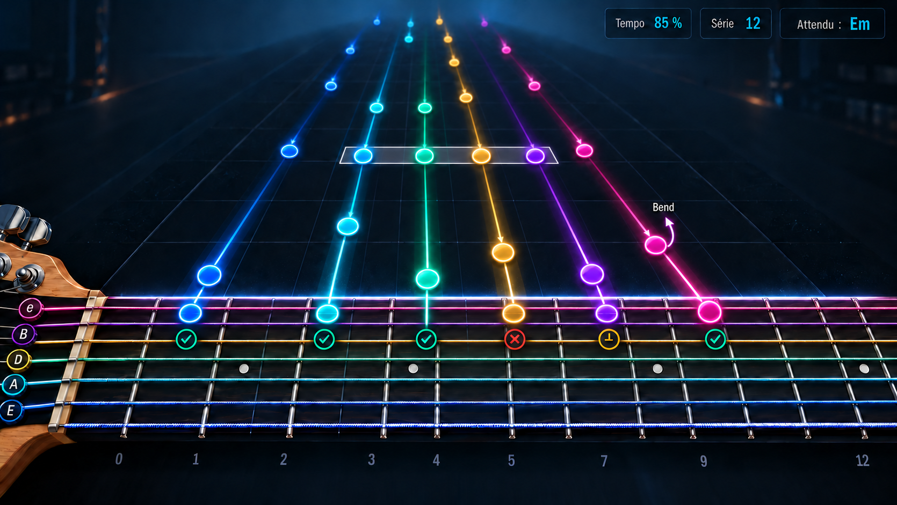

# Feature Specification: Arcade Mode (play along at tempo, with backing band and live guitar sound)

**Feature Branch**: `feature/interactive-practice` (spec dir `003-arcade-mode`)

**Created**: 2026-10-01

**Status**: Draft (clarified 2026-10-07: approved 3D isometric neck view, anticipatory smooth camera; scores shown only at the end of a run)

**Input**: User description: "Mode « Arcade » (variante du mode Practice, inspiré de Rocksmith), distinct de la spec 002 mais qui s'appuie sur son mode de jeu au tempo de la partition (US2b). (1) Le joueur doit jouer chaque note au bon moment (pas d'attente) pendant que la partition défile au tempo, avec retour immédiat et score de type jeu (justesse, timing, enchaînements). (2) Il entend les autres instruments de la partition pendant qu'il joue, la piste jouée étant coupée du lecteur. (3) Retour audio de la guitare en temps réel avec un effet simple : son clair (avec ou sans écho) ou saturé (avec ou sans écho), soit quatre préréglages. (4) Nom du mode : « Arcade » ou équivalent. Contraintes : macOS Apple Silicon d'abord, traitement du signal déterministe, latence annoncée et mesurée, aucun enregistrement de l'audio, honnêteté sur ce qui est vérifié, textes en français et anglais. Risques : latence du retour audio, larsen, choix de la sortie."

## Relation to other specifications

- **Builds on** `002-practice-industrialization`, user story 2b (tempo-following practice) and its recognition work. Arcade reuses its judging of notes against the tempo; it does not redefine it. Arcade cannot ship before that mode exists.
- **Adds what earlier specifications excluded**: the MVP (`001`) listed amp simulation, effects and any live audio return as out of scope. They are new requirements here, stated below with their risks.

## Clarifications

### Session 2026-10-01

- Q1: Display → a dedicated incoming-note view is required; soft but visible colours. The initial 2D direction was superseded on 2026-10-07 by the isometric direction below.
- Q2: Scores → shown only at the end of each run, never kept. Recorded as FR-026.

### Session 2026-10-07

- Q3: Visual direction → the approved direction is a 3D isometric view with a recognisable physical neck across the foreground and notes arriving from the distance, perpendicular to the strings. Recorded as FR-025 and user story 6.
- Q4: Instrument geometry → fret spacing, string count, string thickness and position markers must be derived from the selected instrument and physically credible; the generated concept is not a geometry source. Recorded as FR-027.
- Q5: Chords → all notes at the same expected instant form one visibly grouped object while retaining each expected string/fret position. Recorded as FR-028.
- Q6: Camera → the neck pans smoothly left or right using musical look-ahead. Every target fret, including every member of a chord, must already be visible before its note first appears. Recorded as FR-029.
- Q7: String colours → every string has a stable colour, and each approaching note, trajectory and target ring repeats the colour of the string it targets. Colour remains a redundant cue, never the only way to identify a string or verdict. Recorded as FR-025 and FR-028.

## Approved visual direction

The image fixes the intended composition and visual hierarchy, not literal geometry or final artwork:

- **Top-right HUD**: speed, current streak and the next expected musical event. The numerical score is intentionally absent during play and appears only in the end-of-run result.
- **Upper and middle depth field**: future events start small in the distance and approach the player along the depth axis, perpendicular to the strings. Distance represents time-to-play. From its first visible frame, each note and trajectory uses the stable colour of its destination string.
- **Lower foreground**: the selected track's real neck model, with its strings and frets. A guitar normally shows six strings and a standard bass normally four, but the actual track definition is authoritative. Every string has a distinct, restrained tint repeated by its label, incoming notes and target rings.
- **Impact line**: the thin luminous line immediately before the neck is the fixed musical instant at which an event is expected.
- **Target**: an approaching event resolves to an exact expected string/fret intersection from the tablature. That position is an instruction; audio feedback still claims to verify only pitch and timing.
- **Feedback**: verdict symbols remain close to the impact point and use both colour and shape/text.

The concept image contains generative approximations. Implementations MUST NOT trace its fret widths, dot count or dot positions. Model-space fret position for fret `n` MUST follow twelve-tone equal temperament for the instrument scale length `L`: `x(n) = L * (1 - 2^(-n/12))`; therefore fret 12 lies at half the scale length. The renderer then projects those model positions into the isometric camera. Position inlays are conventional rather than universal: the default visual model may use single markers at 3, 5, 7, 9, 15, 17, 19 and 21 and double markers at 12 and 24, but an explicit instrument model or theme may override them. The neck width, radius, string spacing and string gauges must remain visually plausible.

Implementation should compare its proportions with a real instrument rather than the generated pixels. Useful manufacturer references include a [22-fret, 25.5-inch-scale Fender neck with documented fingerboard and inlays](https://de.fender.com/en/products/richie-kotzen-telecaster) and Fender's explanation that the [12th fret is half the scale length](https://www.fender.com/articles/maintenance/intonation-101).

## User Scenarios & Testing *(mandatory)*

### User Story 1 - Play along with the band (Priority: P1)

A learner opens a song, chooses the Arcade mode for their guitar track, and plays along: the score advances at the tempo, the other tracks (drums, bass, rhythm guitar...) are heard, the learner's own track is silent in the playback, and each note they play is judged as it passes. There is no waiting for the learner.

**Why this priority**: it is the point of the mode: the feeling of playing in a band, which wait-for-the-note practice cannot give.

**Independent Test**: with a song of several tracks, start Arcade on one track: the other tracks play, the chosen one is silent, a count-in leads in, the score advances without stopping, and notes played in time are judged while wrong or missed ones do not stop the song.

**Acceptance Scenarios**:

1. **Given** a song with several tracks, **When** the learner starts Arcade on a guitar track, **Then** a count-in is heard, then the other tracks play at the song's tempo while the chosen track is silent.
2. **Given** Arcade running, **When** the learner misses or plays a wrong note, **Then** the song continues and the following notes are judged normally.
3. **Given** a song with tempo changes and repeats, **When** Arcade runs, **Then** the judging follows the same order and tempo as the playback.
4. **Given** Arcade, **When** the learner sets a speed below 100%, **Then** backing and judging both slow down together.
5. **Given** the learner presses Play, Stop or opens the tuner while Arcade runs, **Then** Arcade reacts predictably and says what happened.
6. **Given** the chosen track is silent in Arcade, **When** the learner leaves Arcade, **Then** the song's own mute and solo settings are exactly as they were before.

---

### User Story 2 - Game-style score and immediate feedback (Priority: P1)

As notes pass, the learner sees at once whether each was right (on time, early, late, wrong, missed) and their streak of consecutive good notes; at the end a result screen shows the score and summarises accuracy, timing and the best streak.

**Why this priority**: the game feel is what makes repeated playing rewarding, and the feedback is what makes it useful.

**Independent Test**: play a known passage with deliberate early, late, wrong and missed notes and confirm that every judgement, the score, the streak and the final summary match.

**Acceptance Scenarios**:

1. **Given** a note played at the right pitch and moment, **When** it is judged, **Then** it scores the most and extends the streak.
2. **Given** an early, late or wrong note, **When** it is judged, **Then** it scores less or nothing, and the learner is told which (early / late / wrong / missed).
3. **Given** a streak, **When** a note is missed or wrong, **Then** the streak restarts at zero.
4. **Given** the end of the song, **When** Arcade completes, **Then** a result shows the score, the share of notes on time, early, late, wrong and missed, and the best streak.
5. **Given** a judgement is uncertain (low confidence input), **When** it is shown, **Then** it is presented as uncertain, never as a definite error.
6. **Given** what audio can establish, **When** feedback is shown, **Then** only pitch and timing are claimed as verified (string and fret never are).

---

### User Story 3 - Hear my own guitar, with a simple sound (Priority: P1)

The learner hears their guitar in real time through their headphones or speakers, shaped by one of four simple sounds: clear, clear with echo, distorted, or distorted with echo. They can switch it off, change its volume, and change the sound while playing.

**Why this priority**: playing along without hearing oneself is uncomfortable; a recognisable guitar tone is what makes the mode feel like the real instrument.

**Independent Test**: with a guitar connected, enable the live return, cycle through the four sounds and confirm that each is audibly different, that the learner's volume is adjustable, and that switching it off silences it.

**Acceptance Scenarios**:

1. **Given** a connected guitar, **When** the learner enables the live return, **Then** they hear their guitar through the chosen output with the chosen sound.
2. **Given** the four sounds, **When** the learner selects each, **Then** clear is undistorted, distorted is audibly saturated, and the echo variants repeat the sound decaying.
3. **Given** the live return on, **When** the learner switches to another sound, **Then** the change is immediate and does not interrupt the playing or the judging.
4. **Given** the live return, **When** the learner changes its volume or the balance with the backing, **Then** the change is heard at once and is not remembered beyond the session unless the owner later decides otherwise.
5. **Given** the live return is off, **When** the learner plays, **Then** the application behaves as without this feature.
6. **Given** any sound and any setting, **When** notes are judged, **Then** the judging uses the guitar's unprocessed signal, so effects never change what is recognised.

---

### User Story 4 - Choose the output and know the delay (Priority: P2)

The learner chooses where the sound goes (headphones, speakers, an interface), sees the measured delay of the live return on their setup, and is warned of the risk of feedback when a microphone and speakers are used together.

**Why this priority**: a live return that lags or howls makes the mode unplayable; the learner must be told, honestly.

**Independent Test**: choose different outputs and inputs; confirm the delay shown comes from a measurement, that a microphone with speakers triggers the feedback warning, and that headphones or a direct input do not.

**Acceptance Scenarios**:

1. **Given** several output devices, **When** the learner picks one, **Then** the live return and the backing use it (or the learner is told why they cannot).
2. **Given** the live return, **When** it is on, **Then** the measured total delay on this setup is shown, not an assumed figure.
3. **Given** the delay is above the level at which playing feels comfortable, **When** it is shown, **Then** the learner is told and offered to use a direct input or headphones, and the live return stays available.
4. **Given** a built-in microphone with the computer speakers as output, **When** the live return is enabled, **Then** a feedback warning recommends headphones, and the return starts at a low volume.
5. **Given** the chosen output disappears (unplugged), **When** it happens during Arcade, **Then** Arcade degrades with a clear message and does not crash or hang.

---

### User Story 5 - Start Arcade easily and retry a section (Priority: P3)

The learner starts Arcade from the practice entry points (transport-bar button and Tools menu), picks the track, speed and sound, can pause, and can replay a difficult section.

**Why this priority**: convenience on top of a working mode.

**Independent Test**: start Arcade from both entry points, pause and resume, and replay a chosen section at a lower speed.

**Acceptance Scenarios**:

1. **Given** the Practice entry points of spec 002, **When** the learner opens them, **Then** Arcade is offered as a mode, with the choice remembered only for the session.
2. **Given** Arcade running, **When** the learner pauses, **Then** backing and judging both pause and resume together.
3. **Given** a finished run, **When** the learner chooses to replay a section, **Then** it restarts from that section with the same settings.

---

### User Story 6 - See notes approach a real neck in an isometric view (Priority: P1)

A 3D isometric view shows the physical neck of the selected track across the foreground. Notes come from far away toward a fixed hit line, perpendicular to the strings, so the learner sees what to play next, where the tablature places it, and when. The neck pans smoothly with look-ahead whenever upcoming events require other frets. It replaces reading the moving cursor in the score during Arcade.

**Why this priority**: seeing upcoming notes is what makes playing in time possible without stopping to read the score.

**Independent Test**: start Arcade on a song containing single notes, chords and large fret jumps: upcoming notes approach the neck at the tempo, all targets are visible before the events appear, the neck pans smoothly without jumping, chords remain grouped, and judged notes change appearance at the impact point.

**Acceptance Scenarios**:

1. **Given** Arcade running, **When** notes approach from the distance, **Then** they move perpendicular to the strings toward the hit line at the tempo and reach it exactly at the moment to play.
2. **Given** a note to play, **When** it is displayed, **Then** it resolves to its expected string/fret intersection on the visible neck (as the tablature's instruction, never claimed as verified).
3. **Given** a chord, **When** it approaches, **Then** one translucent brace, plate or outline groups all of its markers as one event, while every marker remains aligned with its own expected string/fret intersection; partial and complete verdicts remain distinguishable.
4. **Given** a judged note, **When** the verdict is known, **Then** it changes appearance at once (on time, early, late, wrong, missed) using colours and also a shape or text marker, so colour is never the only signal.
5. **Given** the application's light or dark look, **When** Arcade is shown, **Then** the colours stay soft but visible in both, with enough contrast to be read comfortably.
6. **Given** a window resize or a dense passage, **When** the view is drawn, **Then** it stays legible and does not slow the judging or the playback.
7. **Given** the streak and speed, **When** Arcade runs, **Then** they are shown on the same view without hiding incoming notes; the numerical score is reserved for the result screen.
8. **Given** a standard guitar, bass or another supported track definition, **When** its neck is drawn, **Then** the string count comes from the track, frets get progressively narrower according to its scale length, string gauges remain plausible, and position markers follow the selected instrument visual model.
9. **Given** that an upcoming note or chord targets a fret outside the current view, **When** it enters the look-ahead horizon, **Then** the neck begins a smooth horizontal pan early enough that every required fret is visible with a safety margin before the event is spawned into the visible approach field.
10. **Given** successive events that alternate between distant fret regions, **When** the camera follows them, **Then** it does not teleport, oscillate between targets or hide the current event; it pans continuously and may zoom out within readable bounds when that is necessary to keep the current and look-ahead targets visible.
11. **Given** a note or one member of a chord, **When** it is visible from the distance through impact, **Then** its marker, trajectory and target ring use exactly the stable colour of its destination string; its position, string label and geometry still identify the destination with all colours removed.

---

### Edge Cases

- A very dense passage or a very high tempo where notes are too close to be drawn apart on the view.
- A track with more than six strings, fewer strings, or an unusual tuning, requiring a different neck model without changing the approach or judgement semantics.
- A rapid jump between distant fret regions, or a chord spanning a wide fret range, requiring anticipatory pan and possibly bounded zoom without ever spawning an event whose target is off-screen.
- A song with only one track (nothing to hear but the metronome and the learner's own notes).
- The chosen track is also the only one with notes in a section; backing silent there.
- Input too quiet or noisy for reliable judging: judgements become "uncertain" and the learner is told.
- Very fast passages beyond what recognition can follow: notes are flagged as not reliably judged, not wrongly scored.
- Tempo changes, repeats and alternate endings during a run.
- The input or output device changes or disappears during a run.
- Output sample rate differing from the input's; a long-running session drifting out of step between backing and judging.
- The learner plays a technique (bend, slide...) that the recognition of spec 002 judges differently from a plain note.
- Feedback (howl) from a microphone picking up the speakers during the live return.
- Two applications using the audio device; the audio device busy or refused.
- The learner listens without headphones, so the backing is picked up by the microphone and judged as guitar.

## Requirements *(mandatory)*

### Functional Requirements

**The mode**

- **FR-001**: The application MUST offer an Arcade mode next to the existing practice modes, reachable from the same entry points, named "Arcade" in English and French (name to be confirmed by the owner).
- **FR-002**: Arcade MUST start only when the input is suitable and a track is chosen, like the tempo-following mode it builds on.
- **FR-003**: Arcade MUST give a count-in, then advance at the song's tempo scaled by the chosen speed, without ever waiting for the learner.
- **FR-004**: The playback MUST follow the same order, repeats and tempo changes as the judging.

**Backing**

- **FR-010**: The learner's chosen track MUST be silent in the playback, and every other track MUST be heard, as in the song.
- **FR-011**: The mute applied for Arcade MUST NOT change the song or its saved mute/solo settings, and MUST be undone when Arcade ends.
- **FR-012**: The learner MUST be able to adjust the balance between the backing and their live guitar.
- **FR-013**: The backing MUST NOT be judged as the learner's playing (the learner is advised to use headphones, and the application MUST say so when the input could pick up the speakers).

**Score and feedback**

- **FR-020**: Each expected event MUST be judged as on time, early, late, wrong or missed, using the timing tolerance of the tempo-following mode, and feedback MUST appear immediately.
- **FR-021**: The application MUST keep the score in memory during the run, keep and show a streak of consecutive good notes during play, and reserve the numerical score for the end-of-run result as required by FR-026.
- **FR-022**: The scoring rules (points per judgement, how the streak affects the score) MUST be documented and identical from one run to the next for the same play.
- **FR-023**: At the end of a run the application MUST show a result: score, counts per judgement, and best streak.
- **FR-024**: Uncertain judgements MUST be presented as uncertain, and pitch and timing are the only properties claimed as verified.
- **FR-025**: Arcade MUST show the approved 3D isometric incoming-note view (superseding the initial 2D decision on 2026-10-07): a recognisable instrument neck across the foreground; events arriving from the distance perpendicular to its strings; a fixed hit line; and expected string/fret targets taken from the tablature. Each string MUST have one stable, distinct colour repeated exactly by every note, trajectory and target ring assigned to it from first appearance through impact. String labels, position and geometry MUST remain sufficient without colour. Chords MUST be grouped, and streak and speed MUST remain visible without hiding events. Colours MUST be soft but clearly visible in light and dark looks, and colour MUST never be the only string or verdict signal.
- **FR-026**: Scores MUST be shown only in the result at the end of each run (decided 2026-10-01); nothing about scores is kept after the application closes, and no history or personal best is stored.
- **FR-027**: The neck model MUST derive its string count from the chosen track and its fret positions from the instrument scale length using twelve-tone equal-tempered spacing. Default marker placement MUST follow a documented real-instrument convention, including a double marker at the octave where that convention applies; generated concept-art geometry MUST NOT be used as reference data.
- **FR-028**: Notes expected at the same musical instant MUST be rendered as one chord event with a shared neutral brace, plate or outline plus individual string/fret markers. Each member MUST retain the stable colour of its own destination string while the neutral grouping communicates simultaneity at a glance. The group MUST remain readable in perspective and allow complete, partial, wrong and uncertain feedback without implying that audio verified physical fingering.
- **FR-029**: The visible fret range MUST be driven by a deterministic musical look-ahead window. The neck MUST pan left or right with continuous, smooth animation and MAY use bounded zoom to include a wide span. Every target fret for every visible note or chord MUST already be visible with a margin before that event first appears; camera motion MUST never change musical timing or block playback/judging.

**Live guitar return**

- **FR-030**: The application MUST offer a live return of the guitar with four sounds: clear, clear with echo, distorted, and distorted with echo, selectable at any time.
- **FR-031**: The live return MUST be switchable off, have its own volume, and leave the application unchanged when off.
- **FR-032**: Each sound MUST be deterministic signal processing with documented parameters; the four presets have fixed values chosen and verified by listening on the validated setup, and their parameters are not learner-editable in this version.
- **FR-033**: The judging and every analysis MUST use the unprocessed guitar signal; the effects apply only to what is heard.
- **FR-034**: The live return MUST NOT record, store or transmit audio.
- **FR-035**: The live return MUST NOT degrade playback or user-interface responsiveness.

**Latency, output, safety**

- **FR-040**: The application MUST measure and display the total delay between playing a note and hearing it, for the learner's input and output, and MUST NOT state a delay it did not measure.
- **FR-041**: When the measured delay is above a documented comfort limit, the learner MUST be warned and told what improves it.
- **FR-042**: The learner MUST be able to choose the output device for the live return and the backing.
- **FR-043**: The application MUST warn of feedback when a microphone input is combined with a speaker output, and start the live return at a low volume in that case.
- **FR-044**: A lost, refused or busy audio device MUST degrade gracefully with a clear message, never crash or hang.

**Quality**

- **FR-050**: All new texts MUST exist in English and French.
- **FR-051**: New logic MUST have automatic tests using synthetic and real sound examples, and the user interface MUST have GUI tests, as required for spec 002.
- **FR-052**: Existing behaviour of the editor, the player and the other practice modes MUST NOT change.

### Key Entities

- **Arcade Run**: one play-through of a track at a speed with a chosen sound; holds its judgements, score and streak.
- **Judgement**: the verdict for one expected event: on time, early, late, wrong or missed (plus "uncertain"), with its timing offset.
- **Score**: points, current streak, best streak, derived from the judgements by fixed rules; held in memory for the run only.
- **Isometric Neck View**: the 3D view containing the physical neck model, depth-based approach field, hit line, incoming events, chord grouping, verdict markers and anticipatory camera state.
- **String Colour Map**: the deterministic mapping from every displayed string to a distinct visual colour, reused by that string's label, incoming markers, trajectories and target rings, but never used alone to communicate destination or judgement.
- **Run Result**: the end-of-run summary: score, counts per judgement, best streak.
- **Live Sound**: one of four presets (clear, clear + echo, distorted, distorted + echo) with its fixed parameters.
- **Monitoring Path**: the route from the guitar input to the chosen output, with its measured delay, separate from the analysis path.
- **Output Route**: the chosen output device and the balance between backing and live guitar.

## Success Criteria *(mandatory)*

### Measurable Outcomes

- **SC-001**: A learner can start Arcade on a track of a multi-track song in under 30 seconds once the song is open and the guitar is connected.
- **SC-002**: With the judging following the tempo, at least 95% of notes played within the normal tolerance of the expected moment are judged on time, at up to 8 notes per second (provisional, shared with spec 002, SC-009).
- **SC-003**: The measured delay of the live return on the owner's validated setup (direct input through an audio interface, headphones) is reported with its method, and a comfort limit is fixed from that measurement; with a built-in microphone the measured delay is reported separately.
- **SC-004**: For the same recorded play, two runs give identical judgements and the same score.
- **SC-005**: Every chosen sound is distinguishable by ear from the others in a blind check by at least three guitarists, and the clear sound is not distorted (measured distortion below a documented bound).
- **SC-006**: Switching the live sound or the balance during play causes no audible dropout and no missed or wrongly judged note in the test runs.
- **SC-007**: No regression of the other modes: the existing tests of the editor, player and practice modes pass unchanged.
- **SC-008**: After a run, at least three guitarists report that the feedback told them what to improve (timing versus pitch) in a qualitative check.
- **SC-009**: On the isometric view, at least three guitarists can read the next note and its expected string/fret at the tempo of a mid-speed song (provisionally 90 BPM) without stopping, identify a chord as one simultaneous event, and tell every verdict without relying on colour.
- **SC-010**: Automated viewport tests over single notes, chords, repeated positions and large fret jumps prove that 100% of events have every target fret visible with the specified margin from their first visible approach frame through judgement; camera position is continuous and deterministic for the same timeline.
- **SC-011**: Geometry tests prove in model space that fret 12 is at half the configured scale length and every rendered fret originates from `x(n) = L * (1 - 2^(-n/12))`; approved screenshot tests cover a six-string guitar and four-string bass against documented real-instrument references.
- **SC-012**: Automated rendering-state tests for every string on six-string guitar and four-string bass prove that 100% of note markers, trajectories and target rings use their destination string's colour from spawn through impact; monochrome screenshot tests remain readable, and verdict symbols remain distinguishable independently of string colour.

## Assumptions

- Arcade is a variant of the practice mode of spec 002 and reuses its tempo-following judging, latency calibration and tolerance presets; it is planned after that mode exists.
- The first version judges single notes and chords with the recognition of spec 002, at the speeds that recognition supports; techniques are judged as in spec 002 (shown honestly, never blocking).
- "Arcade" is the working name (English and French); the owner confirms or changes it.
- Only macOS on Apple Silicon is validated; other platforms must still build and are not claimed to support the live return.
- The four sounds are presets, not an amp simulator: no cabinet or impulse-response modelling, no user-editable effect chain, in this version.
- Headphones are the recommended setup; the application warns rather than forbids other setups.
- The live return's quality depends on the audio path available on the platform; if the measured delay is not comfortable on a given setup, the feature stays available with an honest warning (the audio path itself is a planning decision, not fixed here).
- Scores follow fixed rules documented in the plan; scores are not kept between sessions; adaptive difficulty, online leaderboards and social features are out of scope.
- The isometric neck view is part of this feature (not a reuse of the score view). It is drawn with the application's own UI toolkit unless planning demonstrates that this cannot meet the geometry, smoothness and portability requirements; no game engine is assumed by this specification.
- Audio is never recorded; only derived numbers (judgements, score) live in memory during a run.
