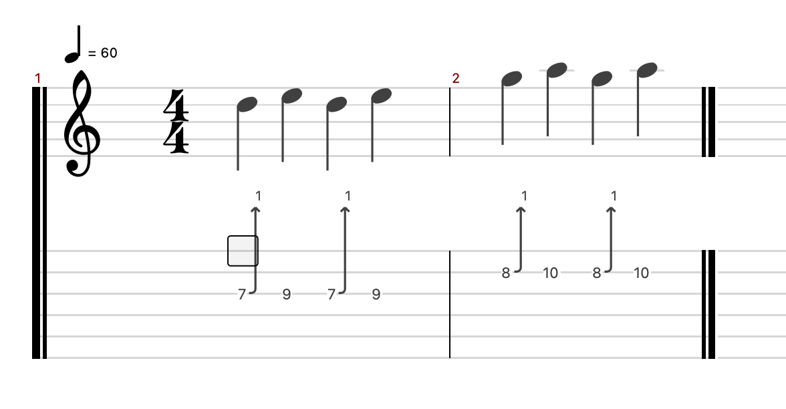
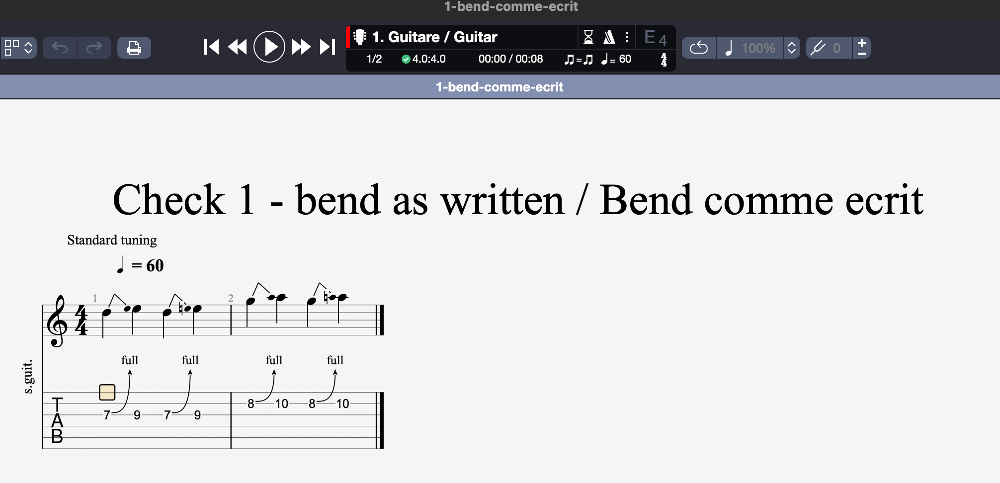

# Visual comparison: `1-bend-comme-ecrit`

**Date**: 2026-10-07
**Purpose**: preserve the owner's evidence and translate it into reproducible requirements. This is not an instruction to copy Guitar Pro artwork.

## Current TuxGuitarAdvanced rendering

## Quality reference for the same score

## Confirmed differences visible in the captures

1. **Wrong whole-tone bend wording**: TuxGuitarAdvanced prints `1`; the reference prints the conventional `full`. Inspection of the current renderer confirms that its movement index 4 is the one-tone case, so this is a display-label problem, not a request to transpose the bend.
2. **Missing tablature identity**: the reference has the stacked vertical `TAB` identifier at the left; TuxGuitarAdvanced leaves that margin blank.
3. **Bend semantics missing from the standard staff**: the reference shows the bend path and target pitch/cue above each source note. TuxGuitarAdvanced shows ordinary isolated notes, so a standard-notation reader cannot see that the pitch is bent rather than newly attacked.
4. **Target accidentals are absent or not communicated**: the reference makes the target alteration visible where needed; the current standard staff does not expose the target cue at all.
5. **Tab bend shape is less readable**: the current arrows are narrow and nearly vertical, visually detached from the following target fret. The reference uses a smoother source-to-target curve with a clear arrowhead and label.
6. **Large unused vertical band**: the current bend labels occupy a wide gap between score and tablature while still being visually detached from the arrows. The reference groups label, curve and tab more tightly.
7. **Disproportionate notation hierarchy**: in the current capture the clef and `4/4` dominate the noteheads and effect marks. The reference uses more balanced relative sizes.
8. **Weak hierarchy/contrast**: current staff lines and several note elements are pale relative to the barlines and symbols. The reference keeps a clearer foreground/background hierarchy.
9. **Excessively stretched short passage**: the current two measures fill most of a wide continuous canvas; the reference page engraving remains compact. This is partly a layout-mode difference, so the spec requires compact page/vertical/print composition while allowing continuous horizontal mode to remain continuous.
10. **Missing contextual metadata in the shown view**: the reference shows title, tuning and an abbreviated instrument label. TuxGuitarAdvanced's shown editor view does not. Existing print code already supports some header/tuning metadata, so the requirement is consistent use in page/print presentation, not invented text.
11. **System-start treatment is heavy**: the current left/system barline and final barline have much stronger visual weight than the internal notation. The improved hierarchy must keep structural barlines visible without overwhelming notes and effects.
12. **Selection must coexist with notation**: the selected fret box is visible in both captures, but future geometry tests must ensure it never hides a bend curve, label or target cue.

## Facts that must not be inferred from screenshots alone

- Different application zoom and layout modes explain some absolute size and whitespace differences; tests compare semantic anchors and ratios, not raw screenshot dimensions.
- Guitar Pro's fonts, glyphs and exact styling are proprietary and are not implementation assets.
- The reference target note is a bend cue, not a second picked attack; rendering must preserve that distinction.
- A screenshot cannot establish the internal bend unit. The model/import path and fixture data remain authoritative.
